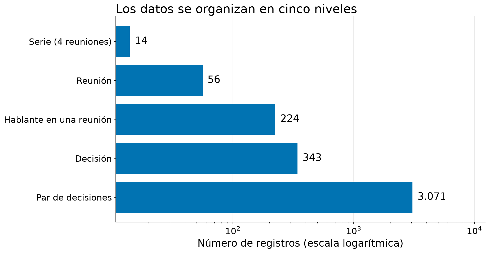
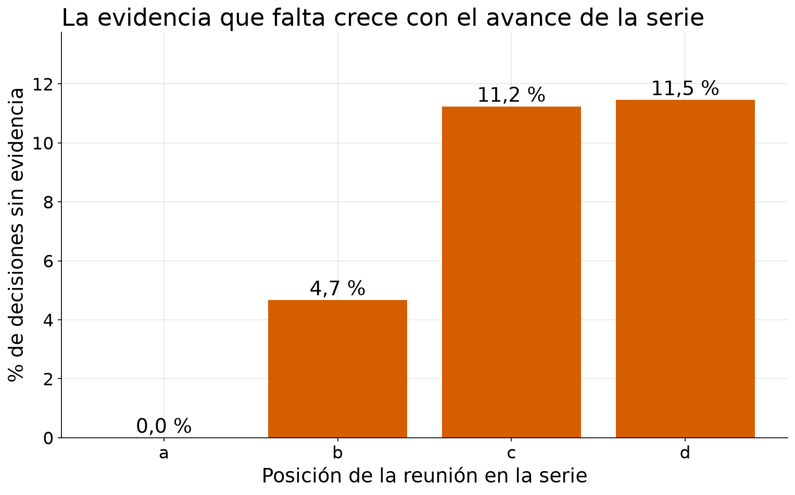
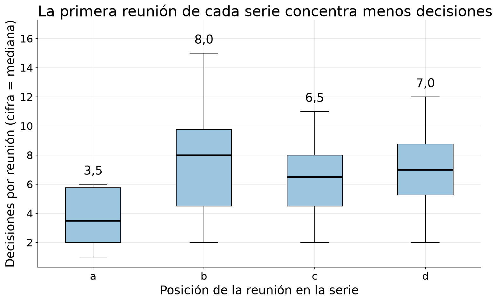
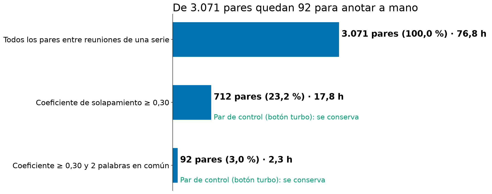
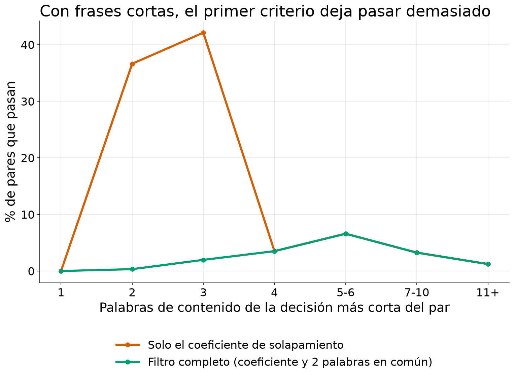

# Análisis exploratorio de datos

| | |
|---|---|
| **Documento** | 07 — Análisis exploratorio de datos |
| **Autor** | Jason Sepúlveda S. |
| **Versión** | 1.0 |
| **Fecha** | 2026-10-15 |
| **Estado** | Vigente |

## Historial de versiones

| Versión | Fecha | Cambio | Motivo |
|---|---|---|---|
| 1.0 | 2026-10-15 | Versión inicial. El análisis exploratorio de datos se redacta para un lector no técnico: organización de los datos, calidad, valores atípicos, estadísticas descriptivas, filtro léxico, dificultades e implicancias para los pasos siguientes. | El video de avance 1 y las secciones 3 (caracterización de los datos) y 4 (análisis exploratorio) del pre-informe necesitan un texto que explique cada figura y cada cifra. Fuente de todas las cifras: [notebook 03](../../notebooks/03-jss-eda.ipynb) y [notebook 11](../../notebooks/11-jss-figuras-video-eda.ipynb). |

> **Cómo versionar.** Un cambio de redacción sube el decimal (1.0 → 1.1). Un cambio que
> altera una decisión, un objetivo o una cifra sube el entero (1.x → 2.0) y **debe declarar
> la evidencia que lo motivó**. El historial nunca se reescribe: se agrega una fila.

## Un caso real para empezar

En una de las series de reuniones con las que trabaja este proyecto, el resumen oficial de
la cuarta reunión afirma que el equipo eliminó el botón "turbo" del control remoto que
estaba diseñando. Al leer la transcripción completa, el botón se mantuvo. El registro que
cualquiera habría consultado para saber qué se decidió estaba equivocado.

Ese caso aparece en este documento varias veces, porque resume lo que un análisis exploratorio
debe descubrir: **qué hay en los datos, qué tan confiables son y qué obstáculos plantean
para lo que sigue**. Un **análisis exploratorio de datos** (EDA, del inglés *exploratory data
analysis*) es el examen de los datos **antes** de ponerlos a trabajar en un experimento. Tiene
tres propósitos: entender qué contienen, detectar lo que podría invalidar un análisis
posterior y decidir con evidencia cómo prepararlos.

Este documento cuenta el resultado en prosa. El detalle completo, con todas las tablas y 20
figuras, está en el [notebook 03](../../notebooks/03-jss-eda.ipynb); las cinco figuras
seleccionadas para el video de avance 1 y su justificación, en el
[notebook 11](../../notebooks/11-jss-figuras-video-eda.ipynb). Cada cifra de este texto
indica la sección del notebook de donde sale.

**El problema de investigación**, en una frase: ¿recordar las decisiones de una serie de
reuniones en una estructura persistente responde mejor que recuperar fragmentos del texto,
sobre todo cuando una decisión cambia de una reunión a otra? Todo lo que sigue se mira desde
esa pregunta ([avance 01](01-jss-problema.md)).

**Qué no hace este EDA.** No evalúa ningún modelo ni mide todavía cuántas decisiones cambian
realmente: las etiquetas que lo dirían las ponen personas y aún están en preparación. Describe
los datos de entrada y lo que implican para el diseño.

## 1. Origen, tipo y relevancia de los datos

Los datos son el **AMI Meeting Corpus** (Carletta et al., 2006), una colección pública de
reuniones grabadas y transcritas, con licencia CC BY 4.0. Equipos de cuatro personas, cada una
con un rol asignado (jefe de proyecto, diseñador industrial, diseñador de interfaz y
especialista en marketing), diseñan un control remoto a lo largo de **cuatro reuniones
consecutivas, llamadas a, b, c y d**. Cuatro reuniones forman una **serie** (notebook 03,
§1.1). Cuatro rasgos importan para lo que sigue:

- **El habla es actuada.** Las decisiones son reales como actos de conversación, pero sus
  consecuencias son simuladas.
- **La transcripción la hicieron personas**, reunión por reunión.
- **Las decisiones no salen de la transcripción**: son las frases de la sección de decisiones
  del **resumen**, escrito por anotadores de AMI. Una decisión es, entonces, una frase de
  resumen y no un fragmento de diálogo.
- **Cada frase del resumen puede enlazarse a las intervenciones que la respaldan**, que se
  llaman su **evidencia**. Una decisión sin enlaces es una decisión sin evidencia.

**Relevancia para el problema.** Es un corpus público con varias reuniones por equipo y con
decisiones ya registradas, lo que permite estudiar cómo una decisión se retoma, cambia o se
revierte en la reunión siguiente. Hay 33 series con las cuatro reuniones y 649 decisiones; la
muestra del proyecto son **14 series con 343 decisiones**, elegidas con criterios registrados
antes de anotar ([ADR 0004](../decisions/0004-adr-oe1-series-selection.md)) y no al azar
(notebook 03, §1.3). Por eso los resultados describen estas 14 series y no se extrapolan a
todo el corpus; además, el dominio es uno solo (el diseño de un control remoto) y el habla es
actuada. El detalle de la fuente está en el [avance 02](02-jss-fuente-de-datos.md).

## 2. Organización de los datos

Los datos se ordenan en **cinco niveles**, cada uno una tabla con su propia unidad de
observación (notebook 03, §1.2 y §2.1):

| Nivel | Qué es una fila | Filas |
|---|---|---|
| Serie | cuatro reuniones del mismo equipo | 14 |
| Reunión | una reunión | 56 |
| Hablante en una reunión | una persona en una reunión | 224 |
| Decisión | una frase de decisión del resumen | 343 |
| Par | dos decisiones de reuniones distintas de la misma serie | 3.071 |

Además existe una tabla auxiliar de 25.857 turnos de habla, que no se analiza por sí sola pero
alimenta las variables de reunión y de hablante.

**Interpretación.** El gráfico usa una escala que multiplica por diez en cada marca, porque las
cantidades son muy distintas: los datos son pocos al nivel de la serie (14) y numerosos al
nivel del par (3.071). El problema de investigación se juega en los pares, porque una decisión
solo puede cambiar respecto de otra anterior. Pero los pares comparten decisiones y las 14
series son el verdadero tamaño de la muestra: cualquier conclusión debe apoyarse en la serie
como unidad y no solo en la cantidad de pares.

La muestra se reparte por **sitio de grabación** (tres lugares: ES, IS y TS): 5 series de ES,
5 de IS y 4 de TS. Tres series, una por sitio, son de **desarrollo** (sirven para ajustar los
parámetros del proyecto) y las otras 11 son de **evaluación** ([ADR 0005](../decisions/0005-adr-development-evaluation-split.md);
notebook 03, §1.4).

## 3. Diccionario de datos y variables

Cada variable se documenta con su tipo (número, categoría, fecha o identificador), su unidad y
su dominio válido. Son **77 variables**: 14 en serie, 20 en reunión, 12 en hablante, 17 en
decisión y 14 en par, y ninguna quedó sin descripción (notebook 03, §2.2). El diccionario sale
de un único registro en el código del proyecto y una prueba automática impide agregar una
columna sin documentarla.

Ninguna variable contiene texto: solo identificadores, categorías, números y fechas. Es
deliberado. Las series de evaluación no pueden leerse antes de tiempo, de modo que el análisis
trabaja solo con conteos y estadísticas, y una verificación automática comprueba que ninguna
tabla analizada tenga columnas de texto (notebook 03, §12).

Se verificaron además 17 reglas de consistencia: cuatro reuniones por serie, llaves únicas,
roles válidos, orden cronológico, decisiones y evidencia que existen, y pares siempre del
pasado al futuro. **Se cumplen 15 de 17.** Las dos que fallan son las de frases duplicadas, que
se tratan en la sección siguiente (notebook 03, §2.3).

## 4. Calidad de los datos

### 4.1 Valores faltantes

Un **valor faltante** es una celda vacía. Qué falta, dónde y por qué determina si un análisis
es válido. En las 77 variables, solo **tres** tienen celdas vacías (notebook 03, §3.1):

| Variable | Qué es | Faltantes | Por qué falta |
|---|---|---|---|
| Hora de inicio | hora real de comienzo de la reunión | 32 de 56 (57,1 %) | El archivo de AMI la trae en IS (20 de 20), no la trae en TS (0 de 16) y la pierde en 16 de 20 reuniones de ES. Depende del sitio. |
| Lengua nativa | lengua materna declarada | 64 de 224 (28,6 %) | Faltan todos los hablantes de TS y ninguno de ES o IS. El archivo de participantes no los incluye. |
| Evidencia de la decisión | rol que respalda la decisión | 26 de 343 (7,6 %) | Son decisiones sin intervención enlazada. Ver abajo. |

Además hay una **capa de anotación ausente**: la segmentación de decisiones, que AMI solo
entrega para 6 de las 14 series (notebook 03, §3.2 y §3.3). Se usa únicamente como subconjunto
de validación.

Ningún registro tiene más de una celda vacía. Los dos primeros faltantes son **estructurales**
(vienen de cómo AMI armó sus archivos) y no se relacionan con nada del contenido. El tercero
merece atención por dos razones:

- **No falta al azar.** Depende de la posición de la reunión: no falta ninguna en la reunión a
  (0 de 51), faltan 5 de 107 en la b (4,7 %), 10 de 89 en la c (11,2 %) y 11 de 96 en la d
  (11,5 %).
- **Es donde está el error del botón turbo.** La decisión posterior de ese caso tiene cero
  intervenciones de evidencia (notebook 03, §5.5). Con un solo caso verificado esto es una
  **hipótesis**, no un resultado: no se sabe qué fracción de las 26 es error y qué fracción es
  una síntesis legítima que ninguna intervención única respalda. Se resolverá al revisar las
  decisiones con las personas que anotan.

**Interpretación.** De las 343 decisiones, 26 no pueden rastrearse hasta la conversación que
las originó. La proporción sube de cero en la primera reunión a cerca de 11 % en la tercera y
se mantiene en la cuarta (11,2 % y 11,5 %): sube hasta la reunión c y luego se queda en ese nivel.
Una posible explicación, que por ahora es solo una **hipótesis** (la primera de la sección 8),
es que las decisiones tardías cierran una relación con una decisión anterior y por eso son más
difíciles de respaldar con una intervención puntual. Por esta razón las 26 decisiones se tratarán
como señal de revisión y no como un dato corriente.

### 4.2 Por qué no se imputa

**Imputar** es reemplazar un valor faltante por uno estimado. Aquí **no se imputa nada**, por
tres razones (notebook 03, §3.4):

1. **Las etiquetas de referencia las pone una persona.** Estimar una etiqueta con un modelo
   introduciría justamente el error del que el experimento debe estar libre.
2. **Imputar la evidencia fabricaría respaldo.** Una decisión sin intervenciones enlazadas es
   una afirmación del resumen que ningún anotador pudo conectar con algo dicho. Asignarle
   evidencia estimada la presentaría como respaldada cuando no lo está.
3. **Los otros faltantes son metadatos** que ningún análisis del proyecto usa como resultado
   (hora de inicio) o que solo se informan como limitación (lengua nativa).

Lo que sí se hace es **marcar**: el faltante se conserva como categoría y se señala.

### 4.3 Duplicados

Hay **4 frases idénticas** y **8 casi idénticas** (mismo conjunto de palabras de contenido, que
incluye las 4 anteriores) dentro de una misma serie (notebook 03, §2.4). En los cuatro casos
las dos copias están en **reuniones consecutivas** (b con c, o c con d) y nunca dentro de una
misma reunión. Ese patrón es el de una decisión **reafirmada** en la reunión siguiente; un
error de captura produciría copias dentro de la misma reunión. Además, los 8 pares con
coincidencia total son todos de reuniones consecutivas.

**Se conservan con una marca.** Las reafirmaciones son parte de lo que el proyecto quiere
medir; eliminarlas borraría casos legítimos y conservarlas sin marca podría inflar la cuenta de
decisiones distintas. Un límite de esta clasificación: se apoya en la estructura y no en leer
las frases, porque solo las series de desarrollo pueden leerse.

## 5. Valores atípicos

Un **valor atípico** es una observación que se aleja mucho del resto. No es sinónimo de error:
puede ser un **error de captura** (se corrige o se excluye) o un **fenómeno real** (se
conserva y se entiende). Esa distinción es un juicio que se registra, no algo que decida un
método estadístico. Se usaron cuatro métodos, dos que miran una variable a la vez y dos que
miran varias a la vez (notebook 03, §5.1 y §5.2).

**Resultado.** Quedaron marcadas **15 de 56 reuniones** por al menos un método, y 10
decisiones y 5 hablantes con valores extremos. Solo **una reunión, TS3005d**, la marcan los
cuatro métodos: tiene el máximo de palabras (9.112) y de turnos (1.194). Para decidir si es un
error, se comparó la duración que declara el archivo con el instante en que termina el último
turno transcrito: son dos fuentes que miden lo mismo, y la brecha mediana es de 19,4 segundos
(1,0 %). La brecha de TS3005d es de 2,9 %, coherente. Es un fenómeno real: una reunión larga y
muy conversada (notebook 03, §5.3).

Hubo una excepción relevante. TS3003c tiene una brecha de 286 segundos (11,1 %): el archivo
declara casi cinco minutos de grabación sin habla transcrita. Puede ser silencio o una
transcripción truncada, y sin el audio no se resuelve. En 4 de 56 reuniones la brecha supera el
10 %. La conclusión práctica es que la **duración del archivo es menos fiable** que los conteos
de palabras y de turnos, que salen de la transcripción, y por eso no se usa como variable
explicativa.

**Decisión: se conservan todos.** La regla del proyecto es que **nada se elimina ni se
corrige a mano**; cada caso se documenta con su tratamiento y su razón. Resultado neto: **0
filas eliminadas, 0 valores corregidos y 0 valores imputados** (notebook 03, §5.6 y §11.2).
Las razones: los casos son fenómenos reales (una reunión muy larga, una decisión redactada con
muchas palabras, un jefe de proyecto que habla casi todo el tiempo) y eliminarlos sesgaría
justo lo que se quiere estudiar. Dos precauciones: los resultados por reunión se reportarán
con y sin TS3005d, y la regla de Tukey, que marca valores lejanos suponiendo una forma
simétrica, marca de más en los conteos con cola larga (42 decisiones por actos de evidencia,
12,2 %, frente a 4 con otra regla), por lo que su cifra no se lee como cantidad de errores.

**Lo que la estadística no encuentra.** El error del botón turbo no es un valor extremo: la
decisión tiene 5 palabras de contenido, un tamaño corriente, y ningún método la señala. La
única señal es la evidencia nula. La lección es que **la detección estadística encuentra
anomalías de tamaño, no errores de sentido**, y estos últimos solo se descubren leyendo
(notebook 03, §5.5).

## 6. Estadísticas descriptivas y patrones principales

### 6.1 Cómo son las reuniones y las decisiones

- **Reuniones (n = 56).** Duran en promedio 1.917 segundos (unos 32 minutos), con un rango de
  791 a 2.911. Tienen en promedio 5.010 palabras y 462 turnos de habla, y 6,1 decisiones; el
  rango va de 1 a 15. El número de decisiones es la variable más dispersa: reuniones de tamaño
  parecido registran números muy distintos de decisiones (notebook 03, §4.1).
- **Decisiones (n = 343).** Son **frases telegráficas**: tienen en promedio 6,1 palabras de
  contenido, la mitad tiene 5 o menos, y lo más frecuente es 3. Cada una tiene en general 1 o 2
  intervenciones de evidencia (mediana 2), pero algunas llegan a 17 (notebook 03, §4.2).
- **Pares (n = 3.071).** Al menos la mitad **no comparte ninguna palabra de contenido**, y
  menos de la cuarta parte alcanza el umbral de coincidencia que se explica en la sección 7
  (notebook 03, §4.3).
- **Roles.** Hay 56 hablantes de cada uno de los cuatro roles. Pero el jefe de proyecto
  respalda 322 de las 685 intervenciones de evidencia (47,0 %), casi el doble de un reparto
  parejo. Esa cifra está mezclada con su mayor volumen de habla y no se lee como un efecto del
  rol sin un análisis adicional (notebook 03, §10.5).

### 6.2 El hallazgo más claro: la primera reunión es distinta

La posición de la reunión dentro de la serie explica más que cualquier otro factor
(notebook 03, §6.3 y §9). La reunión a dura alrededor de la mitad y tiene alrededor de la mitad
de decisiones que las otras tres.

**Cómo leer el gráfico.** Es un diagrama de caja. Cada caja contiene a la mitad central de las
reuniones de esa posición; la línea gruesa es la **mediana**, el valor que deja a la mitad de
las reuniones con menos decisiones y a la otra mitad con más; las líneas verticales llegan hasta
los casos más bajos y más altos. La cifra sobre cada caja es la mediana.

**Interpretación.** La primera reunión tiene una mediana de 3,5 decisiones, frente a 8,0, 6,5 y
7,0 en las reuniones b, c y d. (Los promedios, de 3,6 frente a 7,6, 6,4 y 6,9, cuentan la misma
historia; notebook 03, §9.) El salto ocurre entre la a y la b; de la b a la d el nivel es
parecido. La duración sigue la misma forma (1.151 segundos en a y unos 2.170 en las demás). En
total, la reunión a aporta 51 de las 343 decisiones (14,9 %). Para el proyecto significa que las
preguntas sobre cómo evoluciona una decisión se apoyarán sobre todo en las reuniones b, c y d.
Queda una pregunta abierta: el quiebre puede deberse al diseño del escenario (una primera
reunión más breve) o a un cambio real en la actividad de decisión, y estos datos no permiten
distinguir ambas lecturas.

### 6.3 Relaciones, solo las esenciales

- **Tamaño y decisiones.** Palabras, turnos y duración se mueven juntas (0,92 entre palabras y
  duración, en una escala donde 1 es proporcionalidad perfecta), así que se usará una sola
  medida de tamaño. Más habla no implica más decisiones: la relación es solo moderada (0,51)
  (notebook 03, §7).
- **Sitio y lengua.** La estructura de las decisiones no cambia de forma detectable entre los
  tres sitios, aunque con tan pocas series eso es ausencia de evidencia de diferencia y no
  prueba de igualdad. Sitio y lengua van casi completamente juntos, por lo que no se puede
  separar el efecto de uno del otro (notebook 03, §6.2).
- **Grupos naturales.** No hay: los análisis de componentes y de agrupamiento muestran un
  continuo de tamaño, y los pocos grupos que aparecen reproducen la posición de la reunión
  (notebook 03, §8).

## 7. El filtro léxico en lenguaje simple

### 7.1 El problema

En cada serie se toman decisiones, por ejemplo "el control tendrá un botón turbo". El conjunto
de referencia del proyecto necesita **pares de decisiones** de reuniones distintas, revisados y
etiquetados por una persona: ¿una cambia, revierte o repite a la otra? Si se combina cada
decisión con todas las de las otras reuniones de su serie, salen **3.071 pares**. A 1,5 minutos
por par son **unas 77 horas** de anotación, y la gran mayoría de esos pares no tiene relación
alguna ("el control será amarillo" frente a "la reunión termina a las 5").

### 7.2 La idea

Si dos decisiones hablan de lo mismo, probablemente **comparten palabras**. Antes de que una
persona mire un par, una regla automática descarta los que casi no comparten palabras. Es un
**filtro léxico** (mira solo palabras) y también se le llama **bloqueo**. El filtro **no
asigna la etiqueta**: solo decide qué pares vale la pena que una persona revise
([avance 06](06-jss-metodologia.md), sección del filtro léxico; notebook 11, figura 4).

### 7.3 Cómo funciona

1. **Preparar las frases.** Cada decisión se pasa a minúsculas, se conservan las palabras de
   tres letras o más y se eliminan las **palabras vacías** ("de", "que", "el"; en el corpus,
   "the", "and"), que aparecen en todas las frases y no dicen nada del tema. Lo que queda son
   las **palabras de contenido**.
2. **Medir cuánto se parecen.** Se calcula el **coeficiente de solapamiento**: palabras
   compartidas dividido por el número de palabras de la frase **más corta**. Responde a la
   pregunta: ¿qué parte de la frase corta está contenida en la larga?

   > *Ejemplo ilustrativo (en español; el corpus está en inglés).* Frase A, larga: "el control
   > tendrá rueda de desplazamiento, pantalla, botón turbo, botón de encendido y carcasa
   > amarilla" (10 palabras de contenido). Frase B, corta: "se elimina el botón turbo" (3:
   > *elimina, botón, turbo*). Comparten 2 (*botón, turbo*). Solapamiento = 2 / 3 = **0,67**,
   > sobre el umbral de 0,30: el par pasa.

3. **Por qué no Jaccard**, la medida más usada. Jaccard divide por **todas** las palabras
   distintas de las dos frases: en el ejemplo, 2 / 11 = **0,18**, y el par se pierde. Una
   reversión suele ser una frase corta posterior que apunta a una larga anterior, y Jaccard
   castiga justo esa diferencia de largo. Con el caso real del botón turbo, Jaccard da 0,118 y
   el solapamiento 0,400: el primero perdería el único caso de reversión revisado a mano
   (notebook 11, figura 4).
4. **Por qué además se exigen 2 palabras en común.** El coeficiente se infla con frases muy
   cortas.

   > *Ejemplo ilustrativo.* Frase B: "cambiar color" (2 palabras de contenido). Frase A: "el
   > color del logo es azul". Comparten 1 (*color*). Solapamiento = 1 / 2 = **0,50**: el par
   > pasa sin tener relación.

   Una coincidencia suelta puede ser casualidad; dos ya indican que las frases hablan de lo
   mismo. Por eso un par es **candidato** solo si el coeficiente es **al menos 0,30 y** comparte
   **al menos 2 palabras**.
5. **Por qué 0,30 y 2.** El punto de operación está acotado por ambos lados: si se relaja,
   vuelven los 712 pares; si se endurece (umbral de 0,50 o 3 palabras), se pierde el par del
   botón turbo (notebook 03, §10.4).

**Interpretación.** El primer criterio reduce los pares de 3.071 a 712 (23,2 %); el segundo, a
**92 (3,0 %)**. La anotación pasa de unas 77 horas a unas 2,3 horas, y el par de control del
botón turbo se conserva en ambos pasos. El **beneficio** es que las personas dedican su tiempo
a pares con probabilidad real de estar relacionados, con una regla simple, explicable y
reproducible (con pruebas automáticas). Es el parámetro más
influyente del experimento: pasar de exigir 1 palabra común a exigir 2 baja los candidatos de
712 a 92, mientras que mover el umbral del coeficiente de 0,30 a 0,50 los baja de 92 a 53
(notebook 03, §10.4).

### 7.4 Los riesgos

Un filtro así introduce sesgos que se declaran ([avance 06](06-jss-metodologia.md)):

1. Se pierden las **paráfrasis**: dos frases que dicen lo mismo con otras palabras.
2. Se penaliza a las frases muy cortas, y las reversiones tienden a serlo.
3. El punto de operación se calibró con **un solo** par de control; el par del botón turbo se
   conserva con el menor margen posible (sobrevive en 4 de 9 combinaciones probadas).
4. El presupuesto de horas influyó en la elección del punto de operación.
5. El conjunto de referencia favorece a los métodos que trabajan con palabras.

Por eso **92 es lo máximo que este filtro deja anotar, no el número de relaciones que existen
en el corpus**. Los 92 candidatos se reparten en ES 44, IS 22 y TS 26, una proporción parecida
entre sitios (notebook 03, §6.2), pero eso no demuestra que la pérdida sea igual en cada sitio.

### 7.5 Cómo se mide lo que el filtro pierde: la Tarea C

Se toman al azar, con semilla fija, **50 pares por serie** entre los que el filtro **rechazó**,
y se anotan con las mismas reglas que los demás. Toda relación real que aparezca entre ellos
es una relación que el filtro perdió. Eso permite informar el **recall** del filtro: de todas
las relaciones reales, qué proporción deja pasar. Estado actual: la muestra cubre cuatro series
(IS1004 y una de evaluación por sitio: ES2016, IS1003 y TS3005), está generada y falta anotarla
([avance 06](06-jss-metodologia.md)).

### 7.6 La dificultad que el análisis dejó ver

**Interpretación.** La línea naranja es el primer criterio solo; la verde, el filtro completo.
Cuando la decisión más corta del par tiene 2 o 3 palabras de contenido, el coeficiente solo
deja pasar 36,6 % y 42,1 % de los pares (casi la mitad, y por casualidad), mientras que el
filtro completo deja pasar 0,3 % y 2,0 %. A partir de 4 palabras ambos criterios coinciden.
Las decisiones son frases muy cortas, así que esto importa: el filtro corrige la permisividad
con frases cortas, pero **desplaza el problema**, porque casi no deja pasar pares entre frases
de 2 o 3 palabras. Si una relación real une dos frases así, el filtro probablemente la
descarta. Hay 646 de los 712 pares que pasan con el coeficiente solo (90,7 %) que tienen una
decisión de 2 o 3 palabras (notebook 03, §10.3). Con 14 series no se puede separar este efecto
del estilo de redacción de cada serie; la serie IS1008, por ejemplo, tiene las frases más
largas (mediana de 12 palabras) y la tasa de candidatos más alta (13,3 %).

## 8. Dificultades encontradas y cómo influyen en los pasos siguientes

Un **valor p** es la probabilidad de observar una diferencia tan grande como la medida si en
realidad no existiera ninguna; por convención, un valor p menor que 0,05 se toma como
**significancia estadística**, es decir, una diferencia difícil de atribuir al azar. Un **tamaño
de efecto** dice qué tan grande es la diferencia, no solo si es detectable.

| Dificultad o hallazgo | Implicancia para el proyecto | Fuente (notebook 03) |
|---|---|---|
| **Un error de origen que la estadística no detecta.** El resumen del botón turbo era incorrecto y nada numérico lo delataba. Además hay **26 decisiones sin evidencia**, concentradas en las reuniones tardías (sección 4.1) | Revisar siempre a mano toda decisión con evidencia cero, al adjudicar y antes de que alimente preguntas | §3.3, §5.5, §11.1 |
| No se imputa ni se elimina nada; todo se marca | Los datos de entrada no se tocan; cada decisión de limpieza queda registrada | §3.4, §11.2 |
| Las reafirmaciones son duplicados reales | Se conservan con marca y se incluyen como un subtipo de las preguntas de evolución | §2.4, §11.3 |
| La primera reunión tiene alrededor de la mitad de decisiones | El banco de preguntas de evolución se apoya en las reuniones b, c y d | §9 |
| **Un filtro que puede perder relaciones entre frases cortas**, medido con un solo par de control (secciones 7.4 y 7.6) | Mantener el punto de operación, declarar el sesgo y medir el recall con la Tarea C antes de apoyarse en él | §10.3, §10.4 |
| Los turnos son muy cortos (mediana de 4 palabras; 31,5 % de una sola) | En la condición de fragmentos, el fragmento no puede ser el turno: debe agrupar varios | §10.1, §11.3 |
| **La ventana de lectura del modelo.** El modelo de lenguaje lee a la vez un máximo de 12.288 unidades de texto (unas 9.452 palabras). Según la estimación, las 56 reuniones caben, pero la mayor ocupa el 96,4 % y seis superan el 80 %. La estimación es optimista: en una prueba con una reunión que ocupa el 59,8 % de la ventana, el sistema leyó un extracto y no la reunión entera. Ninguna serie completa cabe: tienen entre 14.990 y 26.204 palabras, de 1,6 a 2,8 veces la ventana | Planificar la extracción por segmentos o con margen reservado y medir la ventana real | §10.1, §11.3 |
| Las series difieren mucho (de 1 a 14 candidatos por serie) | Limitar cuántas preguntas salen de cada serie para que ninguna domine | §6.1, §11.3 |
| **Sitio y lengua van juntos** (sección 6.3); sitio y posición bastan como estratos y el tamaño es una sola dimensión | Usar sitio y posición como variables de control y una sola medida de tamaño; la lengua no puede estudiarse como eje independiente | §6.2, §7, §8, §11.3 |
| **Pocas series.** Con 14 series o 56 reuniones, muchos efectos de tamaño mediano no alcanzan significancia estadística, y los valores p de los hablantes y de los pares son optimistas porque esos registros no son independientes entre sí | Informar tamaños de efecto y no solo valores p | §6.3, §11.3 |

Con estos resultados se plantean cuatro **hipótesis emergentes** para contrastar con el
experimento, no confirmadas por este análisis: (1) las decisiones tardías quedan sin evidencia
con más frecuencia porque son reafirmaciones o síntesis; (2) el filtro pierde sobre todo
relaciones entre frases cortas; (3) las reuniones que ocupan más del 80 % de la ventana
tendrán más errores de extracción; (4) la concentración de la autoría en el jefe de proyecto
se reduce al normalizar por volumen de habla (notebook 03, §11.4).

## 9. Limitaciones

- **Muestra no aleatoria.** 14 series elegidas por criterios, de un único dominio y con habla
  actuada: no se extrapola a otros corpus.
- **Tamaño de reunión estimado.** Se estimó con 1,3 unidades de texto por palabra, una regla
  práctica optimista; no se dispone del medidor del propio modelo.
- **Clasificaciones apoyadas en la estructura.** Como las series de evaluación no pueden
  leerse, la distinción entre error y fenómeno real se apoya en la estructura y en el chequeo
  de coherencia; el contenido se verificará donde sea admisible.
- **No hay etiquetas de relación todavía.** El análisis describe los candidatos, no cuántos son
  relaciones reales.
- **Sin prueba formal de que los faltantes sean al azar.** Se usó un tamizaje por variables
  observadas, que descarta el azar puro cuando encuentra asociación pero no lo prueba cuando no
  la encuentra.
- **Eje temporal de solo cuatro puntos por serie:** no se estudian estacionalidad ni
  tendencias de largo plazo.

## Para más detalle

Los análisis secundarios solo se resumen en la sección 6.3; están completos en el
[notebook 03](../../notebooks/03-jss-eda.ipynb): correlaciones con tres coeficientes y
colinealidad (§7); componentes principales y agrupamiento (§8); análisis temporal completo (§9);
sensibilidad del filtro a su punto de operación (§10.4); distancia entre las reuniones de los
pares candidatos (§10.2); y la respuesta a las nueve preguntas orientadoras (§10.5). Las cinco
figuras con su justificación, y las figuras del notebook 03 que quedan fuera del video, están
en el [notebook 11](../../notebooks/11-jss-figuras-video-eda.ipynb). La regla del filtro léxico
está implementada y probada en `src/afg/annotation/blocking.py`. Las decisiones de diseño que
se apoyan en este análisis están en el [avance 06](06-jss-metodologia.md) y en los
[ADR](../decisions/README.md).
