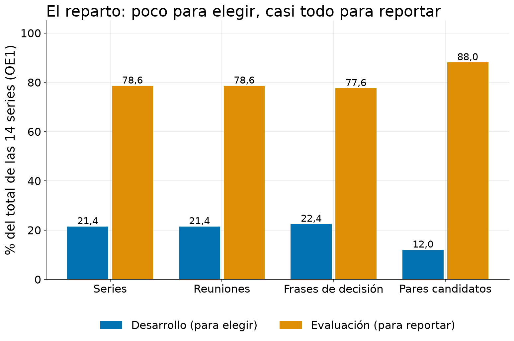
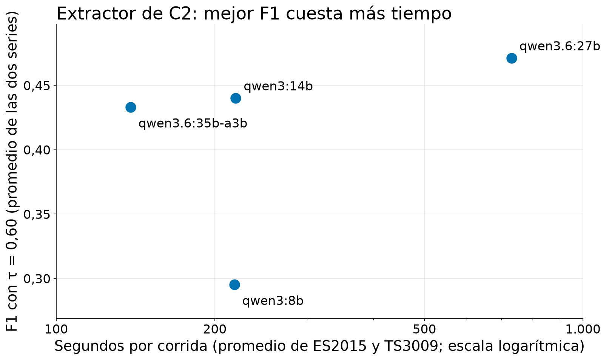
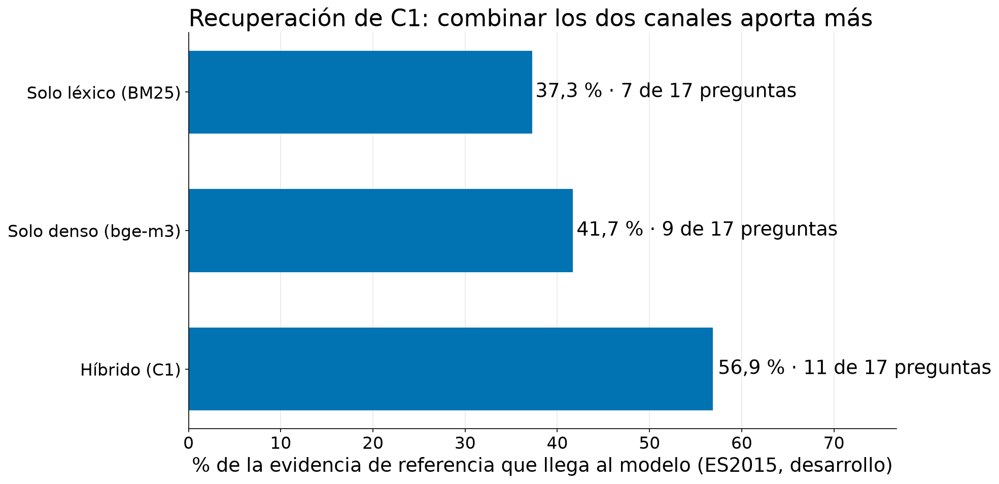
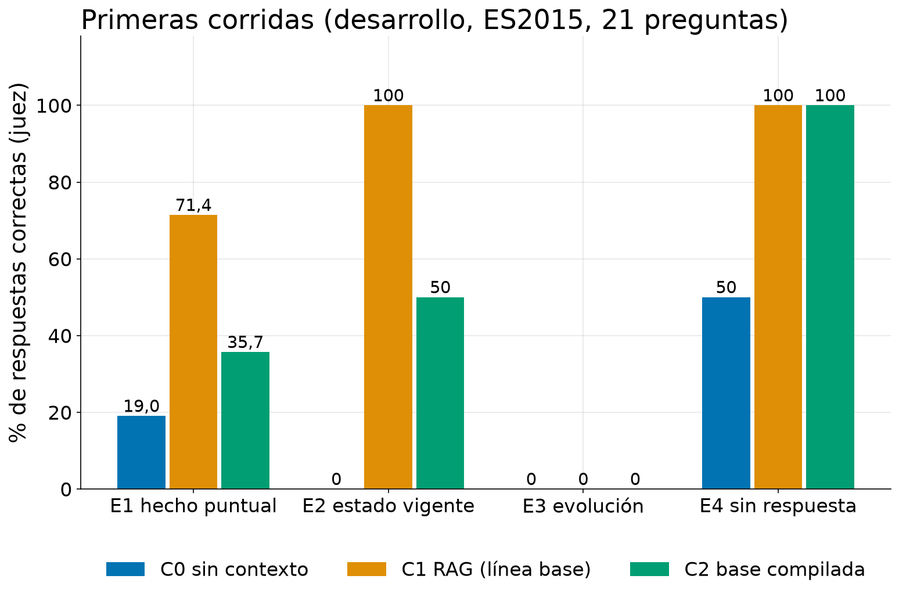
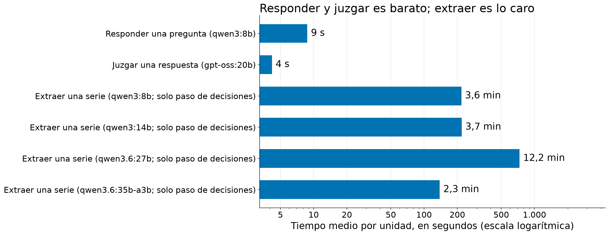

# Modelos y su justificación

| | |
|---|---|
| **Documento** | 09 — Modelos y su justificación |
| **Autor** | Jason Sepúlveda S. |
| **Versión** | 4.2 |
| **Fecha** | 2026-10-28 |
| **Estado** | Vigente |

## Historial de versiones

| Versión | Fecha | Cambio | Motivo |
|---|---|---|---|
| 1.0 | 2026-10-15 | Versión inicial. Reúne en un solo documento los modelos y técnicas del proyecto, la justificación de cada elección con su evidencia, las primeras pruebas realizadas y las dificultades abiertas. No introduce decisiones ni cifras nuevas: cada dato remite al registro de decisiones, a la configuración o al notebook donde ya consta. | Entrega del video de modelado de datos (semana 4) y sección «Modelo de aprendizaje de máquinas» del pre-informe. |
| 1.1 | 2026-10-15 | Se usan los nombres estándar de métricas y técnicas sin traducir (ground truth, baseline, accuracy, precision, LLM-as-a-judge, context window, cosine similarity). | Convención del equipo: los nombres de métricas y técnicas no se traducen. |
| 1.2 | 2026-10-15 | Se agrega la sección «Trazabilidad»; se corrige la referencia del recuento de unas 900 respuestas (notebook 07, el motor de corrida) y se indican los denominadores de las cifras de ES2015 (29 decisiones con acuerdo evaluado; 27 decisiones finales). El pendiente de confirmación con el tutor indica responsable y fecha. No cambia ninguna cifra ni decisión. | Auditoría de gobernanza del 2026-10-15: el recuento citaba el notebook 05 (selección del juez) en lugar del 07; las cifras de ES2015 usaban denominadores distintos sin decirlo; el pendiente no tenía responsable. |
| 1.3 | 2026-10-15 | Se retira la mención al extra `retrieval` (`rank-bm25`): el canal léxico BM25 está implementado en el paquete y la dependencia se eliminó de `pyproject.toml`. No cambia ninguna cifra ni decisión. | Corrección de código del 2026-10-15 (rama `fix/auditoria-codigo`): la dependencia declarada no se importaba en ninguna parte. |
| 2.0 | 2026-10-19 | La dificultad 7 deja de decir que τ sigue sin fijarse y remite al ADR 0012 (τ principal 0,70; 0,75 y 0,80 como sensibilidad). | El ADR 0012 fijó τ con el notebook 17: el juez marca la misma decisión en ≤ 0,32 de los pares bajo 0,70 y en ≥ 0,76 desde 0,70. |
| 3.0 | 2026-10-26 | Reestructuración completa para seguir el orden que pide el curso en la etapa de modelado (qué es el modelo, qué significa funcionar bien, restricciones del análisis exploratorio, estrategia experimental, *pipelines*, modelos por rol, búsqueda de parámetros, línea base, dificultades, pendientes y limitaciones), derivada del [notebook 19](../../notebooks/19-jss-modelos.ipynb). Se agregan: la tabla que traduce cada concepto del curso a su equivalente en la tesis; las particiones con volúmenes y porcentajes; los modelos por rol con su evidencia, incluida la de OpenKOS; los métodos de búsqueda de parámetros nombrados uno a uno; la ablación de la recuperación; el diagnóstico sin contexto (C0); la tabla de costo y latencia; el costo de los errores; las restricciones del análisis exploratorio; y las decisiones pendientes. Se concilian cifras que se citaban con distinto denominador (27 frente a 29 decisiones en ES2015; 6 frente a 9 decisiones con evidencia de varios roles) y el kappa de la segunda persona que etiquetó (0,865, antes redondeado a 0,87). Se retira el primer intento de extracción con OpenKOS 0.5.2 (4 objetos), reemplazado por el de la 0.5.5 (69 a 71 decisiones por corrida). | Video de avance #2 (modelado de datos, semana 4) y sesión sincrónica 2 del 2026-10-20: el notebook 19 es ahora la fuente única de las cifras de esta etapa, y este documento la de su guion. |
| 4.0 | 2026-10-26 | Se incorporan las etiquetas de atribución del error (OE4) de las fallas de C2 en E1: de nueve fallas, 4 son de recuperación, 3 de extracción y 2 de síntesis (sección 8.4). Se actualizan la dificultad 8, la decisión pendiente sobre fuentes en bruto (#146) y las limitaciones del juez, que además de indulgente con lo genérico es estricto con lo parcial. Son datos de desarrollo, de una sola serie y de una sola persona: una dirección, no un resultado. | Las etiquetas las puso jss al revisar las ocho fallas que la regla no podía atribuir (PR #177); el documento decía que no había ninguna cifra de OE4. Las cifras salen del [notebook 16](../../notebooks/16-jss-c2-fuentes-e1.ipynb) y del [notebook 19](../../notebooks/19-jss-modelos.ipynb). |
| 4.1 | 2026-10-27 | Se agregan a las decisiones abiertas (sección 11.1) los cuatro controles de comparabilidad que el notebook 19 (sección 5.6) deja por revisar antes de la corrida formal: huella del generador por corrida, versión y huella de los *embeddings*, texto efectivo entregado al modelo y revisión de las instrucciones copiadas de OpenKOS. En la sección 8.4 se enlaza la figura de las etapas de las fallas de C2 y se remite al [notebook 20](../../notebooks/20-gm-mejoras-modelado.ipynb) como complemento. No cambia ninguna cifra ni decisión. | El PR #187 integró la revisión del modelado hecha por otro integrante del equipo (notebook 20) en el notebook 19; este documento, que es su guion, debía reflejar los controles pendientes. No cambia ninguna figura del documento. |
| 4.2 | 2026-10-28 | Se precisan los controles C1/C2/C3, la referencia humana C3 y el alcance de C0, sin cambiar cifras ni decisiones. | Alinear el avance con las correcciones del notebook 19. |

> **Cómo versionar.** Un cambio de redacción sube el decimal (1.0 → 1.1). Un cambio que
> altera una decisión, un objetivo o una cifra sube el entero (1.x → 2.0) y **debe declarar
> la evidencia que lo motivó**. El historial nunca se reescribe: se agrega una fila.

> **Estado de las cifras.** Todo desempeño que aparece aquí sale de series de **desarrollo**
> (ES2015 y, para la extracción, también TS3009; [ADR 0005](../decisions/0005-adr-development-evaluation-split.md)).
> Las series de evaluación figuran solo como **conteos estructurales**; su contenido no se
> leyó. **No se corrió ningún modelo para este documento**: las cifras se leen de resultados
> guardados. Con 21 preguntas, una corrida por condición y una sola serie, indican una
> dirección y no permiten concluir. **Ninguna cifra de este documento es un resultado de la tesis.**

## Un caso para entrar en materia

En ES2015, una de las series del corpus AMI, un equipo diseña un control remoto a lo largo de
cuatro reuniones. A tres sistemas se les hizo la misma pregunta, que en el banco está
redactada en inglés: *¿qué precio de venta se fijó para el control remoto?* La respuesta de
referencia, escrita por una persona, es «veinticinco euros». Esto fue lo que respondió cada uno
en la serie de desarrollo:

| Sistema | Qué hace | Respuesta (resumida) | ¿Correcta? |
|---|---|---|---|
| **C0** | Responde sin ningún texto de apoyo, solo con lo que el modelo ya sabe | Dice que no tiene información sobre ese control remoto ni su precio | No |
| **C1** | Busca fragmentos de la transcripción y responde con ellos | Veinticinco euros | Sí |
| **C2** | Responde desde una base de decisiones que otro proceso construyó antes a partir de la transcripción | Dice que encontró conceptos relacionados, pero ninguno responde la pregunta | No |

La columna «¿correcta?» es el veredicto de un segundo modelo de lenguaje que actúa como juez
frente a la respuesta de referencia. El caso ilustra algo de fondo: el precio **sí** está en la
reunión, pero la respuesta depende de la forma en que la información se organiza antes de
consultarla. Eso es lo que el proyecto quiere medir con muchas preguntas ([documentos 01](01-jss-problema.md)
y [03](03-jss-objetivos.md)). Este documento explica **con qué modelos y técnicas se hace esa
medición, por qué se eligieron y qué se probó hasta ahora**. Es una sola pregunta de una sola
corrida: muestra el mecanismo y no es un resultado.

## 1. Qué es «el modelo» en este proyecto

El curso entiende por modelo un algoritmo que se **entrena** con datos para predecir algo. Este
proyecto **no entrena ningún modelo** ([ADR 0005](../decisions/0005-adr-development-evaluation-split.md): «no es
train/test: nada se entrena»). Los modelos de lenguaje (LLM, programas entrenados con enormes
cantidades de texto que redactan respuestas) ya vienen entrenados y se ejecutan en el propio
computador con Ollama, un servidor local de modelos, de modo que ningún dato sale a terceros.
Lo que se evalúa es si **una forma de organizar la información** responde mejor que otra.

Por eso cada práctica que el curso pide tiene un equivalente propio en la tesis. La tabla
siguiente es el eje de todo el documento:

| Lo que pide el curso | Su equivalente en esta tesis | Sección |
|---|---|---|
| **El modelo** (algoritmo que se entrena) | El ***pipeline* completo de cada condición**: C1 (buscar fragmentos y responder), C2 (base de decisiones construida por la máquina con OpenKOS) y C3 (la misma base construida por personas). Cada uno junta recuperación, modelo de *embeddings*, modelo generador y *prompt*. Nada se entrena | 5 y 6 |
| **Conjunto de prueba** separado y usado una vez | Las **series de evaluación**, que no se tocan hasta congelar todo. Lo ajustable se ajusta solo en las series de desarrollo | 4 |
| **Fuga de datos** (*leakage*) | Horizonte cronológico, regla «congelar antes de evaluar» y una **fuga declarada** (issue #145) | 4 y 11 |
| **Validación cruzada o temporal** | Como no hay entrenamiento no hay *folds*. La variabilidad se mide con 3 corridas con semilla, **bootstrap** por reuniones y un tamizaje de modelos que exige ganar en las dos series de desarrollo | 7 y 9 |
| **Hiperparámetros** | Modelo elegido, `temperature`, `top_p`, ventana de contexto, tamaño de fragmento, número de fragmentos recuperados (K) y el umbral de alineación τ. Los *prompts* quedan **fijos a propósito** | 7 |
| **Método de búsqueda** de hiperparámetros | ***Grid search*** (C1, 32 configuraciones), **tamizaje prerregistrado** con reglas de veto (extractor), **umbrales prerregistrados** (juez) y **ablación** (canales de recuperación) | 7 |
| **Línea base** simple | **C1** (RAG documental, ajustado con honestidad) y el diagnóstico sin contexto **C0** | 8 |
| **Métrica de éxito** desde los objetivos | Una métrica por objetivo y el criterio D16/D17 | 2 |
| **Costo de los errores** | Qué cuesta responder mal, abstenerse, extraer una decisión falsa o perder una | 2 |
| **Restricciones del análisis exploratorio** | Largo de las transcripciones frente a la ventana, decisiones raras, series temporales, idioma | 3 |
| **Reparto en porcentajes y en volúmenes** | Tabla con series, reuniones, frases de decisión y pares candidatos por partición | 4 |
| **Evaluación final una sola vez** | **Congelar y luego correr** | 11 |
| **Limitaciones** | Lista explícita | 12 |

Las piezas que componen los *pipelines* son de tres naturalezas distintas:

- **Sistemas bajo comparación**: C1, C2 y C3 (sección 5).
- **Modelos de lenguaje que los componen**: un generador de respuestas, un modelo de *embeddings*
  (representación numérica de un texto, que sirve para medir qué tan parecidos son dos textos)
  y un extractor de decisiones (sección 6).
- **Instrumento de medida**: el juez, un segundo modelo que califica las respuestas
  (LLM-as-a-judge). No es un modelo bajo prueba: es la regla con que se mide (sección 6).

El motor que construye y consulta la base de decisiones es **OpenKOS**, un programa de código
abierto desarrollado antes por uno de los integrantes del equipo. Es el **instrumento** de C2 y
C3, no un aporte de la tesis ([ADR 0003](../decisions/0003-adr-openkos-as-instrument.md)): el aporte es la medición.

> **Por confirmar con el tutor** (responsable: jss). El encuadre de este documento es una
> interpretación del equipo sobre cómo aplicar la pauta de modelado a un proyecto sin modelo
> entrenado. El 2026-10-26 el equipo envió un correo al tutor y a la ayudante con tres
> preguntas: (1) si es aceptable presentar los *pipelines* como «el modelo» y el juez como
> instrumento y no como modelo bajo prueba; (2) si una partición en series de desarrollo y
> evaluación, en lugar de entrenamiento y prueba, cumple lo que se espera; y (3) si en el
> pre-informe se pueden presentar solo resultados de desarrollo. **La respuesta sigue
> pendiente.** Hasta recibirla, el documento se mantiene con este encuadre.

## 2. Qué significa «funcionar bien» y cuánto cuesta equivocarse

### 2.1 Un objetivo, una métrica

La pregunta del proyecto es si una base estructurada de decisiones, construida
automáticamente desde transcripciones de reuniones, **responde mejor que buscar en las
transcripciones**, y cuánto se pierde cuando la construye una máquina que se equivoca. Cada
objetivo tiene su métrica:

| Objetivo | Pregunta | Métrica | Regla de lectura |
|---|---|---|---|
| OE1, ground truth | ¿Se puede construir una referencia de decisiones y relaciones confiable? | Kappa de Cohen (acuerdo entre dos anotadores descontado el azar; 1 es acuerdo perfecto) en tres ejes: existencia, tipo y dirección | Sin umbral por diseño: un kappa bajo se informa como hallazgo |
| OE2, extracción (Experimento A) | ¿Qué tan bien reencuentra la máquina las decisiones del ground truth? | Precision (qué parte de lo extraído es correcto), recall (qué parte de lo que había se encontró) y F1 (su media armónica), como curva sobre τ (0,50 a 0,90, 9 valores) | Sin criterio de éxito; τ principal 0,70, con 0,75 y 0,80 de sensibilidad ([ADR 0012](../decisions/0012-adr-umbral-tau-del-experimento-a.md)) |
| OE3, utilidad (Experimento B) | ¿Responde mejor C2 que C1, sobre todo cuando la decisión cambió? | Corrección de la respuesta, calificada por el juez; principal en las preguntas de evolución (E3, al menos 25 por estrato) | Criterio D16, enmendado por D17: el intervalo de la diferencia pareada C2 − C1 en E3 (95 %, 10.000 remuestreos) debe quedar por encima de 0 |
| OE4, atribución del error | Cuando C2 falla, ¿dónde nació el error? | Proporción de errores por etapa: extracción, recuperación o síntesis | Descriptivo; la cifra principal es la parte atribuible a la extracción |

Las preguntas del banco se agrupan en cuatro estratos: **E1** (un hecho puntual), **E2** (el
estado vigente de una decisión), **E3** (la evolución de una decisión entre reuniones, el que
prueba la tesis) y **E4** (preguntas sin respuesta en el material).

Solo una comparación decide si el experimento «tuvo éxito»: la **corrección de la respuesta
en E3, de C2 frente a C1**. Para cada pregunta se calcula cuánto mejor o peor le fue a C2 que a
C1 y se arma un intervalo **bootstrap** (repetir el cálculo sobre muestras al azar del mismo
conjunto para saber cuánto podría variar el resultado) de la diferencia promedio. Hay tres
desenlaces: *respaldada* (el intervalo queda por encima de 0), *no concluyente* (incluye el 0,
y nunca se reporta como éxito) y *contraria* (queda por debajo). Todo lo demás es descriptivo.
Esta regla se escribió antes de ejecutar nada, para no reinterpretar después ([documento 08](08-jss-metricas-y-criterio-de-exito.md), §6).

**Potencia del criterio.** Con pocas preguntas en E3 el criterio podría no detectar una mejora
real. Una simulación sintética (no se ejecuta ningún modelo; 1.000 experimentos por escenario,
exactitud base de C1 de 0,5) lo comprobó:

| Preguntas en E3 | Mejora verdadera de C2 | Criterio pareado (vigente) | Criterio de no solapamiento (robustez) |
|---|---|---|---|
| 25 | +0,00 | 3,3 % | 0,0 % |
| 25 | +0,15 | 57,5 % | 10,4 % |
| 25 | +0,20 | 79,5 % | 27,8 % |
| 40 | +0,00 | 2,8 % | 0,0 % |
| 40 | +0,15 | 75,7 % | 17,4 % |
| 40 | +0,20 | 93,8 % | 49,1 % |

Con 25 preguntas y una mejora verdadera de +0,15, el criterio pareado declara «respaldada» en
57,5 % de los experimentos simulados, contra 10,4 % del otro criterio, y solo da falsos
positivos en 3,3 % cuando no hay mejora. Por eso se eligió: más potencia sin inflar los falsos
positivos ([ADR 0010](../decisions/0010-adr-decisiones-del-analisis-del-experimento-b.md), notebook 10). Es una simulación: dice cuánta
potencia tiene el criterio, no cuánto mejorará C2.

### 2.2 El costo de los errores

No todos los errores cuestan lo mismo. La tabla separa lo que el diseño ya decide de lo que se
informa aparte para que no quede escondido en un promedio:

| Error | Cómo se cuenta | Por qué importa |
|---|---|---|
| **Responder mal** una pregunta que sí tiene respuesta (E1 a E3) | Respuesta incorrecta | Es el error «confiado»: el usuario cree una respuesta falsa. La hipótesis H4 espera más de esto en C1 que en C2 |
| **Abstenerse** (decir «no hay información») ante una pregunta que sí tiene respuesta | También incorrecta, pero se informa **aparte** | No ayuda, pero tampoco engaña: distinguir «no sabe» de «se equivoca» cambia qué conviene mejorar |
| **Abstenerse** ante una pregunta sin respuesta (E4) | **Correcta** | Es la única situación en que abstenerse es la respuesta buena: mide si el sistema reconoce sus límites |
| **Responder** una pregunta sin respuesta (E4) | Incorrecta | Inventar es el error que más daño hace a quien decide con esa respuesta |
| **Extraer una decisión falsa** (OE2) | Baja la precision | Una decisión falsa en la base se escribe una vez y se lee muchas: contamina todas las consultas posteriores |
| **Perder una decisión** (OE2) | Baja el recall | La base no puede responder lo que nunca guardó |
| **Citar mal** | Regla determinista aparte ([ADR 0009](../decisions/0009-adr-regla-de-citacion-correcta.md)); no cambia si la respuesta es correcta | Una respuesta correcta sin fuente verificable sirve menos |

El diseño **no asigna costos distintos** a una decisión falsa y a una perdida: el F1 las pondera
igual. Por eso se informan la precision y el recall por separado, y la curva completa sobre τ en
lugar de un solo número. La cifra principal de OE4 es la parte de los errores que nace en la
extracción, precisamente porque es el error que se propaga.

**Un riesgo ya observado.** En ES2015, OpenKOS 0.5.5 con `qwen3:8b` extrajo entre 69 y 71
decisiones por corrida, frente a 27 de la ground truth adjudicada: unas 2,6 veces más. El exceso
apunta a la precision (valoraciones o datos tomados por decisiones) y no a una pérdida de
decisiones. Es una serie, un modelo y una versión provisional (notebook 12).

## 3. Restricciones que impone el análisis exploratorio

El análisis exploratorio (documento 07) describió los datos antes de pensar en modelos. Cada
hallazgo se convierte aquí en una **restricción sobre una decisión de modelado**. Las cifras son
conteos y longitudes sobre las 14 series de OE1, nunca texto de las series de evaluación.

| Hallazgo del análisis exploratorio | Decisión de modelado que condiciona |
|---|---|
| Una serie completa tiene entre 14.990 y 26.204 palabras, de 1,6 a 2,8 veces la ventana de 12.288 tokens del modelo | El generador no puede leer la serie: hace falta recuperar (C1) o compilar (C2) |
| OpenKOS recorta el contexto del *prompt* a lo más 10.240 caracteres y a unos 7.400 tras la sobrecarga ([ADR 0007](../decisions/0007-adr-ajuste-c1-y-presupuesto-de-contexto.md)) | El tamaño de fragmento y K de C1 se ajustan contando el texto que **de verdad llega** al modelo, no el recuperado |
| Las decisiones son raras: 13,3 por cada 1.000 turnos (343 decisiones en 25.857 turnos) | Encontrar una decisión es buscar una aguja: la recuperación importa |
| Los turnos son muy cortos: mediana de 4 palabras y 31,5 % de una sola palabra | El fragmento de C1 no puede ser un turno: agrupa varios turnos completos |
| 26 de 343 decisiones no tienen actos de diálogo de evidencia | No se imputa ni se elimina: se marcan y se revisan a mano al adjudicar; no se puede verificar su citación |
| Las series son temporales (reuniones a → d) y las cuatro de una serie comparten fecha. Solo 6 de 14 series tienen hora real de inicio | OpenKOS procesa cada serie en orden cronológico con fechas de evento ([ADR 0008](../decisions/0008-adr-fechas-de-reunion-para-openkos.md)); el orden vale, la hora sintética no es un dato temporal |
| El corpus y lo que extrae el modelo están en inglés (6.190 de 6.198 textos extraídos), pero las etiquetas humanas del ground truth están en español | La ground truth se traduce al inglés para comparar texto con texto (4 series hasta ahora: ES2015, ES2016, IS1003 y TS3009); la traducción nunca es una etiqueta. τ se calibró después de traducir |
| Pocas series: 14 en total, 11 de evaluación | La unidad de análisis es la serie o la reunión, no el par; el bootstrap remuestrea reuniones ([ADR 0011](../decisions/0011-adr-alineacion-rol-e-intervalos-del-experimento-a.md)) |

Tres restricciones pesan más que las demás. **La ventana**: ni el generador puede leer una serie
completa ni OpenKOS cabe una reunión larga sin recortarla, así que la comparación entre C1 y C2
es en realidad una comparación de *qué texto le llega al modelo*. **La rareza de las
decisiones**: la recuperación debe encontrar una frase corta entre miles de turnos. **El
idioma**: toda comparación de texto extraído con la ground truth cruza un idioma salvo que se
traduzca, y eso desplaza toda la curva de τ.

## 4. Estrategia experimental: reparto, horizonte y fuga

### 4.1 No es entrenamiento y prueba

La partición separa los datos usados para **tomar decisiones** (desarrollo: ajustar el
fragmento de C1, la grilla de τ, el punto de operación del filtro) de los usados para **reportar
resultados** (evaluación; [ADR 0005](../decisions/0005-adr-development-evaluation-split.md)). Las series de desarrollo, ES2015 e IS1004, ya se habían
leído por completo en el piloto y no podían usarse como datos limpios; se les suma TS3009 para
cubrir los tres sitios de grabación del corpus. La tabla muestra el reparto **en volúmenes y en
porcentajes**, calculado con código (reproduce, no copia, las cifras del ADR 0005). Un **par
candidato** es un par de decisiones de reuniones distintas que un filtro léxico (*blocking*)
propone como posiblemente relacionadas, para anotar su relación; hay 92 de 3.071 pares posibles.

| Partición | Series | Reuniones | Frases de decisión | Pares entre reuniones | Pares candidatos | Preguntas |
|---|---|---|---|---|---|---|
| Desarrollo | 3 (21,4 %) | 12 (21,4 %) | 77 (22,4 %) | 688 (22,4 %) | 11 (12,0 %) | 21 (100,0 %) |
| Evaluación | 11 (78,6 %) | 44 (78,6 %) | 266 (77,6 %) | 2.383 (77,6 %) | 81 (88,0 %) | 0 escritas de 115 filas del banco |
| Total OE1 | 14 (100,0 %) | 56 (100,0 %) | 343 (100,0 %) | 3.071 (100,0 %) | 92 (100,0 %) | — |
| Reserva | 18 | sin medir | sin medir | sin medir | sin medir | sin medir |



El reparto es deliberado: lo que se usa para elegir es poco y lo que se usa para reportar es la
gran mayoría. Las 21 preguntas de calibración son todas de ES2015. El banco de evaluación tiene
115 filas numeradas y 0 escritas, de modo que todavía no puede existir ningún resultado sobre
preguntas de evaluación. La reserva (18 series) no se ha medido ni tocado; está disponible si
E3 necesita más material.

### 4.2 Congelar antes de evaluar

Tres reglas protegen la evaluación de la contaminación, el equivalente de «el conjunto de
prueba se usa una sola vez»:

1. **Análisis estructural en cualquier serie; análisis de contenido solo en desarrollo.**
   Contar, medir longitudes y repartir es admisible en todas; leer textos solo en ES2015, IS1004
   y TS3009. Por eso las series de evaluación solo aparecen como conteos.
2. **Todo lo ajustado en desarrollo se congela antes de tocar evaluación** y su valor queda
   registrado en un ADR o en la configuración.
3. **Horizonte cronológico.** Una serie son cuatro reuniones sucesivas (a, b, c, d). OpenKOS las
   procesa en ese orden y las fechas de evento lo conservan: una decisión nunca se extrae
   «sabiendo» lo que se decidió en una reunión posterior.

**Fuga declarada.** El issue #145 documenta que dos umbrales de troceo de OpenKOS (cuándo una
fuente se parte en ventanas) se fijaron en agosto de 2026 con mediciones sobre TS3005, una serie
de **evaluación**, antes de que existiera la partición. Lo medido fue si la llamada al modelo
colapsaba, no si lo extraído coincidía con la ground truth, y los umbrales no codifican
contenido; aun así se declara en lugar de omitirse ([documento 06](06-jss-metodologia.md), §7–8).

### 4.3 Cifras que se parecen y no son lo mismo

Algunas cantidades de ES2015 se citan en distintos documentos y no cuentan lo mismo:

| Serie | Frases de decisión (partición) | Filas adjudicadas | Decisiones de la ground truth | Con evidencia de varios roles |
|---|---|---|---|---|
| ES2015 | 29 | 34 | 27 | 6 |
| TS3009 | 24 | 29 | 26 | 15 |

En ES2015, **29** es el número de frases de decisión del resumen de AMI (la unidad de la
partición y del acuerdo entre anotadores) y **27** el de decisiones de la ground truth
adjudicada (la unidad de OE2): al adjudicar, las frases compuestas se parten en hijas y las que
no son decisión, o no tienen soporte, se excluyen (7 filas). Este documento usa 29 cuando habla
de la anotación y 27 cuando habla de la ground truth. Algo parecido pasa con los roles: el
código cuenta 6 decisiones de ES2015 con evidencia de varios roles, no las 9 que mencionaba el
issue #99 (queda como pregunta abierta en el notebook 14, §3). **Cifra vigente: la del código.**

## 5. Los *pipelines*: qué se compara

Cada condición abarca un *pipeline* completo, desde la preparación de la información hasta la respuesta.
El diseño compara distintas representaciones del conocimiento bajo componentes compartidos
(`config/experiments.toml`, `[shared_budget]`). Aún debemos comprobar la equivalencia efectiva
entre condiciones: suficiencia, fuentes disponibles, texto entregado y versiones de los modelos
(secciones 6.5 y 11.1). Hasta hacerlo, no podemos atribuir todas las diferencias a la representación.

```
Transcripción ─► C1: fragmentos ─► BM25 + vectores ─► fusión RRF ─► K fragmentos ─┐
                                                                                   ├─► ¿alcanza el contexto?
Transcripción ─► C2: OpenKOS (modelo extractor) ─► base compilada ─► consulta ─────┤      │
                                                                                   │      ▼
Anotación humana ─► C3: referencia humana adjudicada ─► consulta ──────┘   modelo generador ─► respuesta + fuentes ─► juez
(C0, diagnóstico: la pregunta va directo al modelo generador, sin ningún texto de apoyo)
```

| Paso | C0 (diagnóstico, no es condición) | C1 (línea base) | C2 (la propuesta) | C3 (ground truth humana) |
|---|---|---|---|---|
| Material de partida | Ninguno | Transcripciones congeladas de la serie | Transcripciones, procesadas de la reunión a a la d | Anotación humana adjudicada de la serie (OE1) |
| Preparación | — | Troceo en fragmentos de turnos completos: hasta 1.200 caracteres, 1 turno compartido entre fragmentos | OpenKOS extrae objetos (decisiones, temas, eventos) con un modelo extractor y guarda la fuente en bruto | Objetos equivalentes a los de C2, elaborados desde anotaciones humanas adjudicadas |
| Índice | — | BM25 (léxico) + vectores densos de `bge-m3` | Índice híbrido de OpenKOS con `bge-m3` | Igual que C2 |
| Recuperación | — | Fusión RRF (k = 60) y los 5 mejores fragmentos | `openkos query --limit 5`, sin modificar | Igual que C2 |
| Presupuesto de contexto | — | Mismo recorte que OpenKOS (sus funciones, portadas línea por línea) | El de OpenKOS | Igual que C2 |
| ¿Alcanza el contexto? | Sin verificación | Instrucción de suficiencia de OpenKOS copiada byte a byte | Verificación de suficiencia de OpenKOS (sección 6.5) | Igual que C2 |
| Respuesta | Solo la pregunta; prosa, o «no sé» | Instrucción de respuesta de OpenKOS copiada byte a byte; cita con la línea `USED:` | OpenKOS, sin modificar | Igual que C2 |
| Modelo generador | `qwen3:8b` | `qwen3:8b` | `qwen3:8b` | `qwen3:8b` |

**C1: buscar fragmentos y redactar con ellos (RAG).** RAG significa generación aumentada por
recuperación: antes de contestar, el sistema recupera los pasajes más relacionados con la
pregunta y se los entrega al modelo para que redacte con ellos. Es lo que cualquier
organización haría hoy con sus transcripciones, y por eso es el baseline, el punto de
comparación. Una línea base débil haría que cualquier propuesta pareciera buena, así que el
diseño exige que sea **honesta**: tiene su propio recuperador híbrido y sus parámetros se
ajustaron con datos (sección 7). Combina dos buscadores: uno **léxico** (BM25, que recupera por
palabras compartidas) y uno **denso** (por parecido de significado, con *embeddings* de
`bge-m3`), cuyas listas se fusionan con *reciprocal rank fusion* (RRF), una regla que premia
lo que aparece bien ubicado en ambas. El buscador BM25 está implementado dentro del proyecto
(`src/afg/conditions/c1_retrieval.py`); los *embeddings* y la generación se piden a Ollama.

**C2: base de decisiones construida por la máquina.** Un modelo de lenguaje lee las reuniones en
orden cronológico, extrae las decisiones y las guarda como registros con procedencia (reunión y
pasaje de origen), junto con las relaciones entre decisiones de reuniones distintas. Para
responder, se recuperan esos registros y el mismo generador de C1 redacta. La hipótesis H1
apuesta a que la ventaja se verá sobre todo en las preguntas de evolución (E3), no en datos
puntuales.

**C3: la misma base, construida por personas.** Sin C3, una mala respuesta de C2 no se podría
atribuir: no se sabría si la idea de la base no sirve o si la máquina la llenó mal. La distancia
C1 → C3 permitiría estimar el valor de la base; C3 → C2, el efecto de construirla
automáticamente, considerando también la fiabilidad de la referencia humana. Por eso las etiquetas de la ground truth las pone siempre una persona. **C3 todavía no
se puede ejecutar**: depende de la anotación humana de las series y hoy lanza un error
explícito de «sin implementar»; no hay ninguna cifra de C3 en este documento.

**C0: diagnóstico sin contexto.** El generador responde sin evidencia recuperada. Se usa
solo en desarrollo, como referencia sin recuperación y para explorar posibles señales de
conocimiento previo del corpus AMI. No demuestra ni descarta contaminación del entrenamiento
(sección 8.3).

### 5.1 Lo que se comparte entre condiciones (§5.3 de la propuesta)

| Parámetro | Valor | Por qué |
|---|---|---|
| Modelo generador | `qwen3:8b` | Mismo modelo que redacta la respuesta en C0, C1, C2 y C3 |
| Modelo de *embeddings* | `bge-m3` | Multilingüe; el mismo en las tres condiciones |
| Ventana de contexto | 12.288 tokens | Valor por defecto de OpenKOS (`num_ctx`) |
| Largo máximo de respuesta | 8.192 tokens | Valor por defecto de OpenKOS (`num_predict`) |
| `temperature` | 0,1 | Azar bajo: respuestas casi siempre iguales |
| `top_p` | 0,9 | Configurado, pero C1 **no lo envía** porque OpenKOS tampoco, para que las condiciones reciban las mismas opciones |
| Semilla | 42 | Hace repetible la corrida |
| Corridas por configuración | 3 | Mínimo de la propuesta: se informa media y dispersión |
| Bloques de contexto en C2 y C3 | 5 | `--limit` de `openkos query`: presupuesto de **texto** igual, no K igual ([ADR 0007](../decisions/0007-adr-ajuste-c1-y-presupuesto-de-contexto.md)) |

C1 copia las instrucciones de respuesta de OpenKOS para que la redacción no explique una
diferencia, y su copia se verifica con una huella digital SHA-256 ([ADR 0006](../decisions/0006-adr-c1-rag-separado-con-respuesta-de-openkos.md)).
La configuración deja anotado un segundo punto de escala, `qwen3:32b`, como extensión para la
hipótesis H3 y no como corrida comprometida.

## 6. Modelos por rol: candidatos, selección y evidencia

Hay cuatro roles de modelo, cada uno con su propia pregunta de selección. Solo dos se eligieron
comparando candidatos con una prueba propia (el extractor y el juez). Se distingue qué evidencia
es de esta tesis y cuál viene de OpenKOS.

| Rol | Dónde interviene | Modelo | ¿Se comparó con alternativas aquí? |
|---|---|---|---|
| **Generador de respuestas** | C0, C1, C2 y C3 | `qwen3:8b` | No: es el modelo compartido de la propuesta. La evidencia viene de OpenKOS (6.4) |
| **Embeddings** | Recuperación en C1, C2 y C3; alineación del Experimento A | `bge-m3` | No: se hereda de OpenKOS, que lo eligió por fiabilidad |
| **Extractor de C2** | Construye la base compilada | `qwen3:8b` hoy; **decisión pendiente** (#143) | Sí: *screen* de cuatro modelos (6.2) |
| **Juez** | Califica cada respuesta | `gpt-oss:20b` | Sí: calibración de tres candidatos (6.3) |

### 6.1 Generador y *embeddings*

**Generador.** `qwen3:8b` responde en todas las condiciones porque la propuesta exige el mismo
modelo generativo en las tres, porque corre en local sin enviar datos a terceros y porque es el
modelo por defecto de OpenKOS (elegido allí por una medición, ADR-0001 de OpenKOS), de modo que
C2 y C3 responden «tal como responde OpenKOS». La tesis **no comparó otros generadores**: es una
limitación declarada.

**Embeddings.** `bge-m3` es multilingüe y OpenKOS lo adoptó por fiabilidad: el modelo anterior
hacía fallar el servidor de forma no determinista en documentos largos y `bge-m3` no falló
(ADR-0006 de OpenKOS). Se mantiene en las tres condiciones y en el protocolo de alineación.

El modelo lee a lo más lo que cabe en su ventana, y eso se reparte entre las instrucciones, la
pregunta, los bloques recuperados y la reserva para responder. Por eso el mismo `qwen3:8b` «ve»
cosas distintas en C1 y en C2 si no se iguala el presupuesto de texto: es lo que iguala el ADR 0007.

### 6.2 Extractor de C2: el *screen* de cuatro modelos

OpenKOS necesita un modelo para extraer las decisiones de cada transcripción. Cuatro candidatos
de la familia Qwen: `qwen3:8b` (el modelo base y generador compartido), `qwen3:14b`,
`qwen3.6:27b` y `qwen3.6:35b-a3b`. **Método: *screen* con regla prerregistrada** (fijada antes
de la primera corrida; prerregistro en OpenKOS, PR #1554). Un candidato avanza solo si, frente a
`qwen3:8b` y **en las dos series de desarrollo**, (1) mejora el F1 con τ = 0,60 por un margen
mayor que el ruido entre corridas (al menos 0,05), (2) no pierde cobertura, (3) no falla más
reuniones que el modelo base y (4) no inunda de decisiones (hasta 1,10 veces el volumen del base).
Las corridas (5 por modelo y serie, y 15 nuevas para el que avanzó) las hizo OpenKOS; aquí se
leen sin modificarlas y se les aplica la regla con código de la tesis, que coincide con el de
OpenKOS en las 108 combinaciones (notebook 15).

Primera fase, 5 corridas por modelo y serie (F1 con mínimo y máximo; tiempo relativo al de `qwen3:8b`):

| Serie | Modelo | F1 (mín–máx) | Cobertura | Reuniones fallidas | Segundos por corrida | Veces el tiempo del 8b |
|---|---|---|---|---|---|---|
| ES2015 | `qwen3:8b` | 0,290 (0,250–0,349) | 0,481 | 0 de 20 | 168 | 1,0 |
| ES2015 | `qwen3:14b` | 0,387 (0,324–0,421) | 0,548 | 0 de 20 | 216 | 1,3 |
| ES2015 | `qwen3.6:27b` | 0,485 (0,413–0,542) | 0,563 | 0 de 20 | 581 | 3,5 |
| ES2015 | `qwen3.6:35b-a3b` | 0,461 (0,413–0,554) | 0,652 | 0 de 20 | 90 | 0,5 |
| TS3009 | `qwen3:8b` | 0,300 (0,252–0,336) | 0,654 | 0 de 20 | 268 | 1,0 |
| TS3009 | `qwen3:14b` | 0,493 (0,462–0,543) | 0,785 | 0 de 20 | 223 | 0,8 |
| TS3009 | `qwen3.6:27b` | 0,457 (0,379–0,512) | 0,808 | 0 de 20 | 883 | 3,3 |
| TS3009 | `qwen3.6:35b-a3b` | 0,405 (0,377–0,438) | 0,838 | 0 de 20 | 187 | 0,7 |

Con la regla, avanzan `qwen3.6:27b` y `qwen3.6:35b-a3b`. `qwen3:14b` queda fuera por un margen
mínimo en ES2015: ganó 0,097 de F1 y se exigían 0,099. Es la regla operando como se registró, no
evidencia de que sea peor. Segunda fase, 15 corridas nuevas de `qwen3.6:27b` frente a `qwen3:8b`:

| Serie | Modelo | F1 (mín–máx) | Cobertura | Reuniones fallidas | Segundos por corrida | Veces el tiempo del 8b |
|---|---|---|---|---|---|---|
| ES2015 | `qwen3:8b` | 0,289 (0,255–0,322) | 0,474 | 1 de 60 | 166 | 1,0 |
| ES2015 | `qwen3.6:27b` | 0,470 (0,394–0,554) | 0,575 | 0 de 60 | 598 | 3,6 |
| TS3009 | `qwen3:8b` | 0,303 (0,248–0,400) | 0,646 | 6 de 60 | 489 | 1,0 |
| TS3009 | `qwen3.6:27b` | 0,474 (0,429–0,522) | 0,818 | 4 de 60 | 895 | 1,8 |

`qwen3.6:27b` gana 0,18 de F1 en ES2015 y 0,17 en TS3009 sobre `qwen3:8b`, sin perder cobertura.
**El costo es el tiempo**: 3,6 veces más por corrida en ES2015 y 1,8 en TS3009 (en esta serie el
tiempo del 8b está inflado por sus 6 reuniones fallidas de 60, casi todas por tope de
generación). Con 5 corridas `qwen3:8b` no había fallado ninguna reunión en TS3009 (0 de 20): cinco
corridas subestiman la variación y la confirmación con corridas nuevas no es un trámite.



**Esto todavía no es la decisión del extractor.** La ganancia sale de dos series de desarrollo, y
el puntaje con τ = 0,60 incluye parecido temático (en el control con salidas de otro equipo la
cobertura es alrededor de 0,3; notebook 15, §6.2). Además, OpenKOS confirmó con 15 corridas a
`qwen3.6:35b-a3b` y este **no pasa** la regla (margen de F1 de +0,164 frente a 0,192 exigido en
ES2015, y +0,070 frente a 0,165 en TS3009; issue #1561 de OpenKOS). La elección queda abierta
(#143, sección 11).

### 6.3 Juez: calibración de tres candidatos

El Experimento B genera unas 900 respuestas (100 preguntas como mínimo × 3 condiciones × 3
corridas, notebook 07). Calificarlas a mano es inviable para un equipo de tres personas, así que
las califica un **LLM-as-a-judge**: un segundo modelo que lee la pregunta, la respuesta de
referencia, la respuesta del sistema y el pasaje de la transcripción donde está la evidencia.
Como es la regla de medir y no un modelo bajo prueba, se lo valida contra personas antes de
usarlo. **Método: umbrales prerregistrados** (`[judge.calibration]`, escritos antes de correr
ningún candidato) sobre un conjunto propio de 42 respuestas de ES2015 etiquetadas a mano, porque
ningún ranking público mide esta tarea. Un candidato debe cumplir **todos** los umbrales; si
varios cumplen, gana el más rápido. Además debe ser de una **familia distinta** de la del
generador y extractor (Qwen), para evitar el sesgo de preferir las propias respuestas; por la
misma razón se excluyó la familia Gemma, que OpenKOS usa en sus jueces internos.

| Criterio | Umbral | Qué protege |
|---|---|---|
| Acuerdo con las personas (kappa de Cohen, sobre «correcta») | ≥ 0,70 | Que juzgue como lo haría una persona |
| Consistencia al invertir el orden de presentación | ≥ 0,90 | Que no dependa de qué texto aparece primero |
| Consistencia entre semillas | ≥ 0,95 | Que el veredicto sea estable |
| Accuracy en preguntas sin respuesta (E4) | ≥ 0,80 | Que reconozca cuando no hay respuesta |
| Salidas válidas | ≥ 0,99 | Que el formato de salida se pueda leer |
| Cambio de veredicto al alargar una respuesta errada | ≤ 0,10 | Que no premie la verbosidad |

| Candidato | Kappa | Orden | Semillas | Accuracy E4 | Salidas válidas | Cambio por verbosidad | Latencia por llamada | Falla |
|---|---|---|---|---|---|---|---|---|
| `mistral-small3.2:24b` | 0,951 | 0,952 | 1,00 | 1,00 | 1,00 | 0,06 | 5,5 s | Ninguno |
| `atla/selene-mini:q8_0` | 0,485 | 0,738 | 1,00 | 1,00 | 1,00 | 0,00 | 3,0 s | Kappa y orden |
| **`gpt-oss:20b`** | **0,951** | 0,952 | 1,00 | 1,00 | 1,00 | 0,00 | **3,2 s** | Ninguno |

Dos candidatos cumplen todo con el mismo kappa; la regla fijada de antemano desempata por
rapidez y gana `gpt-oss:20b`, de la familia OpenAI de pesos abiertos, distinta de Qwen.
`atla/selene-mini:q8_0` queda fuera por el acuerdo con las personas y la estabilidad ante el
orden de presentación. Se descartaron sin correrlos `phi4:14b` (su contexto de 16 K no alcanza),
Llama 3.3 70B (43 GB, no cabe en el equipo) y las destilaciones de DeepSeek-R1 de base Qwen
(heredan la familia del extractor; notebook 05, §3.2). Parámetros del juez: temperatura 0, semilla
fija y razonamiento acotado a nivel `low`, porque sin ese tope los modelos de razonamiento piensan
largo antes de dar el veredicto y la corrida sería impracticable.

Una segunda persona etiquetó 15 ítems por separado y coincidió en 15 sobre «correcta» (kappa
1,00) y en 14 sobre «respaldada» (kappa 0,865). **Límites:** son 42 ítems de una sola serie, las
respuestas de calibración las generó `qwen3:8b` y el identificador de cada ítem delataba cómo se
generó la respuesta, por lo que el acuerdo podría estar algo inflado (notebook 05, §9.2). Como
salvaguarda, una persona vuelve a juzgar el 20 % de las respuestas del experimento y el kappa
debe alcanzar 0,70. El juez no evalúa las citas: su corrección se calcula con una regla
determinista, porque el juez no sabe qué fuentes citó la respuesta (ADR 0009).

### 6.4 Lo que OpenKOS usa por tarea (evidencia externa)

Lo que sigue **no es evidencia de esta tesis**: son hechos documentados en el repositorio de
OpenKOS, verificados leyendo su código y sus documentos (versión 0.6.0 más 35 commits
posteriores, `354fe2ad`). No se importa ningún código de OpenKOS y las corridas de esos *screens*
no se reprodujeron aquí. Se citan porque explican qué modelo interviene en cada paso de C2 y C3.

| Tarea de OpenKOS | Modelo por defecto | Qué decidió OpenKOS y con qué evidencia |
|---|---|---|
| Extracción y respuesta (síntesis) | `qwen3:8b` | ADR-0001: elegido por una medición con tres candidatos de 7–8 B. Un *screen* del paso de respuesta (epic jasonssdev/openkos#1556, issue #1560) **no encontró ganador** y `qwen3:8b` se queda |
| Embeddings | `bge-m3` | ADR-0006: elegido por fiabilidad (cero fallos entre 8 y 100 mil caracteres) |
| Jueces internos de **adjudicación** y **contradicción** | `gemma4:26b-a4b` | ADR-0047 (issue #1269): ganó ambos roles en un barrido prerregistrado. Solo actúan al compilar, es decir, afectan a C2 |
| **Verificación de suficiencia** de `query` | `gemma4:26b-a4b` solo en la rama principal (ADR-0076, issue #1560) | No está en la 0.6.0. En el *screen* ganó con +0,096 de diferencia pareada sobre `qwen3:8b` en 96 ítems. Cambia **cómo responde C2** (6.5) |
| Extracción de conceptos: modelo y tamaño de ventana | `qwen3:8b`, ventana de 4.000 caracteres | Issues #1557 y #1558: sin ganador, no se adopta nada |
| Pase de decisiones de transcripciones (el que mide la sección 6.2) | `qwen3:8b` | El issue #1561 confirmó con 15 corridas a `qwen3.6:35b-a3b`, que no pasa la regla; tampoco se adopta nada |

### 6.5 Un riesgo para la igualdad entre condiciones: la verificación de suficiencia

C1 hace la verificación de suficiencia (¿alcanza el contexto para responder?) con el mismo
`qwen3:8b` que redacta. Si C2 y C3 se ejecutaran con una versión de OpenKOS que ya empaqueta
`gemma4:26b-a4b` para esa verificación (la rama principal hoy, no la 0.6.0), **C2 y C3 decidirían
con otro modelo si el contexto alcanza** y las condiciones dejarían de ser iguales salvo en la
representación: la abstención de C2 dependería de otro modelo. Hay dos salidas, que el equipo
decide al fijar la versión (#94): fijar una versión sin esa verificación (la 0.6.0), o fijar
`models: {sufficiency: qwen3:8b}` en el espacio de trabajo de C2 y C3. Importa especialmente
porque, en las corridas de desarrollo, las 8 abstenciones de C1 y las 10 de C2 las decidió esa
verificación y no la redacción (sección 8.2).

## 7. Búsqueda de parámetros (los «hiperparámetros» del curso)

Algunos parámetros se **eligen** con datos y otros se **fijan** por diseño. Para cada uno se
nombra el método. El principio común: todo lo que se ajusta se ajusta en **series de
desarrollo**, con una regla escrita **antes** de correr, y queda congelado antes de tocar
evaluación.

### 7.1 Fragmento y K de C1: *grid search* con regla prerregistrada

**Método: *grid search*** (se prueban todas las combinaciones de una grilla). Se barren el tamaño
máximo del fragmento (800, 1.200, 1.600 y 2.400 caracteres), los turnos compartidos entre
fragmentos (0 y 1) y el número de fragmentos entregados K (3, 5, 8 y 10): 4 × 2 × 4 = 32
configuraciones, de las cuales 26 caben en el presupuesto prerregistrado de 13.516 caracteres. La
métrica es el *recall* de evidencia: qué parte de los pasajes que respaldan la respuesta llega al
modelo, sobre las 17 preguntas de ES2015 con evidencia de referencia. No interviene ningún modelo
generativo. Las configuraciones a menos de 0,02 de la mejor se consideran empatadas, y gana la de
menor K, luego menor tamaño y luego menos turnos compartidos. La regla se fijó antes de ver
resultados (`[retrieval.tuning]`; [ADR 0007](../decisions/0007-adr-ajuste-c1-y-presupuesto-de-contexto.md)).

La primera medición contó la evidencia sobre los fragmentos recuperados **completos** y eligió
1.600 / 0 / 8, con un recall de 0,642. Después se comprobó que OpenKOS recorta el contexto: de
esa configuración le llega al modelo texto con un recall de solo 0,446. Se repitió el ajuste con
la misma regla, contando **solo el texto que de verdad llega al modelo**, y el ganador cambió:

| Configuración (tamaño / turnos / K) | Recall de los fragmentos recuperados | Recall del texto que llega al modelo | Caracteres que llegan | Papel |
|---|---|---|---|---|
| 1600 / 0 / 8 | 0,642 | 0,446 | 6.946 | Ganadora de la primera medición (corregida) |
| **1200 / 1 / 5** | 0,569 | 0,569 | 5.599 | **Ganadora final** |
| 1600 / 0 / 5 | 0,583 | 0,583 | 7.628 | |
| 1200 / 0 / 5 | 0,520 | 0,520 | 5.654 | |
| 1200 / 1 / 8 | 0,598 | 0,510 | 8.146 | |
| 1200 / 0 / 8 | 0,593 | 0,505 | 7.566 | |

Es un error de medición propio, detectado y corregido a la vista: el ADR 0007 conserva el
registro original y agrega una enmienda. Limitaciones: una serie y 17 preguntas, y la mejor
configuración (0,583) y la elegida (0,569) están dentro del ruido; las desempata la regla y no la
evidencia.

### 7.2 Canales de recuperación: ablación

**Método: ablación** (quitar una pieza para ver cuánto aportaba). Con los parámetros de C1 ya
fijados, se mide cada canal por separado y la combinación, sobre las mismas 17 preguntas:

| Canal | Recall de evidencia entregada | Preguntas con algún pasaje entregado |
|---|---|---|
| Solo léxico (BM25) | 0,373 | 7 de 17 |
| Solo denso (`bge-m3`) | 0,417 | 9 de 17 |
| **Híbrido (C1)** | **0,569** | **11 de 17** |



Combinar los dos canales aporta más que cualquiera por separado, lo que justifica una línea base
híbrida y, por lo tanto, difícil de superar. El recall es un piso: AMI suele enlazar un solo acto
de diálogo por respuesta, así que un fragmento puede contener la respuesta y contar igual como
fallo.

### 7.3 El umbral τ del Experimento A

τ es el umbral de similitud con que se decide si una decisión extraída es «la misma» que una de
la ground truth. Con un τ bajo se acepta casi cualquier parecido; con uno alto, solo textos casi
iguales. Como elegir uno solo permitiría escoger el más favorable, el F1 se informa como **curva**
sobre la grilla de τ. **Método prerregistrado** (notebook 17): (A) un control nulo, que puntúa la
salida de un equipo contra la ground truth de otro, donde ningún acierto puede ser real; y (B) una
muestra de pares juzgada por un modelo de otra familia (`gpt-oss:20b`), que responde «¿describen
ambos textos la misma decisión?». La regla era τ = máx(τ nulo, τ juez).

| Intervalo de similitud | Pares juzgados | «Misma decisión» | Proporción | IC 95 % (Wilson) |
|---|---|---|---|---|
| [0,50; 0,55) | 25 | 3 | 0,12 | 0,04–0,30 |
| [0,55; 0,60) | 25 | 6 | 0,24 | 0,11–0,43 |
| [0,60; 0,65) | 25 | 7 | 0,28 | 0,14–0,48 |
| [0,65; 0,70) | 25 | 8 | 0,32 | 0,17–0,52 |
| [0,70; 0,75) | 25 | 20 | 0,80 | 0,61–0,91 |
| [0,75; 0,80) | 25 | 19 | 0,76 | 0,57–0,89 |
| [0,80; 0,85) | 25 | 23 | 0,92 | 0,75–0,98 |
| [0,85; 0,90) | 25 | 23 | 0,92 | 0,75–0,98 |

El juez dice «misma decisión» en a lo más 32 % de los pares por debajo de 0,70 y en al menos 76 %
desde ahí: τ del criterio B es **0,70**, con 200 pares juzgados. El control nulo dio 0,80
([ADR 0012](../decisions/0012-adr-umbral-tau-del-experimento-a.md)), así que la regla prerregistrada daba 0,80, pero con ese valor casi no queda
cobertura real. **Desvío declarado:** el ADR 0012 fijó **τ principal = 0,70**, con 0,75 y 0,80
como sensibilidad y la curva completa siempre al lado. La razón no es que 0,70 dé mejores
resultados, sino un defecto del control nulo: cruza dos equipos con el mismo encargo de diseño
(mismo precio, mismo costo), así que parte de lo que cuenta como «azar» es la misma decisión de
verdad y el piso nulo está sobrestimado. La concordancia del juez con una persona sobre 50 pares
sigue pendiente.

### 7.4 Resumen: qué se fijó, cómo y con qué evidencia

| Parámetro | Valor | Método | Evidencia |
|---|---|---|---|
| Tamaño de fragmento, turnos compartidos, K (C1) | 1200 / 1 / 5 | *Grid search* prerregistrado, 32 configuraciones | 7.1; ADR 0007; notebook 06 |
| Canales de recuperación (C1) | BM25 + denso, fusión RRF | Ablación de los tres modos | 7.2 |
| `rrf_k` | 60 | Igual al de OpenKOS (no se buscó) | `[retrieval]` |
| Bloques que entrega `openkos query` (C2, C3) | 5 | Valor por defecto de OpenKOS, conservado a propósito | ADR 0007, decisión 5 |
| Modelo generador | `qwen3:8b` | Fijado por diseño (el mismo en todas las condiciones) | 6.1; ADR 0006 |
| Modelo de *embeddings* | `bge-m3` | Heredado de OpenKOS | 6.1 |
| Modelo extractor (C2) | `qwen3:8b` hoy; **pendiente** | *Screen* prerregistrado con reglas de veto | 6.2 |
| Modelo juez | `gpt-oss:20b` | Umbrales prerregistrados sobre 42 ítems | 6.3 |
| `temperature`, semilla, ventana | 0,1, 42, 12.288 tokens | Fijados por diseño; **no se exploró** su sensibilidad | 5.1 |
| `top_p` | 0,9 | Configurado; C1 no lo envía (OpenKOS tampoco) | 5.1 |
| *Prompts* de respuesta | Copia byte a byte de OpenKOS, con huella SHA-256 | **No se buscan a propósito** | ADR 0006 |
| Umbral τ (Experimento A) | 0,70 (principal); 0,75 y 0,80 de sensibilidad | Calibración con control nulo y juez; desvío declarado | 7.3; ADR 0012 |
| Criterio de éxito | D16/D17: diferencia pareada en E3 | Simulación de potencia | 2.1; ADR 0010 |

Son cuatro métodos distintos, cada uno con el rigor que el parámetro pide: *grid search* donde
hay una grilla y una métrica barata (C1); tamizaje con reglas de veto donde cada corrida es cara
y la ganancia de un modelo puede ser solo ruido (extractor); umbrales prerregistrados donde un
modelo debe cumplir requisitos mínimos (juez); y ablación donde la pregunta es si una pieza se
justifica (recuperación). Lo que **no** se buscó (temperatura, semilla, ventana, `top_p`,
*prompts*) se fijó por diseño para mantener las condiciones iguales; es una decisión y no un
olvido.

## 8. Línea base y primeros resultados (solo desarrollo)

El curso pide comparar **siempre** contra una línea base simple. Aquí hay dos: **C1**, el RAG
documental ajustado con honestidad, que es lo que cualquier organización tendría hoy; y **C0**, el
mismo generador respondiendo sin texto de apoyo. Las corridas son de desarrollo y de humo (el
motor del Experimento B funciona de punta a punta con modelos reales), con las 21 preguntas de
calibración de ES2015. **Ninguna cifra de esta sección es un resultado de la tesis.**

| Corrida | Condición | Preguntas | Corridas | Generador | Observación |
|---|---|---|---|---|---|
| Diagnóstico sin contexto | C0 | 21 | 3 | `qwen3:8b` | Se hizo con el árbol de trabajo sin confirmar; se declara y no cambia las cifras |
| Humo de C1 | C1 | 21 | 1 | `qwen3:8b` | Anterior al registro de huellas de modelo: su manifiesto no las trae |
| Humo de C2 (conceptos) | C2 | 21 | 1 | `qwen3:8b` | Sin observaciones |

Las tres usan el mismo juez (`gpt-oss:20b`) y las mismas 21 preguntas. C0 se corrió 3 veces y C1 y C2 una sola, así que se comparan porcentajes y no conteos absolutos.

### 8.1 Resultado por estrato

| Estrato | C0 sin contexto (3 corridas) | C1 RAG (1 corrida) | C2 base compilada (1 corrida) |
|---|---|---|---|
| E1 hecho puntual | 8 de 42 (19,0 %) | 10 de 14 (71,4 %) | 5 de 14 (35,7 %) |
| E2 estado vigente | 0 de 6 (0,0 %) | 2 de 2 (100,0 %) | 1 de 2 (50,0 %) |
| E3 evolución | 0 de 3 (0,0 %) | 0 de 1 (0,0 %) | 0 de 1 (0,0 %) |
| E4 sin respuesta | 6 de 12 (50,0 %) | 4 de 4 (100,0 %) | 4 de 4 (100,0 %) |
| **Todas** | **14 de 63 (22,2 %)** | **16 de 21 (76,2 %)** | **10 de 21 (47,6 %)** |



Sin contexto el modelo acierta 22,2 % de las respuestas; con la recuperación de C1 sube a
76,2 %; y la base compilada de C2 queda en 47,6 %. **Recuperar texto aporta mucho** y, **en esta
primera corrida, C2 está por debajo de la línea base**, sobre todo en E1: 5 de 14 frente a 10 de
14 de C1. La hipótesis H1 esperaba paridad en E1; la propuesta pide explicar una pérdida ahí como
una regresión. Hay un solo caso de evolución (E3) en el conjunto, así que **no se puede decir
nada sobre lo que la tesis quiere probar**. Son 21 preguntas y una corrida: la dirección es
clara, la magnitud no. En E4, C0 «acierta» 6 de 12 porque el juez acepta como correcta una
respuesta que admite no saber; no mide abstención en sentido estricto.

### 8.2 Cómo fallan: respuestas equivocadas y abstenciones

| Condición | Estrato | Preguntas | Correctas | Respuesta incorrecta | Abstención incorrecta | Abstención correcta (E4) |
|---|---|---|---|---|---|---|
| C1 | E1 | 14 | 10 | 1 | 3 | 0 |
| C1 | E2 | 2 | 2 | 0 | 0 | 0 |
| C1 | E3 | 1 | 0 | 0 | 1 | 0 |
| C1 | E4 | 4 | 4 | 0 | 0 | 4 |
| C2 | E1 | 14 | 5 | 5 | 4 | 0 |
| C2 | E2 | 2 | 1 | 0 | 1 | 0 |
| C2 | E3 | 1 | 0 | 0 | 1 | 0 |
| C2 | E4 | 4 | 4 | 0 | 0 | 4 |

En E1, C1 falla 4 veces y 3 son abstenciones; C2 falla 9, de las cuales 5 son respuestas falsas y
4 abstenciones. La pérdida de C2 viene sobre todo de **contestar algo equivocado**, no de callar.
Y un dato importante para el diseño: en estas corridas las abstenciones (8 de C1 y 10 de C2) las
decidió la **verificación de suficiencia** y no la redacción de la respuesta; de ahí el riesgo de
la sección 6.5.

### 8.3 El diagnóstico sin contexto: ¿hay contaminación?

C0 permite observar respuestas sin contexto recuperado. Como AMI es público, no podemos
excluir que parte del corpus haya estado presente durante el entrenamiento. De 14 preguntas E1,
C0 no acierta ninguna de sus 3 corridas en 11 y acierta alguna en 3 (q007, q008 y q020).
El precio de venta (veinticinco euros) y el costo máximo (doce euros con cincuenta) fallan
en las 3 corridas. Estos errores no muestran memorización de esos hechos, pero no descartan
exposición previa al corpus. La revisión humana del PR #175 interpretó los aciertos como
conocimiento general sobre controles remotos. Solo 1 de 21 preguntas cambió de veredicto
entre corridas.

**Una limitación del juez.** Los dos aciertos más claros de C0 (3 de 3 corridas) son q020, que
pide las funciones básicas de un control remoto (cualquier modelo las conoce), y q008, que
pregunta si se incluyó una pantalla LCD, con referencia «no, se excluyó». La respuesta de C0 no
afirma eso: dice que incluir una LCD «no es típico» y habla de pantallas en general. Aun así el
juez la marcó correcta, atribuyéndole algo que no dice. Es decir, puede ser indulgente con una
respuesta genérica que coincide con el sentido de la referencia sin comprometerse. Infla un poco
el piso de C0 y obliga a que la verificación humana del 20 % mire justo este tipo de caso.

### 8.4 La pérdida de C2 en E1 y su atribución (OE4)

La pérdida de C2 en E1 es el hallazgo más fuerte de las corridas de humo. El notebook 16 miró
qué texto recuperó C2 en cada pregunta y dejó una hoja para que una persona clasifique cada falla
según la etapa donde nació: extracción (el hecho no quedó bien en la base), recuperación (estaba
y no se recuperó) o síntesis (se recuperó y la respuesta lo contradice). La regla automática
atribuye una sola de las nueve fallas (`q003`, síntesis). Las otras ocho las etiquetó una persona
(jss) con la base compilada a la vista. Con las dos fuentes juntas:

| Etapa donde nació el error | Fallas | Preguntas |
|---|---|---|
| Recuperación | 4 | q002, q006, q017, q020 |
| Extracción | 3 | q004, q011, q026 |
| Síntesis | 2 | q003 (por regla), q023 (etiqueta de jss) |

Lo que dicen las notas de quien etiquetó:

- **La recuperación suele traer la decisión vecina, no la correcta.** En q006 llegó la decisión
  sobre DVD y VCR del mismo tramo de la reunión en lugar de la exclusión del teletexto, que sí
  estaba en la base.
- **Los resúmenes de tema llegan recortados y pierden el dato clave** (q017 y q023).
- **Propuesta descartada en la base compilada (q017).** La extracción guardó como decisión una propuesta descartada
  (botones de desplazamiento) y esa entrada engañó al modelo frente a la decisión correcta
  (botones de presión).
- **El juez es estricto con las respuestas parciales** (q011 y q023). En q023 la granada sí aparece
  en la reunión y en el resumen recuperado; la respuesta es correcta en lo sustancial y el juez
  la marcó incorrecta (falso negativo).

Son nueve fallas de una sola serie de desarrollo, etiquetadas por una persona: indican una
dirección (en esta serie pesa más la recuperación que la síntesis) y no son un resultado de la
tesis. El reparto se grafica en [`modelos-etapas-fallas-c2.png`](../entregables/figuras/modelos-etapas-fallas-c2.png) (sección 7.5 del notebook 19). El [notebook 20](../../notebooks/20-gm-mejoras-modelado.ipynb) complementa esta sección con la revisión del modelado hecha por otro integrante del equipo.

## 9. Variabilidad, reproducibilidad y costo

Como no hay entrenamiento no hay validación cruzada, pero hay dos fuentes de variación que el
diseño controla: el azar al redactar (se fija con semilla y se mide repitiendo) y el conjunto de
preguntas (se mide con bootstrap).

**Semilla y repetición.** Cada configuración se corre 3 veces con semillas 42, 43 y 44 (la base
más el número de corrida). Con la misma semilla (42), dos extracciones de ES2015 con OpenKOS son
idénticas decisión por decisión (71 decisiones en cada una). Con semillas distintas las corridas
comparten un núcleo estable, pero entre una cuarta parte y un tercio de lo extraído cambia: el
índice de Jaccard (qué fracción de lo extraído coincide entre dos corridas) va de 0,70 a 0,82. La
semilla fija el azar, no lo elimina; esa es la razón de repetir.

**Procedencia.** Cada carpeta de extracción deja la versión de OpenKOS (0.5.5), los dos modelos
con su huella digital en Ollama (la identidad exacta de los pesos, no solo la etiqueta), la
temperatura, la semilla y el *commit* del repositorio. Las corridas del Experimento B guardan lo
mismo. Eso permite decir, para cada cifra, con qué se produjo.

**Costo y latencia.** Con `qwen3:8b`, responder una pregunta tarda unos 9 s y juzgarla con
`gpt-oss:20b` unos 4 s. Lo caro es **extraer**:

| Rol | Modelo | Actividad | Segundos por unidad | Veces el tiempo del 8b |
|---|---|---|---|---|
| Responder | `qwen3:8b` | C1, corrida de humo (21) | 8,8 | |
| Responder | `qwen3:8b` | C2, corrida de humo (21) | 10,3 | |
| Juzgar | `gpt-oss:20b` | C1, corrida de humo (21) | 4,2 | |
| Juzgar | `gpt-oss:20b` | C0, diagnóstico (63) | 22,2 | |
| Juzgar | `mistral-small3.2:24b` | Calibración (270 llamadas) | 5,5 | |
| Juzgar | `atla/selene-mini:q8_0` | Calibración (270 llamadas) | 3,0 | |
| Juzgar | `gpt-oss:20b` | Calibración (270 llamadas) | 3,2 | |
| Extraer | `qwen3:8b` | *Screen* ES2015 / TS3009 (por corrida) | 168 / 268 | 1,0 |
| Extraer | `qwen3:14b` | *Screen* ES2015 / TS3009 | 216 / 223 | 1,3 / 0,8 |
| Extraer | `qwen3.6:27b` | *Screen* ES2015 / TS3009 | 581 / 883 | 3,5 / 3,3 |
| Extraer | `qwen3.6:35b-a3b` | *Screen* ES2015 / TS3009 | 90 / 187 | 0,5 / 0,7 |



Extraer una serie de cuatro reuniones tarda entre 138 s (`qwen3.6:35b-a3b`) y 732 s
(`qwen3.6:27b`) en el *screen*. Como proyección aritmética (no medición), extraer las 11 series de
evaluación 3 veces serían unas 2,0 h con `qwen3:8b`, 2,0 h con `qwen3:14b` y 6,7 h con
`qwen3.6:27b`: de ese costo depende la decisión del extractor (#143). Esos tiempos son solo del
paso de decisiones de OpenKOS 0.6.0; la extracción completa de una serie con OpenKOS 0.5.5 y
`qwen3:8b` tardó 25 min por corrida, de modo que el costo total de C2 es mayor. También se ve que
el juez tarda más en C0 (22 s por respuesta) que en C1 (4 s); la causa no se investigó. Las cifras
de un mismo origen son comparables entre sí; entre orígenes son indicativas (distinta carga y
distinta máquina).

## 10. Dificultades y aprendizajes

| # | Dificultad | Qué pasó | Qué se hizo / estado |
|---|---|---|---|
| 1 | El recorte de contexto de OpenKOS invalidó una medición propia | El primer ajuste de C1 eligió 1600 / 0 / 8 (recall 0,642); al modelo le llegaba 0,446. Se repitió contando el texto entregado y el ganador pasó a 1200 / 1 / 5 | Corregido y documentado como enmienda del ADR 0007, sin borrar el registro original |
| 2 | La marca de atribución `USED:` se pierde a veces | En 2 de 21 respuestas de C1 el modelo escribió `USED:` al final de la frase y OpenKOS solo la reconoce al inicio de línea; se citaron todos los fragmentos y bajó la precision de la citación. Afecta a la citación, no a la corrección | Pendiente: portar la corrección de OpenKOS a C1 cuando se publique y repetir la corrida de humo (#87) |
| 3 | La regla de citación tuvo que revisarse | La primera versión exigía que todas las citas respaldaran la respuesta y rechazaba 8 de 13 respuestas, 7 de ellas correctas. Se cambió a «al menos una» y la precision se informa aparte | Resuelto (ADR 0009). Abierto: si el tamaño distinto de las citas de C1 y C2 sesga la comparación (#97) |
| 4 | La versión de OpenKOS no está fijada | Las corridas de extracción usaron la 0.5.5; el *screen* usó el arnés de la 0.6.0; la rama principal ya cambia el modelo de la verificación de suficiencia. `pyproject.toml` pide `openkos>=0.5.5` (un piso, no una versión) | Pendiente (#94): fijar versión exacta y enmendar el ADR 0006 antes de cualquier corrida de evaluación |
| 5 | Cruce de idiomas | La extracción sale en inglés y la ground truth está en español; ni la oración inglesa de origen alcanza una similitud alta contra su propia referencia en español. La cobertura colapsa con τ alto por el idioma, no por los modelos | Mitigado: la ground truth se traduce al inglés para comparar (la traducción nunca es una etiqueta) y τ se calibra después de traducir |
| 6 | El control nulo del umbral τ tiene un defecto | Al cruzar dos equipos con el mismo encargo, parte del «azar» es la misma decisión de verdad; la regla daba τ = 0,80 y casi no dejaba cobertura real | Desvío declarado: τ principal 0,70 con 0,75 y 0,80 de sensibilidad (ADR 0012). Pendiente: concordancia del juez con una persona sobre 50 pares |
| 7 | El modelo base es menos fiable de lo que el *screen* mostraba | Con 5 corridas `qwen3:8b` no falló ninguna reunión en TS3009 (0 de 20); con 15 corridas nuevas fallaron 6 de 60 por tope de generación | Aprendizaje: la confirmatoria con corridas nuevas no es un trámite. Alimenta la decisión del extractor (#143) |
| 8 | C2 pierde en E1 frente a C1 | 5 de 14 frente a 10 de 14; las abstenciones de ambas las decidió la verificación de suficiencia | OE4 etiquetado por jss: recuperación 4, extracción 3, síntesis 2 (de 9 fallas; una serie, una persona). Pendiente: decisión sobre fuentes en bruto en C2 (#146) |
| 9 | El cargador de la ground truth no leía TS3009 | Las dos filas compuestas de TS3009 traen vacíos la reunión, la oración y la cita de sus hijas, y el cargador buscaba la transcripción de una reunión vacía | Corregido con prueba: una hija vacía hereda los campos de su fila compuesta (notebook 15) |
| 10 | El juez es indulgente con una respuesta genérica y estricto con una parcial | Marcó correcta una respuesta sin contexto que no afirma lo que dice la referencia (8.3) y marcó incorrecta una respuesta correcta en lo sustancial por faltarle elementos (q023, 8.4); su calibración pudo quedar algo inflada porque el identificador delataba cómo se generó cada respuesta | Declarado. Mitigación prevista: verificación humana del 20 % de las respuestas del experimento |

Dos aprendizajes atraviesan la lista. **Primero, medir lo que de verdad llega al modelo**: el
recorte de contexto invalidó una medición propia, y la lección se aplicó después (el mismo
cuidado con τ, con el idioma y con las abstenciones). **Segundo, desconfiar de las muestras
pequeñas**: cinco corridas ocultaron la fragilidad del modelo base, una serie de desarrollo no
basta para elegir un extractor y 21 preguntas dejan ver una dirección y no una magnitud. Por eso
casi cada fila termina en «declarado» o «pendiente» y no en «resuelto».

## 11. Decisiones pendientes y congelamiento

El equivalente a «usar el conjunto de prueba una sola vez» es **congelar todo y luego correr**.

### 11.1 Decisiones abiertas

| # | Decisión | Estado y opciones | Qué cambia |
|---|---|---|---|
| 1 | Modelo extractor de C2 y alcance de la regla del «mismo modelo» (#143) | `qwen3.6:27b` gana en F1 pero tarda 1,8 a 3,6 veces más; `qwen3:8b` es el más rápido pero falló reuniones en la confirmatoria; `qwen3.6:35b-a3b` es más rápido que el 27b pero no pasa la regla de OpenKOS con 15 corridas. ¿La regla de la propuesta (§5.3) obliga al extractor a ser el mismo modelo que responde, o solo al que responde? | El costo del Experimento A y el sentido de comparar C2 con C1 y C3 |
| 2 | Fijar la versión de OpenKOS (#94) | Hoy hay un piso (`>=0.5.5`), no una versión; la 0.6.0 ya existe y la rama principal cambia la verificación de suficiencia | Ninguna evaluación se corre sin versión fijada; hay que enmendar el ADR 0006 |
| 3 | Verificación de suficiencia de C2 y C3 (6.5) | Versión sin esa verificación, o `models: {sufficiency: qwen3:8b}` en el espacio de trabajo | Sin esto, C1 y C2 abstendrían con modelos distintos |
| 4 | Fuentes en bruto en C2 (#146) | C2 recupera la transcripción en bruto (`sources/`), que no es resultado de la extracción; hay que decidir si cuenta como parte de C2. Ya hay evidencia de OE4 (8.4): recuperación 4, extracción 3, síntesis 2 de 9 fallas, en desarrollo y con una serie | Qué mide la comparación en E1 |
| 5 | Concordancia del juez de τ con una persona | 50 pares de la muestra juzgada; sin anotador asignado (ADR 0012) | Si es baja, el ADR 0012 se reemplaza con otro |
| 6 | Huella del generador en cada corrida | Confirmar que C1 y C2 usan el mismo `qwen3:8b` por su huella en Ollama y no solo por la etiqueta (9) | Sin esto, «el mismo generador» solo se sostiene por el nombre |
| 7 | Versión y huella de los *embeddings* | `bge-m3` está declarado como compartido, pero la versión y la huella de cada backend aún no se registran | Sin esto, la recuperación de C1 y C2 podría diferir sin que se note |
| 8 | Texto efectivo entregado, no solo K | Comparar lo que realmente llega al generador en C1 y en C2 tras el recorte de contexto (ADR 0007), y no únicamente K o el límite nominal | Sin esto, la comparación puede favorecer a la condición que recibe más texto |
| 9 | Instrucciones copiadas de OpenKOS | Revisar que las menciones a *bundle* y a objetos en los *prompts* de respuesta de C1 no favorezcan a C2 (ADR 0006) | Sin esto, parte de la ventaja de C2 podría venir de la redacción de las instrucciones |

Los controles 6 a 9 son los que el notebook 19 (sección 5.6) lista antes de la corrida formal; el [notebook 20](../../notebooks/20-gm-mejoras-modelado.ipynb) los ordena junto con los de las secciones 4, 8.2, 9 y 11 en una tabla de referencia.

### 11.2 Lo que debe estar listo y congelado antes de evaluar

| Requisito | Estado hoy | Situación |
|---|---|---|
| Ground truth adjudicada de las 11 series de evaluación (OE1) | 4 de 14 series adjudicadas (2 de 11 de evaluación) | Pendiente |
| Banco de preguntas (al menos 25 por estrato) validado | 0 de 115 filas escritas | Pendiente |
| C3 ejecutable | Depende de la ground truth; hoy lanza «sin implementar» | Pendiente |
| Modelos y huellas (generador, *embeddings*, extractor, juez) | Juez, generador y *embeddings* definidos; extractor por decidir | Parcial |
| Versión de OpenKOS | Sin fijar (#94) | Pendiente |
| Parámetros de C1 | 1200 / 1 / 5 en `config/experiments.toml`; una prueba verifica que coinciden con el ganador guardado | Congelado |
| Umbral τ | 0,70 principal; 0,75 y 0,80 de sensibilidad (ADR 0012) | Congelado, con concordancia del juez pendiente |
| *Prompts* de respuesta | Copia byte a byte con huella SHA-256 verificada por prueba (ADR 0006) | Congelado |
| Criterio de éxito | D16/D17, escrito antes de ejecutar (ADR 0010) | Congelado |
| Verificación humana del 20 % del juez | 20 % de las respuestas, kappa ≥ 0,70 | Pendiente (sobre el Experimento B) |
| Registro del congelamiento | Un ADR que liste modelos, huellas, versión de OpenKOS y *commit* del código antes de la primera corrida | Pendiente |

Lo congelado es lo que se pudo ajustar en desarrollo (C1, τ, los *prompts*, el criterio de
éxito). Lo pendiente depende de decisiones del equipo (extractor, versión) o de trabajo humano en
curso (anotación, banco de preguntas). La regla de oro, la misma del ADR 0005: **nada se ajusta
ya con las series de evaluación**; si algo debe cambiar, se cambia con un ADR nuevo y sobre
desarrollo, antes de la primera corrida.

## 12. Limitaciones

**De los datos**

- Todo el desempeño mostrado sale de **una serie de desarrollo** (ES2015) con 21 preguntas, una
  corrida por condición (tres en C0) y un solo caso de evolución (E3). Indica una dirección, no
  una magnitud, y no es generalizable.
- El corpus es de un único dominio (diseño de un control remoto) con habla actuada; las 14 series
  se eligieron por criterios, no al azar.
- La ground truth está en español y se compara con una traducción automática al inglés; la
  traducción no es una etiqueta, pero introduce ruido propio. El banco y la calibración están en
  inglés, así que el desempeño con preguntas en español no se midió.
- Todavía no se conocen las **relaciones reales** entre decisiones: la viabilidad de E3 es
  plausible, no demostrada (documento 08).

**De los modelos y de la medición**

- Los parámetros de C1 se ajustaron en una sola serie con 17 preguntas, y la diferencia entre las
  dos mejores configuraciones está dentro del ruido. El recall de evidencia es un piso.
- La temperatura, la semilla, `top_p` y la ventana se fijaron por diseño y **no se exploró** su
  sensibilidad; tampoco se compararon otros generadores de respuestas.
- La elección del extractor se apoya en dos series de desarrollo y en un puntaje (τ = 0,60) que
  incluye parecido temático; la decisión final no está tomada.
- El juez se calibró con 42 ítems de una serie, generados por el mismo generador y con un
  identificador que delataba su origen. Su validación con personas sobre el experimento real
  sigue pendiente.
- El juez tiene dos sesgos vistos al etiquetar: es indulgente con una respuesta genérica que no
  se compromete (C0, q008) y estricto con una respuesta parcial correcta en lo sustancial (C2,
  q023, un falso negativo; también q011). Infla el piso de C0, puede subestimar a C2 y es una razón
  más para la verificación humana del 20 %.
- Las nueve etapas de OE4 las atribuyó una sola persona, sobre una serie de desarrollo.
- La citación se mide con una regla determinista aparte; queda abierto si el tamaño distinto de
  las citas de C1 y C2 sesga la comparación (#97).

**De la comparación**

- La verificación de suficiencia puede romper la igualdad entre C1 y C2 si no se controla la
  versión de OpenKOS (6.5).
- Las instrucciones de OpenKOS hablan de *concepts* y de *compiled bundle*, lo que no describe
  fragmentos de transcripción; se copiaron igual a C1 y se declara ([ADR 0006](../decisions/0006-adr-c1-rag-separado-con-respuesta-de-openkos.md), decisión 4).
- C1 no puede, por diseño, saber que dos fragmentos de reuniones distintas tratan de la misma
  decisión: esa es justamente la debilidad que C2 y C3 intentan superar.
- C3 es una **referencia**, no un «techo teórico»: una anotación humana con fiabilidad medida no
  es un límite superior demostrable. La calibración de las dos personas que anotan en ES2015 dio
  un acuerdo bajo (kappa de 0,094, 13 de 29 decisiones con acuerdo evaluado), lo que llevó a
  corregir la guía y recalibrar con otra serie (documento 06, §5–6).
- Dos umbrales de troceo de OpenKOS se midieron con una serie de evaluación (#145): fuga
  declarada, de bajo riesgo, pero declarada.
- El formato OKF de OpenKOS (*Open Knowledge Format*, una especificación para guardar
  conocimiento estructurado) es un borrador sin versión estable: si cambia, las bases se
  recompilan ([ADR 0003](../decisions/0003-adr-openkos-as-instrument.md)).

---

## Trazabilidad

Cada sección de este documento se deriva del [notebook 19](../../notebooks/19-jss-modelos.ipynb), que lee resultados guardados en `reports/` y es la fuente única de las cifras.

| Sección de este documento | Sección del notebook 19 | ADR y reportes que la respaldan |
|---|---|---|
| Un caso para entrar en materia | Un caso para entrar en materia | `reports/experiment-b/` (corridas de C0, C1 y C2 en ES2015) |
| 1. Qué es «el modelo» | Cómo leer este notebook | [ADR 0003](../decisions/0003-adr-openkos-as-instrument.md); [ADR 0005](../decisions/0005-adr-development-evaluation-split.md) |
| 2. Funcionar bien y costo de los errores | 1 | [ADR 0009](../decisions/0009-adr-regla-de-citacion-correcta.md), [0010](../decisions/0010-adr-decisiones-del-analisis-del-experimento-b.md), [0012](../decisions/0012-adr-umbral-tau-del-experimento-a.md); [notebook 10](../../notebooks/10-jss-potencia-criterio-d16.ipynb); [notebook 12](../../notebooks/12-jss-extraccion-openkos-es2015.ipynb); [documento 08](08-jss-metricas-y-criterio-de-exito.md) |
| 3. Restricciones del análisis exploratorio | 2 | [documento 07](07-jss-analisis-exploratorio.md); [ADR 0007](../decisions/0007-adr-ajuste-c1-y-presupuesto-de-contexto.md), [0008](../decisions/0008-adr-fechas-de-reunion-para-openkos.md), [0011](../decisions/0011-adr-alineacion-rol-e-intervalos-del-experimento-a.md); `src/afg/eda/modeling.py` |
| 4. Estrategia experimental | 3 | [ADR 0005](../decisions/0005-adr-development-evaluation-split.md); [documento 06](06-jss-metodologia.md) §7–8; issue #145; [notebook 14](../../notebooks/14-jss-alineacion-experimento-a.ipynb) |
| 5. Los *pipelines* | 4 | [ADR 0006](../decisions/0006-adr-c1-rag-separado-con-respuesta-de-openkos.md), [0007](../decisions/0007-adr-ajuste-c1-y-presupuesto-de-contexto.md); [`config/experiments.toml`](../../config/experiments.toml) (`[shared_budget]`) |
| 6.1 a 6.2 Generador, *embeddings*, extractor | 5.1 a 5.3 | [notebook 15](../../notebooks/15-jss-screen-de-modelos-openkos.ipynb); `reports/experiment-a/model-screen-openkos/` |
| 6.3 Juez | 5.4 | [notebook 05](../../notebooks/05-jss-seleccion-juez.ipynb); [`reports/judge-calibration/resultados.json`](../../reports/judge-calibration/resultados.json); [`reports/judge-calibration/acuerdo-humano.json`](../../reports/judge-calibration/acuerdo-humano.json) |
| 6.4 a 6.5 OpenKOS y suficiencia | 5.5 y 5.6 | Repositorio de OpenKOS (ADR-0001, 0006, 0047, 0076; issues #1556 a #1561); issue #94 |
| 7.1 a 7.2 C1 y ablación | 6.1 y 6.2 | [notebook 06](../../notebooks/06-jss-ajuste-c1.ipynb); [`reports/c1-tuning/resultados.json`](../../reports/c1-tuning/resultados.json); `src/afg/conditions/c1_ablation.py` |
| 7.3 Umbral τ | 6.3 | [notebook 17](../../notebooks/17-jss-tau-referencia-en.ipynb); [ADR 0012](../decisions/0012-adr-umbral-tau-del-experimento-a.md) |
| 8. Línea base y primeros resultados | 7 | `reports/experiment-b/`; [notebook 07](../../notebooks/07-jss-runner-experimento-b.ipynb); [notebook 16](../../notebooks/16-jss-c2-fuentes-e1.ipynb) |
| 9. Variabilidad, reproducibilidad y costo | 8 | `reports/experiment-a/`; `src/afg/experiments/cost_table.py` |
| 10. Dificultades y aprendizajes | 9 | [ADR 0007](../decisions/0007-adr-ajuste-c1-y-presupuesto-de-contexto.md), [0009](../decisions/0009-adr-regla-de-citacion-correcta.md), [0012](../decisions/0012-adr-umbral-tau-del-experimento-a.md); issues #87, #94, #97, #143, #146 |
| 11. Decisiones pendientes y congelamiento | 5.6 y 10 | [ADR 0005](../decisions/0005-adr-development-evaluation-split.md), [0006](../decisions/0006-adr-c1-rag-separado-con-respuesta-de-openkos.md), [0007](../decisions/0007-adr-ajuste-c1-y-presupuesto-de-contexto.md); [notebook 20](../../notebooks/20-gm-mejoras-modelado.ipynb); issues #94, #143, #146 |
| 12. Limitaciones | 11 | [documento 08](08-jss-metricas-y-criterio-de-exito.md); [ADR 0006](../decisions/0006-adr-c1-rag-separado-con-respuesta-de-openkos.md) |

Las cinco figuras de este documento, más la de las etapas de OE4 enlazada en la sección 8.4, están en [`../entregables/figuras/`](../entregables/figuras/) (`modelos-*.png`).
