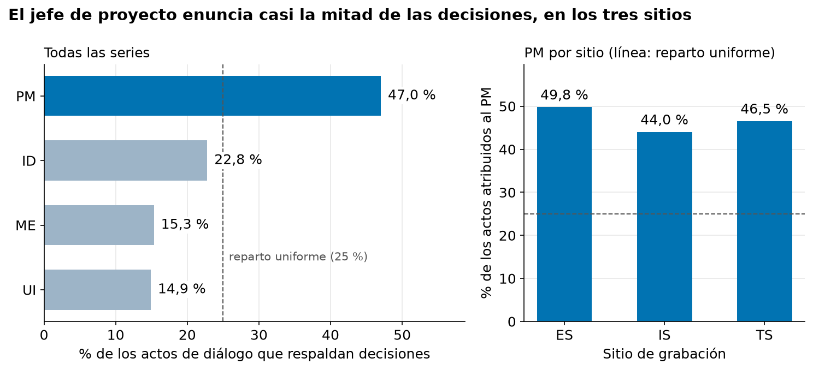
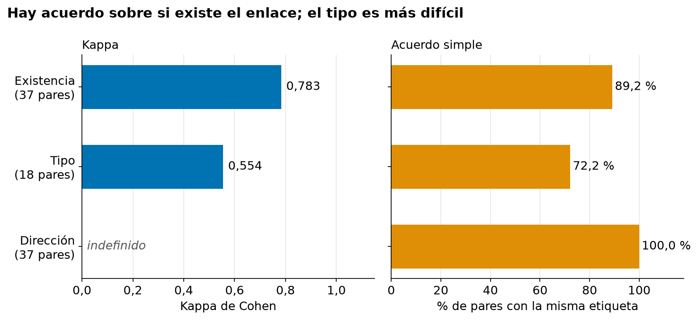
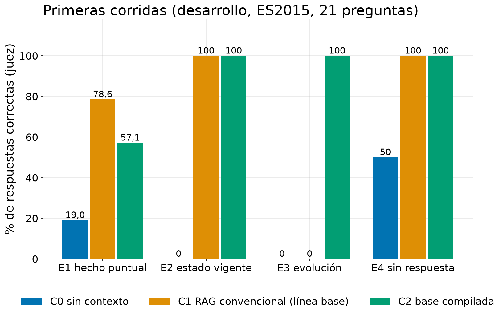

# Pre-informe AFG2

| | |
|---|---|
| **Documento** | 01 — Pre-informe AFG2 |
| **Autores** | Jason Sepúlveda S., Germán Vega, Gustavo Martínez |
| **Versión** | 0.1 (borrador para revisión del equipo) |
| **Fecha** | 2026-11-02 |
| **Estado** | Borrador |

## Historial de versiones

| Versión | Fecha | Cambio | Motivo |
|---|---|---|---|
| 0.1 | 2026-11-02 | Borrador inicial, redactado a partir de los avances 01 a 10 (modelos en su versión 12.0). No se ha enviado. | Pre-informe de AFG2, con entrega el 2026-11-09. |

> **Cómo versionar.** Un cambio de redacción sube el decimal (0.1 → 0.2). Un cambio que
> altera una decisión, un objetivo o una cifra sube el entero y **debe declarar la evidencia
> que lo motivó**. El historial nunca se reescribe: se agrega una fila. El PDF enviado en
> cada entrega se registra aquí, con su fecha y su versión.

---

# Compilar o recuperar: una medición controlada del valor de una base persistente de decisiones frente a un RAG convencional

## 1. Introducción

### 1.1 Tema y relevancia

Las organizaciones graban y transcriben casi todas sus reuniones, pero no por ello recuerdan lo que decidieron. En una serie del corpus usado aquí, el resumen oficial de la cuarta reunión afirma que el equipo eliminó el botón «turbo» de un control remoto; al leer la transcripción completa, el botón se mantuvo. Ese registro daría una respuesta segura, bien redactada y falsa.

La respuesta habitual a «¿qué se decidió sobre X?» es la recuperación aumentada (RAG; Lewis et al., 2020): se buscan los fragmentos más parecidos a la pregunta y un modelo de lenguaje redacta con ellos. Este trabajo mide si conviene compilar las decisiones en una base persistente que registre su evolución, y cuánto cuesta que la construya una máquina que se equivoca. Importa porque un error de extracción en una base compilada se escribe una vez y se lee en cada consulta, y porque la evidencia disponible compara sistemas completos sin separar el valor de la estructura del de quien la construye (Edge et al., 2024).

### 1.2 Objetivos e hipótesis

**Objetivo general.** Diseñar, implementar y evaluar un método de extracción automática y representación persistente de decisiones organizacionales, incluida su evolución entre reuniones, con modelos de lenguaje de ejecución local, para cuantificar por separado el valor del sistema compilado frente a un RAG convencional, el costo de los errores de su extracción y las condiciones en que el resultado neto supera a ese RAG.

- **OE1.** Construir un *ground truth* de decisiones con enlaces de evolución, con confiabilidad medida por kappa de Cohen.
- **OE2.** Medir la calidad de la extracción automática (precision, recall y F1) contra ese *ground truth*.
- **OE3.** Medir la utilidad funcional de tres condiciones (RAG convencional, base de máquina y base humana) sobre un mismo banco de preguntas.
- **OE4.** Atribuir cada error de la base de máquina a su etapa de origen: extracción, recuperación o síntesis.

La hipótesis principal (H1) es que la base compilada supera al RAG convencional en preguntas de evolución de una decisión, con diferencia pequeña o nula en hechos puntuales. Otras tres, declaradas antes de ejecutar nada: la brecha entre base humana y de máquina es mayor en relaciones temporales que en decisiones (H2); la dirección de una relación es un modo de falla dominante (H3); y el RAG da más respuestas seguras pero desactualizadas (H4).

### 1.3 Alcance

AFG2 cierra OE1 y diseña OE2 y OE3; AFG3 agrega OE4 y las conclusiones. **No se ha ejecutado ningún experimento formal**: las series de evaluación están bloqueadas hasta congelar los parámetros.

## 2. Caracterización del problema

### 2.1 Identificación y análisis del problema

Las decisiones se pierden por tres razones: se reparten entre varios turnos (propuesta, objeción, acuerdo implícito); nadie las anuncia, así que nada distingue el pasaje donde se decidió algo de uno donde solo se conversó; y cuando se revisan en una reunión posterior, el cambio no queda escrito en ninguna transcripción. Ni las personas coinciden en qué es una decisión: Hsueh y Moore (2007) encontraron que son solo el 1,4 % de los actos de diálogo del corpus AMI, y Fernández et al. (2008) repitieron la marca con un criterio propio, con un acuerdo peor que el azar (kappa negativo, 12,22 % de solapamiento). Una etiqueta hay que medirla, venga de una persona o de un modelo.

Un RAG tiene aquí tres límites que no se corrigen buscando mejor: no guarda memoria entre consultas; no ve la relación entre dos pasajes lejanos, porque «A revierte a B» es propiedad del par y no de cada fragmento; y recupera trozos de texto, no decisiones. Compilar una base los resuelve, pero un error de extracción persiste y, si nadie lo corrige, termina pareciendo un hecho.

### 2.2 Contextualización en el campo de estudio

Sobre AMI, Hsueh y Moore (2007) y Fernández et al. (2008) intentaron detectar decisiones automáticamente, y Murray et al. (2009) mostraron con personas que reconstruir la historia de una decisión es difícil. GraphRAG (Edge et al., 2024) y LightRAG (Guo et al., 2025) construyen un índice estructurado antes de consultar, pero comparan sistemas completos y no separan el aporte del índice del de quien lo construyó. Los trabajos sobre respuestas que cambian con la fecha (Liska et al., 2022; Vu et al., 2024) sustentan H4, y la memoria organizacional (Walsh y Ungson, 1991) y la racionalidad de diseño (Buckingham Shum y Hammond, 1994) discuten el costo de registrar decisiones.

El vacío es verificable. AMI diseñó una capa de anotación, `decisionlink`, para enlazar decisiones, pero solo enlaza una decisión con una frase del resumen de la *misma* reunión y no distribuye datos: 47 archivos de decisiones, 288 decisiones marcadas y cero enlaces entre ellas. Falta, entonces, una medición controlada que separe el valor de compilar las decisiones frente a un RAG convencional, el costo de los errores de su extracción y la contribución de representar su evolución temporal.

## 3. Caracterización de los datos

### 3.1 Origen, permisos, tipo y relevancia

Los datos son el AMI Meeting Corpus (Carletta et al., 2006): unas 100 horas de reuniones grabadas en tres centros europeos, cerca de dos tercios con un escenario en que un equipo de cuatro personas, cada una con un rol asignado, diseña un control remoto en cuatro reuniones consecutivas. La licencia es CC BY 4.0, que permite usar y redistribuir citando la fuente (AMI Meeting Corpus, s.f.); se verificó en la página oficial y no en los artículos del corpus, que describen un régimen anterior más restrictivo. Los participantes están anonimizados y no se intenta reidentificarlos.

Cada equipo se reúne cuatro veces; ese bloque es una **serie**, la unidad con que se elige y se anota. Una decisión es una frase del apartado de decisiones del resumen, y su evidencia son los actos de diálogo enlazados a ella. De 33 series completas se seleccionaron 14, equilibradas por sitio: 56 reuniones, 343 decisiones y 3.071 pares entre reuniones, de los que un filtro léxico deja 92 para anotación humana (sección 4.3).

### 3.2 Partición y fuga declarada

**Tabla 1.** Partición de las 14 series.

| Partición | Series | Decisiones | Uso |
|---|---|---|---|
| Desarrollo | 3 (ES2015, IS1004, TS3009) | 77 | Ajustar parámetros |
| Evaluación | 11 (4 ES, 4 IS, 3 TS) | 266 | Solo reportar, tras congelar |
| de ellas, doble anotación | 4 (ES2008, ES2016, IS1003, TS3005) | — | Medir confiabilidad (36,4 % de la evaluación) |

Nada se entrena: la partición separa dónde se toman decisiones de diseño de dónde se reportan resultados, y todo lo ajustado en desarrollo se congela antes de tocar evaluación. Existe una **fuga declarada**: dos umbrales con que el motor de extracción parte las fuentes largas se fijaron en agosto de 2026 con mediciones sobre una serie de evaluación (TS3005); lo medido fue si la llamada al modelo colapsaba, no si lo extraído coincidía con el *ground truth*.

### 3.3 Calidad y limitaciones

**Calidad.** De 77 variables, solo tres tienen celdas vacías: hora de inicio (32 de 56 reuniones, 57,1 %), lengua materna (64 de 224 hablantes, 28,6 %) y evidencia de la decisión (26 de 343, 7,6 %); los dos primeros son estructurales, pues vienen de cómo AMI armó sus archivos. No se imputa nada: estimar la evidencia de una decisión fabricaría un respaldo inexistente. Hay 4 frases idénticas y 8 casi idénticas, siempre en reuniones consecutivas (decisiones reafirmadas); se conservan con una marca. De 56 reuniones, 15 quedaron señaladas como atípicas y todas se conservaron por ser fenómenos reales; 317 de 343 decisiones (92,4 %) tienen evidencia en un acto de diálogo.

**Limitaciones.** (i) *Dominio único* y *habla actuada*: no se afirma generalización, y las consecuencias de las decisiones son simuladas. (ii) *El material de origen contiene errores*, como el resumen del botón turbo; se contrasta contra la transcripción. (iii) *Lengua y sitio van juntos*: de 189 participantes, 91 son nativos de inglés, 96 no nativos y 2 desconocidos, y en un sitio ninguno está registrado; se balancea por sitio. (iv) *Referencia traducida* al inglés para comparar texto con texto; la traducción nunca es una etiqueta. (v) *Muestra no aleatoria*: los resultados describen estas 14 series.

## 4. Análisis exploratorio de datos

### 4.1 Patrones, tendencias y anomalías

La primera reunión de la serie es distinta de las otras tres: la mediana es de 3,5 decisiones en la reunión a, frente a 8,0, 6,5 y 7,0 en b, c y d, y la reunión a aporta 51 de las 343 decisiones (14,9 %). Una serie completa excede entre 1,6 y 2,8 veces la ventana de 12.288 tokens del modelo, de modo que ninguno puede leerla entera.

Entre las anomalías, las decisiones sin evidencia no se distribuyen al azar: son 0 de 51 en la reunión a, 4,7 % en b, 11,2 % en c y 11,5 % en d. Esa señal anticipó el error del botón turbo, que la detección estadística de atípicos no encuentra: halla anomalías de tamaño, no de sentido.

### 4.2 Sesgo por rol del hablante

Cada participante tiene un rol: jefe de proyecto (PM), diseñador industrial (ID), experto en marketing (ME) y diseñador de interfaz (UI). La Figura 1 muestra quién enuncia las decisiones.

**Figura 1.** Porcentaje de los actos de diálogo que respaldan decisiones, por rol (izquierda, 685 actos en las 14 series), y porcentaje atribuido al PM en cada sitio (derecha). La línea punteada es el reparto uniforme.

El PM respalda el 47,0 % de los actos, casi el doble de un reparto uniforme; siguen ID (22,8 %), ME (15,3 %) y UI (14,9 %). En cada sitio el PM se mantiene entre 44 % y 50 %, lo que sugiere un rasgo del escenario, aunque está mezclado con su mayor volumen de habla. Si el sistema recuperara mejor lo que dice quien preside, el diseñador que propuso una idea desaparecería del registro: amplificaría la jerarquía. Por eso se mide la amplificación por rol (proporción del rol entre lo que el sistema recupera, sobre su proporción en el corpus; 1 significa que refleja la fuente) y los resultados se publican solo agregados por categoría.

### 4.3 El filtro léxico y su recall

Anotar a mano los 3.071 pares tomaría unas 77 horas y casi todos no se relacionan, así que un filtro léxico conserva los pares con *overlap coefficient* (palabras compartidas sobre las de la frase más corta) de al menos 0,30 y al menos 2 palabras de contenido en común: el coeficiente solo deja 712 pares (23,2 %) y con el mínimo absoluto quedan 92 (3,0 %, unas 2,3 horas). Se prefirió a Jaccard porque una reversión suele ser una frase corta que apunta a una larga: sobre el par de control del botón turbo Jaccard da 0,118 y lo pierde, y el *overlap coefficient* da 0,400.

El filtro tiene un sesgo medido: si la decisión más corta del par tiene 2 o 3 palabras, deja pasar apenas 0,3 % y 2,0 % de los pares, frente a 36,6 % y 42,1 % con el coeficiente solo, y probablemente descarta relaciones reales entre frases muy cortas. Por eso 92 es lo máximo que deja anotar, no el número de relaciones del corpus. Su *recall* se medirá con 200 pares rechazados (tres series ya anotadas); la cifra aún no se reporta.

## 5. Modelo de aprendizaje de máquinas

### 5.1 Qué es «el modelo» y qué condiciones se comparan

El proyecto **no entrena ningún modelo**: los modelos de lenguaje (LLM) ya vienen entrenados y se ejecutan en un computador propio con Ollama, de modo que ningún dato sale de la máquina. Se evalúa si una forma de organizar la información responde mejor que otra, así que «el modelo» es el *pipeline* completo de cada condición; el juez es un instrumento de medida. OpenKOS, que compila y consulta la base, es un programa de código abierto desarrollado antes por un integrante del equipo: es el instrumento, no un aporte de la tesis.

**Tabla 2.** Las cuatro condiciones, con el mismo generador, *embeddings*, hardware y ventana de contexto.

| | Qué hace | Papel |
|---|---|---|
| C0 | El modelo responde sin texto de apoyo | Referencia descriptiva |
| C1 | RAG convencional: texto Markdown cortado con un divisor genérico; búsqueda híbrida léxica y densa; una llamada con *prompt* genérico | **Línea base** |
| C2 | Base compilada por máquina con OpenKOS 0.7.0 | Propuesta evaluada |
| C3 | La misma base, construida desde el *ground truth* adjudicado | Referencia superior |

La distancia entre C1 y C3 mide el valor del sistema compilado; la de C3 a C2, que usan el mismo sistema, el costo de los errores de la máquina. Como C1 y C2/C3 difieren también en la etapa de respuesta, su diferencia no puede repartirse entre representación y respuesta (limitación declarada). C3 aún no puede ejecutarse: el *ground truth* está adjudicado para 6 de las 14 series.

### 5.2 Modelos, parámetros y su justificación

Los cinco roles de modelo y sus candidatos están en el Anexo A. El **generador** es `qwen3:8b` en todas las condiciones, porque la regla del mismo modelo generativo lo exige, corre en local y es el de OpenKOS; los *embeddings* son `bge-m3`, multilingües, heredados de OpenKOS. El **extractor** `qwen3:8b` se eligió con un tamizaje de cuatro modelos con reglas fijadas antes de correr: `qwen3.6:27b` mejora el F1 de decisiones con τ = 0,60, pero tarda 3,6 y 1,8 veces más y no es el modelo del producto evaluado, de modo que usarlo modificaría el sistema que se mide. La verificación de suficiencia (decidir si el contexto alcanza para responder) usa `gemma4:26b-a4b`, empaquetado en OpenKOS (solo C2 y C3). El **juez** es `gpt-oss:20b`, elegido entre tres candidatos con seis umbrales fijados antes de correr; es de otra familia que el generador, porque los modelos tienden a favorecer sus propias respuestas (Panickssery et al., 2024) y los jueces tienen otros sesgos (Wang et al., 2024), aunque pueden funcionar (Zheng et al., 2023).

Para C1 se hizo una grilla de 32 configuraciones con regla fijada antes de ver resultados y como métrica el recall de la evidencia que de verdad llega al modelo, sobre 17 preguntas de desarrollo. El umbral τ, que decide si una decisión extraída es «la misma» que una de referencia, se fijó en 0,70 (sensibilidad 0,75 y 0,80) y el F1 se reporta como curva; como el juez fue más estricto que una persona (43 de 50 pares, 86 %, kappa 0,716), las cifras de alineación son un piso conservador. Temperatura (0,1), semilla (42), ventana (12.288 tokens) y 3 corridas por configuración se fijaron por diseño. Las librerías son Ollama, OpenKOS 0.7.0, un BM25 propio y un divisor de texto genérico; el análisis usa pandas, scipy y scikit-learn (con algoritmo húngaro para el emparejamiento), y sentence-transformers es una dependencia opcional del alineamiento.

### 5.3 Métricas y criterio de éxito

OE1 se mide con kappa de Cohen en existencia, tipo y dirección por separado, sin umbral. OE2, con precision, recall y F1 como curva sobre τ de 0,50 a 0,90, y con existencia, tipo y dirección de las relaciones. OE3, con la corrección de la respuesta calificada por el juez, por estrato: hecho puntual (E1), estado vigente (E2), evolución (E3) y sin respuesta (E4). OE4, con reglas fijas de una sola categoría por error.

El éxito se juzga con una sola comparación fijada de antemano (D16): la corrección en E3 de C2 frente a C1, con el intervalo *bootstrap* del 95 % (10.000 remuestreos) de la diferencia pareada por pregunta. Si queda por completo sobre 0, H1 queda respaldada; si incluye el 0, es no concluyente y nunca se reporta como éxito; si queda bajo 0, es contrario. Personas revisan además el 20 % de las respuestas (kappa mínimo 0,70 frente al juez).

### 5.4 Línea base

La línea base es **C1**, un RAG convencional híbrido: es lo que cualquier organización haría hoy y se ajustó con datos para que no sea débil. **C0** es una referencia descriptiva: indica cuánto aporta recuperar texto (C1 frente a C0) y cuánto la base compilada frente a no recuperar nada (C2 frente a C0). La mejora de AFG3 se medirá con la métrica del criterio de éxito: la diferencia pareada de corrección en E3 entre C2 y C1 y su intervalo del 95 %, con la brecha en E1 como lectura descriptiva (hoy C2 queda por debajo en E1, sección 6.2). La extracción no tiene línea base comparativa y su avance se leerá en la curva de F1 sobre τ.

## 6. Resultados preliminares

**Solo desarrollo: una serie, 21 preguntas, una corrida. Estas cifras indican una dirección, no una magnitud, y ninguna es un resultado de la tesis.**

### 6.1 Confiabilidad de la referencia (OE1)

Dos personas anotaron por separado y una tercera resolvió cada desacuerdo. La Figura 2 reporta la Fase 2 (cuatro series de control). El kappa de la Fase 1 no se reporta: fue una calibración diagnóstica con la guía aún en ajuste, que mediría la guía sin pulir y no la referencia final.

**Figura 2.** Acuerdo entre las dos personas que anotan, Fase 2 (cuatro series de control). Izquierda: kappa de Cohen. Derecha: porcentaje de pares con la misma etiqueta.

Las dos personas coinciden en si dos decisiones están enlazadas (kappa de 0,783; acuerdo de 89,2 % en 37 pares) y menos en la clase de enlace (kappa de 0,554; 72,2 % en 18 pares): en la escala convencional de lectura, que es solo una ayuda, sustancial y moderado. La dirección no tiene kappa: en los 37 pares ambas marcaron la misma y, con un solo valor posible, el kappa no existe. Las muestras son pequeñas y una sola persona adjudica.

### 6.2 Línea base y primeras corridas

Se corrieron C0 (3 corridas), C1 y C2 (una cada una) sobre las 21 preguntas de calibración de ES2015, con el mismo juez (Figura 3).

**Figura 3.** Corrección por estrato en C0 (sin contexto), C1 (RAG convencional, línea base) y C2 (base compilada). Desarrollo, ES2015, 21 preguntas.

Sin contexto el modelo acierta el 22,2 % (14 de 63 respuestas); con la recuperación de C1 sube a 81,0 % (17 de 21); C2 queda en 71,4 % (15 de 21). En hecho puntual (E1), C1 acierta 11 de 14 (78,6 %) y C2 8 de 14 (57,1 %). En E2 y E4 C1 y C2 aciertan todo; C0 acierta la mitad de E4 porque el juez acepta una respuesta que admite no saber. En evolución (E3) hay una sola pregunta, que C2 acierta y C1 no: nada puede decirse sobre lo que la tesis quiere probar. C2 queda bajo la línea base en E1, donde H1 esperaba paridad, sobre todo por callar: de sus 6 fallas, 4 son abstenciones, decididas por la verificación de suficiencia, un paso que C1 no tiene.

### 6.3 Evidencia sobre las decisiones de diseño y atribución del error

La ablación de C1 muestra que combinar canales aporta más que cada uno por separado: el recall de la evidencia entregada es 0,314 con solo búsqueda léxica, 0,456 con solo búsqueda densa y 0,520 con la combinación, lo que justifica una línea base híbrida. En ES2015 la máquina extrae entre 69 y 71 decisiones por corrida frente a 27 del *ground truth*, unas 2,6 veces más, lo que apunta a una precision baja más que a un recall bajo; en relaciones, con solo 9 de referencia, casi ningún enlace de la máquina cae sobre decisiones alineadas (en ES2015, 1 de 75).

De las 6 respuestas erróneas de C2 en E1, una persona atribuyó 3 a la recuperación (el hecho estaba en la base y no se trajo), 2 a la extracción (nunca se compiló) y 1 a la síntesis (llegó el material correcto y la respuesta lo mezcló con otro). Una es un caso de memoria contaminada: la extracción guardó como decisión una propuesta descartada por el equipo, y esa entrada se recuperó, se citó y desplazó a la decisión correcta.

## 7. Discusión y conclusiones

### 7.1 Discusión frente a la literatura

Que recuperar texto suba la corrección de 22,2 % a 81,0 % es coherente con la premisa del RAG (Lewis et al., 2020). La literatura de índices estructurados (Edge et al., 2024; Guo et al., 2025) no separa cuánto de su ventaja viene de la representación y cuánto de quien la construye; C3 sí lo separa. El kappa de existencia (0,783) no es comparable punto a punto con el negativo de Fernández et al. (2008), pero muestra que con guía y adjudicación sí hay acuerdo. La sobreextracción y la memoria contaminada ilustran un riesgo descrito: un error de extracción se propaga a todo lo calculado después (Cai y O'Connor, 2025) y una memoria puede contaminarse con lo que la máquina anotó mal (Zhang y Li, 2026).

### 7.2 Aprendizajes, fallas, riesgos y limitaciones

**El recorte de contexto invalidó una medición propia:** el primer ajuste de C1 eligió una configuración con recall recuperado de 0,642, pero al modelo le llegaba 0,446, porque el motor recorta el contexto; se repitió contando el texto que de verdad llega. **Las muestras pequeñas ocultan fragilidad:** con 5 corridas el extractor base no falló ninguna reunión en una serie (0 de 20); con 15 fallaron 6 de 60. **El juez no es perfecto:** es indulgente con lo genérico y estricto con lo parcial, y su calibración pudo quedar algo inflada; la salvaguarda es la revisión humana del 20 %.

Los riesgos y limitaciones, con su mitigación, están en la Tabla A4 (Anexo A): dominio único, referencia traducida, C1 − C2 sin separar representación de respuesta, fuga declarada, baja potencia en E3, sesgos del juez y pérdida de relaciones en el filtro.

### 7.3 Ética integrada

Tres principios organizan el trabajo, y cada uno se traduce en algo que se mide. *Transparencia*: toda decisión conserva el fragmento que la respalda, y una afirmación sin fuente cuenta como falla aunque sea correcta. *Equidad*: el sesgo por rol se mide como amplificación frente al corpus, y el eje nativo/no-nativo queda como limitación por no ser separable del sitio. *Responsabilidad*: la cifra principal de OE4 es la proporción de errores atribuibles a la extracción, el que persiste. La ejecución local es un requisito de diseño, porque una organización real no subiría deliberaciones internas a un servicio externo. El marco de riesgos es el del NIST (Tabassi, 2023).

### 7.4 Conclusiones y próximos pasos

Con la evidencia de desarrollo pueden afirmarse tres cosas: la referencia de OE1 es confiable en existencia y moderadamente estable en tipo; recuperar texto aporta mucho frente a no recuperar; y la base compilada pierde frente al RAG en hechos puntuales, con fallas repartidas entre recuperación, extracción y síntesis. Nada puede afirmarse sobre evolución.

Los pasos siguientes son congelar los parámetros, ejecutar una corrida formal sobre las series de evaluación, completar la adjudicación y con ella C3, y medir OE2, OE3 y OE4. Un resultado negativo seguiría siendo informativo: si un RAG convencional iguala al sistema compilado incluso en evolución, sería la primera medición controlada que acota el valor de compilar en este dominio.

## Referencias

AMI Meeting Corpus. (s.f.). *Licence* [Página web]. University of Edinburgh. Recuperado el 20 de septiembre de 2026, de https://groups.inf.ed.ac.uk/ami/corpus/license.shtml

Buckingham Shum, S. J., & Hammond, N. (1994). Argumentation-based design rationale: What use at what cost? *International Journal of Human-Computer Studies*, *40*(4), 603–652. https://doi.org/10.1006/ijhc.1994.1029

Cai, E., & O'Connor, B. (2025). *Understanding the effect of knowledge graph extraction error on downstream graph analyses: A case study on affiliation graphs* (arXiv:2506.12367) [Preprint, sin revisión por pares]. https://doi.org/10.48550/arXiv.2506.12367

Carletta, J., Ashby, S., Bourban, S., Flynn, M., Guillemot, M., Hain, T., Kadlec, J., Karaiskos, V., Kraaij, W., Kronenthal, M., Lathoud, G., Lincoln, M., Lisowska, A., McCowan, I., Post, W., Reidsma, D., & Wellner, P. (2006). The AMI Meeting Corpus: A pre-announcement. En *Machine Learning for Multimodal Interaction (MLMI 2005)* (Lecture Notes in Computer Science, vol. 3869, pp. 28–39). Springer. https://doi.org/10.1007/11677482_3

Edge, D., Trinh, H., Cheng, N., Bradley, J., Chao, A., Mody, A., Truitt, S., Metropolitansky, D., Ness, R. O., & Larson, J. (2024). *From local to global: A graph RAG approach to query-focused summarization* (arXiv:2404.16130) [Preprint, sin revisión por pares]. https://doi.org/10.48550/arXiv.2404.16130

Fernández, R., Frampton, M., Ehlen, P., Purver, M., & Peters, S. (2008). Modelling and detecting decisions in multi-party dialogue. En *Proceedings of the 9th SIGdial Workshop on Discourse and Dialogue* (pp. 156–163). Association for Computational Linguistics.

Guo, Z., Xia, L., Yu, Y., Ao, T., & Huang, C. (2025). LightRAG: Simple and fast retrieval-augmented generation. En *Findings of the Association for Computational Linguistics: EMNLP 2025* (pp. 10746–10761). Association for Computational Linguistics. https://doi.org/10.18653/v1/2025.findings-emnlp.568

Hsueh, P.-Y., & Moore, J. D. (2007). What decisions have you made? Automatic decision detection in meeting conversations. En *Proceedings of NAACL-HLT 2007* (pp. 25–32). Association for Computational Linguistics.

Lewis, P., Perez, E., Piktus, A., Petroni, F., Karpukhin, V., Goyal, N., Küttler, H., Lewis, M., Yih, W., Rocktäschel, T., Riedel, S., & Kiela, D. (2020). Retrieval-augmented generation for knowledge-intensive NLP tasks. En *Advances in Neural Information Processing Systems 33* (pp. 9459–9474).

Liska, A., Kocisky, T., Gribovskaya, E., Terzi, T., Sezener, E., Agrawal, D., de Masson d'Autume, C., Scholtes, T., Zaheer, M., Young, S., Molloy, R., Lazaridou, A., & Blunsom, P. (2022). StreamingQA: A benchmark for adaptation to new knowledge over time in question answering models. En *Proceedings of the 39th International Conference on Machine Learning (ICML 2022)* (PMLR, vol. 162, pp. 13604–13622).

Murray, G., Kleinbauer, T., Poller, P., Becker, T., Renals, S., & Kilgour, J. (2009). Extrinsic summarization evaluation: A decision audit task. *ACM Transactions on Speech and Language Processing*, *6*(2).

Panickssery, A., Bowman, S. R., & Feng, S. (2024). LLM evaluators recognize and favor their own generations. En *Advances in Neural Information Processing Systems 37 (NeurIPS 2024)* (pp. 68772–68802).

Tabassi, E. (2023). *Artificial intelligence risk management framework (AI RMF 1.0)* (NIST AI 100-1). National Institute of Standards and Technology. https://doi.org/10.6028/NIST.AI.100-1

Vu, T., Iyyer, M., Wang, X., Constant, N., Wei, J., Wei, J., Tar, C., Sung, Y.-H., Zhou, D., Le, Q., & Luong, T. (2024). FreshLLMs: Refreshing large language models with search engine augmentation. En *Findings of the Association for Computational Linguistics: ACL 2024* (pp. 13697–13720). Association for Computational Linguistics. https://doi.org/10.18653/v1/2024.findings-acl.813

Walsh, J. P., & Ungson, G. R. (1991). Organizational memory. *Academy of Management Review*, *16*(1), 57–91. https://doi.org/10.5465/amr.1991.4278992

Wang, P., Li, L., Chen, L., Cai, Z., Zhu, D., Lin, B., Cao, Y., Liu, Q., Liu, T., & Sui, Z. (2024). Large language models are not fair evaluators. En *Proceedings of the 62nd Annual Meeting of the Association for Computational Linguistics (ACL 2024)* (pp. 9440–9450). Association for Computational Linguistics. https://doi.org/10.18653/v1/2024.acl-long.511

Zhang, Y., & Li, S. (2026). *ConsistencyGate: Preventing memory contamination in LLM agents via self-consistency admission control* (arXiv:2607.22962) [Preprint, sin revisión por pares]. https://doi.org/10.48550/arXiv.2607.22962

Zheng, L., Chiang, W.-L., Sheng, Y., Zhuang, S., Wu, Z., Zhuang, Y., Lin, Z., Li, Z., Li, D., Xing, E. P., Zhang, H., Gonzalez, J. E., & Stoica, I. (2023). Judging LLM-as-a-judge with MT-Bench and Chatbot Arena. En *Advances in Neural Information Processing Systems 36 (NeurIPS 2023), Datasets and Benchmarks Track* (pp. 46595–46623).

---

## Anexo A. Modelos por rol y candidatos evaluados

**Tabla A1.** Modelos por rol.

| Rol | Modelo | ¿Se comparó con alternativas? | Fundamento |
|---|---|---|---|
| Generador de respuestas (C0 a C3) | `qwen3:8b` | No | Regla del mismo modelo generativo; local; modelo por defecto de OpenKOS |
| *Embeddings* (recuperación y alineamiento) | `bge-m3` | No | Multilingüe; adoptado por OpenKOS por fiabilidad en documentos largos |
| Extractor de la base compilada (C2, C3) | `qwen3:8b` con pasada de decisiones | Sí: tamizaje de cuatro modelos | Reglas fijadas antes de correr; costo; es el modelo del producto evaluado |
| Verificación de suficiencia (C2, C3) | `gemma4:26b-a4b` | No | Empaquetado en OpenKOS 0.7.0; C1 no tiene este paso |
| Juez (LLM-as-a-judge) | `gpt-oss:20b` | Sí: calibración de tres candidatos | Umbrales fijados antes de correr; familia distinta del generador |

**Tabla A2.** Tamizaje del extractor: F1 de decisiones con τ = 0,60, cinco corridas por modelo y serie.

| Modelo | F1 en ES2015 | F1 en TS3009 | Resultado |
|---|---|---|---|
| `qwen3:8b` | 0,290 | 0,300 | Elegido (modelo del producto) |
| `qwen3:14b` | 0,387 | 0,493 | No avanza (margen en ES2015: 0,097 de 0,099 exigidos) |
| `qwen3.6:27b` | 0,485 | 0,457 | Avanza; descartado por costo y por no ser el modelo del producto |
| `qwen3.6:35b-a3b` | 0,461 | 0,405 | Avanza; no pasa la confirmación con 15 corridas |

**Tabla A3.** Calibración del juez sobre 42 respuestas etiquetadas.

| Candidato | Kappa con personas (umbral ≥ 0,70) | Consistencia ante el orden (≥ 0,90) | Latencia por llamada | Resultado |
|---|---|---|---|---|
| `mistral-small3.2:24b` | 0,951 | 0,952 | 5,5 s | Cumple todo |
| `atla/selene-mini:q8_0` | 0,485 | 0,738 | 3,0 s | Falla kappa y orden |
| `gpt-oss:20b` | 0,951 | 0,952 | 3,2 s | Cumple todo; gana por rapidez |

**Tabla A4.** Riesgos declarados y su tratamiento.

| Riesgo o limitación | Mitigación |
|---|---|
| Dominio único; habla actuada | No se afirma generalización; las decisiones son reales como actos de conversación |
| Referencia traducida del español al inglés | La traducción nunca es una etiqueta; τ se calibró después de traducir |
| C1 − C2 no separa representación de etapa de respuesta | Se declara; C2 − C3 no tiene esta limitación; una cuarta condición se descartó por costo |
| Fuga: dos umbrales de troceo medidos con una serie de evaluación | Lo medido fue un colapso, no un acierto; se declara |
| Poca potencia: con 25 preguntas en E3 y mejora de 0,15, el criterio detecta 57,5 % | Intervalos pareados; lo no concluyente no se reporta como éxito |
| Juez indulgente con lo genérico y estricto con lo parcial | Juez de otra familia; revisión humana del 20 % con kappa ≥ 0,70 |
| El filtro pierde relaciones entre frases cortas | Declarado; se mide su recall con 200 pares rechazados |

## Anexo B. Glosario breve

| Término | Significado en este documento |
|---|---|
| Serie | Cuatro reuniones consecutivas del mismo equipo; unidad de selección y de anotación |
| *Ground truth* | Decisiones y relaciones marcadas a mano, contra las que se mide todo lo demás |
| RAG | Recuperación aumentada: buscar fragmentos parecidos a la pregunta y redactar con ellos |
| Kappa de Cohen | Acuerdo entre dos anotadores descontando el azar; 0 es azar, 1 es acuerdo total |
| τ | Umbral de similitud con que una decisión extraída se considera «la misma» que una de referencia |
| Filtro léxico (*blocking*) | Regla automática que reduce los pares a anotar según las palabras que comparten |
| *Bootstrap* | Repetir un cálculo sobre muestras al azar del mismo conjunto para estimar su variación |
| E1 a E4 | Estratos de preguntas: hecho puntual, estado vigente, evolución y sin respuesta |

## Anexo C. Trazabilidad (uso interno del equipo)

Cada cifra del informe proviene de un avance; ninguna se calculó aquí.

| Cifra o afirmación | Sección del informe | Avance y sección |
|---|---|---|
| 1,4 % de actos de decisión; kappa negativo; 12,22 % | 2.1 | 01, §3 |
| 47 archivos, 288 decisiones, 0 enlaces | 2.2 | 01, §4 |
| Licencia CC BY 4.0; ~100 horas; dos tercios del escenario | 3.1 | 02, §1 |
| 14 series, 56 reuniones, 343 decisiones, 3.071 pares, 92 candidatos; 33 series completas | 3.1 | 02, §4.1 a §4.4 |
| 77 variables; 25.857 turnos | 3.1 | 07, §2 y §3 |
| Partición 3 / 11; 77 / 266 decisiones; 11 / 81 candidatos; 36,4 % | 3.2 | 02, §4.3 |
| Fuga: dos umbrales de troceo medidos con TS3005 | 3.2 | 09, §4.2 |
| Faltantes 32/56, 64/224, 26/343; duplicados 4 y 8; 15 de 56 atípicas; 317/343 | 3.3 | 07, §4 y §5; 02, §4.7 |
| 189 participantes: 91 / 96 / 2 | 3.3 | 02, §4.5 |
| Mediana de decisiones 3,5 / 8,0 / 6,5 / 7,0; 51 de 343 (14,9 %) | 4.1 | 07, §6.2 |
| 6,1 palabras; 1,6 a 2,8 veces la ventana; 12.288 tokens | 4.1 | 07, §6.1 y §8; 09, §3 |
| PM 47,0 %, ID 22,8 %, ME 15,3 %, UI 14,9 %; 685 actos; 44 % a 50 % | 4.2 | 02, §4.6; 07, §6.1; 05, §2 |
| Sin evidencia 0 de 51 / 4,7 % / 11,2 % / 11,5 % | 4.1 | 07, §4.1 y §5 |
| Filtro: 712 (23,2 %), 92 (3,0 %), 77 h y 2,3 h; 0,118 y 0,400; 36,6 % y 42,1 %; 0,3 % y 2,0 %; 200 pares | 4.3 | 07, §7; 08, §4.2 |
| Tamizaje de modelos: F1, tiempos 3,6 y 1,8 veces | 5.2, Anexo A | 09, §6.2 |
| Juez: 42 respuestas, kappa 0,951; 43 de 50 (86 %), kappa 0,716 | 5.2, Anexo A | 09, §6.3, §7.3 |
| Grilla de 32 configuraciones (26 caben), 17 preguntas | 5.2 | 09, §7.1 |
| τ 0,70 / 0,75 / 0,80; 200 pares; 32 % y 76 % | 5.2 | 09, §7.3 |
| Temperatura 0,1; semilla 42; 3 corridas | 5.2 | 09, §5.1 |
| Criterio D16; 10.000 remuestreos; 57,5 % y 10,4 %; kappa ≥ 0,70 con revisión del 20 % | 5.3, Anexo A | 08, §5 y §6; 09, §2.1 |
| Fase 2: 37 pares, 89,2 %, 0,783; 18 pares, 72,2 %, 0,554; dirección 37 pares, 100 % | 6.1 | 10 |
| C0 22,2 % (14/63); C1 81,0 % (17/21); C2 71,4 % (15/21); estratos; 4 abstenciones; 8 abstenciones | 6.2 | 09, §8.1 y §8.2 |
| Ablación 0,314 / 0,456 / 0,520; configuración de grilla ganadora | 6.3 | 09, §7.1 y §7.2 |
| 69 a 71 decisiones frente a 27 (2,6 veces); 9 relaciones; 1 de 75 | 6.3 | 09, §2.2; 08, §4.3 |
| OE4: 3 / 2 / 1 de 6; memoria contaminada | 6.3 | 09, §8.4 |
| 0,642 recuperado y 0,446 entregado; 0 de 20 y 6 de 60 | 7.2 | 09, §10 (dificultades 1 y 7) |

**Referencias con verificación pendiente** (el avance 04 las declara contrastadas con fuente primaria; el equipo pidió reconfirmarlas antes del envío): arXiv.2607.22962 (Zhang y Li, 2026) y arXiv.2506.12367 (Cai y O'Connor, 2025). La referencia con DOI 10.1145/3785010 (Zhou et al., 2026) está en la bibliografía del avance 04 pero no se cita en el cuerpo; si se reincorpora, reconfirmarla.

**Pendientes de redacción para el equipo.**

- OpenKOS no tiene una referencia citable en el avance 04 (solo la especificación OKF del formato, que no se cita en el cuerpo); si existe un repositorio o artículo citable, agregarlo.
- La escala de lectura del kappa (Sección 6.1) se menciona sin autor porque el avance 04 no incluye Landis y Koch; si se quiere citar, agregar la referencia.
- El encuadre de «el modelo» como *pipeline* (Sección 5.1) y la presentación de solo resultados de desarrollo siguen pendientes de confirmación con el tutor (avance 09, §1).
- El recall del filtro léxico (Sección 4.3) y la adjudicación completa del *ground truth* (Sección 5.1) están en curso; actualizar antes del envío.
