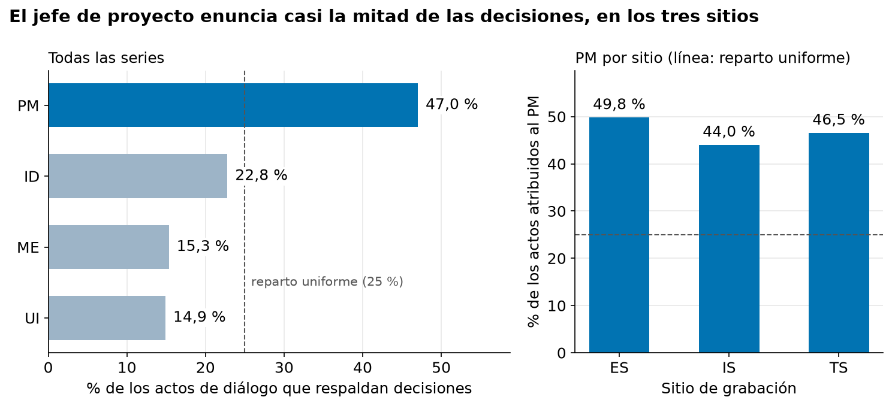
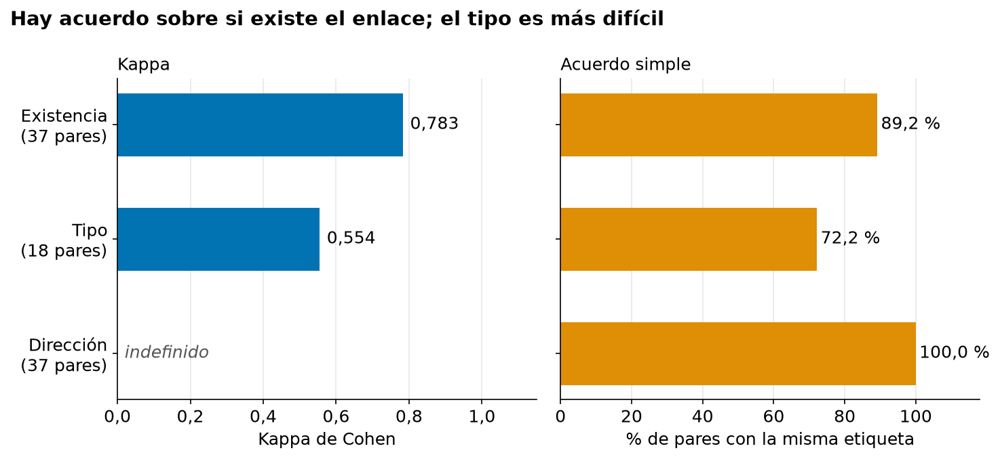

# Pre-informe AFG2 (después de los experimentos)

| | |
|---|---|
| **Documento** | 02 — Pre-informe AFG2, redactado después de los experimentos formales |
| **Autores** | Jason Sepúlveda S., Germán Vega, Gustavo Martínez |
| **Versión** | 0.2 (borrador para revisión del equipo) |
| **Fecha** | 2026-11-07 |
| **Estado** | Borrador |

## Historial de versiones

| Versión | Fecha | Cambio | Motivo |
|---|---|---|---|
| 0.1 | 2026-11-07 | Borrador inicial, redactado a partir de los avances 01 a 13 (en particular 10 a 13) y de las tablas finales. Documento aparte del [pre-informe 01](01-jss-pre-informe.md), que se escribió antes de los experimentos y no se modifica. No se ha enviado. | Las dos corridas formales, las verificaciones humanas y las conclusiones quedaron completas (épica #288); el pre-informe de AFG2 se entrega el 2026-11-09 y debe reportar resultados formales y no preliminares. |
| 0.2 | 2026-11-07 | Se verifican en arXiv las dos referencias pendientes heredadas del 01 (título, autores y DOI coinciden; siguen como *preprint*) y la cita de OpenKOS apunta a la publicación de v0.7.0. | Pendientes de verificación heredados del pre-informe 01. |

> **Cómo versionar.** Un cambio de redacción sube el decimal (0.1 → 0.2). Un cambio que
> altera una decisión, un objetivo o una cifra sube el entero y **debe declarar la evidencia
> que lo motivó**. El historial nunca se reescribe: se agrega una fila. El PDF enviado en
> cada entrega se registra aquí, con su fecha y su versión.

---

# Compilar o recuperar: una medición controlada del valor de una base persistente de decisiones frente a un RAG convencional

## 1. Introducción

### 1.1 Tema y relevancia

Las organizaciones graban y transcriben casi todas sus reuniones, pero no por ello recuerdan lo que decidieron. En una serie del corpus usado aquí, el resumen oficial de la cuarta reunión afirma que el equipo eliminó el botón «turbo» de un control remoto; al leer la transcripción completa, el botón se mantuvo. Ese registro daría una respuesta segura, bien redactada y falsa.

La respuesta habitual a «¿qué se decidió sobre X?» es la recuperación aumentada (RAG; Lewis et al., 2020): se buscan los fragmentos más parecidos a la pregunta y un modelo de lenguaje redacta con ellos. Este trabajo mide si conviene compilar las decisiones en una base persistente que registre su evolución, y cuánto cuesta que la construya una máquina que se equivoca. Importa porque un error de extracción en una base compilada se escribe una vez y se lee en cada consulta, y porque la evidencia disponible compara sistemas completos sin separar el valor de la estructura del de quien la construye (Edge et al., 2024).

### 1.2 Objetivos e hipótesis

**Objetivo general.** Diseñar, implementar y evaluar un método de extracción automática y representación persistente de decisiones organizacionales, incluida su evolución entre reuniones, con modelos de lenguaje de ejecución local, para cuantificar por separado el valor del sistema compilado frente a un RAG convencional, el costo de los errores de su extracción y las condiciones en que el resultado neto supera a ese RAG.

- **OE1.** Construir un *ground truth* de decisiones con enlaces de evolución, con confiabilidad medida por kappa de Cohen.
- **OE2.** Medir la calidad de la extracción automática (precision, recall y F1) contra ese *ground truth*.
- **OE3.** Medir la utilidad funcional de tres condiciones (RAG convencional, base de máquina y base con decisiones humanas) sobre un mismo banco de preguntas.
- **OE4.** Atribuir cada error de la base de máquina a su etapa de origen: extracción, recuperación o síntesis.

La hipótesis principal (H1) es que la base compilada supera al RAG convencional en preguntas de evolución de una decisión, con diferencia pequeña o nula en hechos puntuales. Otras tres, declaradas antes de ejecutar nada: la brecha entre base humana y de máquina es mayor en relaciones temporales que en decisiones (H2); la dirección de una relación es un modo de falla dominante (H3); y el RAG da más respuestas seguras pero desactualizadas (H4).

### 1.3 Alcance

Este documento reporta los cuatro objetivos medidos. La referencia humana (OE1) está cerrada para las 14 series. Los experimentos formales se corrieron una vez cada uno sobre las 11 series de evaluación, con un solo modelo local pequeño: el Experimento A mide la extracción (OE2) y el B, la respuesta a preguntas y la atribución de errores (OE3 y OE4). Las cifras describen ese caso y no se generalizan.

## 2. Caracterización del problema

### 2.1 Identificación y análisis del problema

Las decisiones se pierden por tres razones: se reparten entre varios turnos (propuesta, objeción, acuerdo implícito); nadie las anuncia, así que nada distingue el pasaje donde se decidió algo de uno donde solo se conversó; y cuando se revisan en una reunión posterior, el cambio no queda escrito en ninguna transcripción. Ni las personas coinciden en qué es una decisión: Hsueh y Moore (2007) encontraron que son solo el 1,4 % de los actos de diálogo del corpus AMI, y Fernández et al. (2008) repitieron la marca con un criterio propio, con un acuerdo peor que el azar (kappa negativo, 12,22 % de solapamiento). Una etiqueta hay que medirla, venga de una persona o de un modelo.

Un RAG tiene aquí tres límites que no se corrigen buscando mejor: no guarda memoria entre consultas; no ve la relación entre dos pasajes lejanos, porque «A revierte a B» es propiedad del par y no de cada fragmento; y recupera trozos de texto, no decisiones. Compilar una base los resuelve, pero un error de extracción persiste y, si nadie lo corrige, termina pareciendo un hecho.

### 2.2 Contextualización en el campo de estudio

Sobre AMI, Hsueh y Moore (2007) y Fernández et al. (2008) intentaron detectar decisiones automáticamente, y Murray et al. (2009) mostraron con personas que reconstruir la historia de una decisión es difícil. GraphRAG (Edge et al., 2024) y LightRAG (Guo et al., 2025) construyen un índice estructurado antes de consultar, pero comparan sistemas completos y no separan el aporte del índice del de quien lo construyó. Las respuestas que cambian con la fecha (Liska et al., 2022; Vu et al., 2024) sustentan H4, y la memoria organizacional (Walsh y Ungson, 1991) y la racionalidad de diseño (Buckingham Shum y Hammond, 1994) discuten el costo de registrar decisiones.

El vacío es verificable. AMI diseñó una capa de anotación, `decisionlink`, para enlazar decisiones, pero solo enlaza una decisión con una frase del resumen de la *misma* reunión y no distribuye datos: 47 archivos de decisiones, 288 decisiones marcadas y cero enlaces entre ellas. Falta, entonces, una medición controlada que separe el valor de compilar las decisiones frente a un RAG convencional, el costo de los errores de su extracción y la contribución de representar su evolución temporal.

## 3. Caracterización de los datos

### 3.1 Origen, permisos, tipo y relevancia

Los datos son el AMI Meeting Corpus (Carletta et al., 2006): unas 100 horas de reuniones grabadas en tres centros europeos, cerca de dos tercios con un escenario en que un equipo de cuatro personas, cada una con un rol asignado, diseña un control remoto en cuatro reuniones consecutivas. La licencia es CC BY 4.0, que permite usar y redistribuir citando la fuente (AMI Meeting Corpus, s.f.); se verificó en la página oficial y no en los artículos del corpus, que describen un régimen anterior más restrictivo. Los participantes están anonimizados y no se intenta reidentificarlos.

Cada equipo se reúne cuatro veces; ese bloque es una **serie**, la unidad con que se elige y se anota. Una decisión es una frase del apartado de decisiones del resumen, y su evidencia son los actos de diálogo enlazados a ella. De 33 series completas se seleccionaron 14, equilibradas por sitio: 56 reuniones, 343 frases candidatas de decisión y 3.071 pares entre reuniones, de los que un filtro léxico deja 92 para anotación humana (sección 4.3). Tras el etiquetado humano, la referencia final tiene **358 decisiones** (las personas descartaron 49 frases que no eran decisiones y reemplazaron 24 frases compuestas por 88 decisiones hijas) y **46 relaciones**.

### 3.2 Partición y fuga declarada

**Tabla 1.** Partición de las 14 series (decisiones de la referencia final).

| Partición | Series | Decisiones | Uso |
|---|---|---|---|
| Desarrollo | 3 (ES2015, IS1004, TS3009) | 80 | Ajustar parámetros |
| Evaluación | 11 (4 ES, 4 IS, 3 TS) | 278 | Solo reportar, tras congelar |
| de ellas, doble anotación | 4 (ES2008, ES2016, IS1003, TS3005) | — | Medir confiabilidad (36,4 % de la evaluación) |

Nada se entrena: la partición separa dónde se toman decisiones de diseño de dónde se reportan resultados, y todo lo ajustado en desarrollo se congeló antes de tocar evaluación. De las series de evaluación solo se publican identificadores y cifras agregadas, nunca texto de decisiones, respuestas o transcripciones (ADR 0005). Existe una **fuga declarada**: dos umbrales con que el motor de extracción parte las fuentes largas se fijaron en agosto de 2026 con mediciones sobre una serie de evaluación (TS3005); lo medido fue si la llamada al modelo colapsaba, no si lo extraído coincidía con el *ground truth*.

### 3.3 Calidad y limitaciones

**Calidad.** De 77 variables, solo tres tienen celdas vacías: hora de inicio (32 de 56 reuniones, 57,1 %), lengua materna (64 de 224 hablantes, 28,6 %) y evidencia de la decisión (26 de 343, 7,6 %); los dos primeros son estructurales. No se imputa nada: estimar la evidencia de una decisión fabricaría un respaldo inexistente. Hay 4 frases idénticas y 8 casi idénticas, siempre en reuniones consecutivas (decisiones reafirmadas), y 15 reuniones atípicas; todo se conservó con una marca.

**Limitaciones.** (i) *Dominio único* y *habla actuada*: no se afirma generalización. (ii) *El material de origen contiene errores*, como el resumen del botón turbo; se contrasta contra la transcripción. (iii) *Lengua y sitio van juntos*: de 189 participantes, 91 son nativos de inglés, 96 no nativos y 2 desconocidos; se balancea por sitio. (iv) *Referencia traducida* al inglés para comparar texto con texto; la traducción nunca es una etiqueta. (v) *Muestra no aleatoria*: los resultados describen estas 14 series. (vi) *Referencia de un solo anotador* en 7 de las 11 series de evaluación (sección 6.1).

## 4. Análisis exploratorio de datos

### 4.1 Patrones, tendencias y anomalías

La primera reunión de la serie es distinta de las otras tres: la mediana es de 3,5 decisiones en la reunión a, frente a 8,0, 6,5 y 7,0 en b, c y d, y la reunión a aporta 51 de las 343 frases candidatas (14,9 %). Una serie completa excede entre 1,6 y 2,8 veces la ventana de 12.288 tokens del modelo, de modo que ninguno puede leerla entera. Las decisiones sin evidencia no se distribuyen al azar: son 0 de 51 en la reunión a, 4,7 % en b, 11,2 % en c y 11,5 % en d.

### 4.2 Sesgo por rol del hablante

Cada participante tiene un rol: jefe de proyecto (PM), diseñador industrial (ID), experto en marketing (ME) y diseñador de interfaz (UI).

**Figura 1.** Porcentaje de los actos de diálogo que respaldan decisiones, por rol (izquierda, 685 actos en las 14 series), y porcentaje atribuido al PM en cada sitio (derecha). La línea punteada es el reparto uniforme.

El PM respalda el 47,0 % de los actos, casi el doble de un reparto uniforme; siguen ID (22,8 %), ME (15,3 %) y UI (14,9 %), y en cada sitio el PM se mantiene entre 44 % y 50 %. Si el sistema recuperara mejor lo que dice quien preside, el diseñador que propuso una idea desaparecería del registro: amplificaría la jerarquía. Por eso los resultados se publican por rol solo como agregados (sección 6.2).

### 4.3 El filtro léxico y su recall

Anotar a mano los 3.071 pares tomaría unas 77 horas y casi todos no se relacionan, así que un filtro léxico conserva los pares con *overlap coefficient* (palabras compartidas sobre las de la frase más corta) de al menos 0,30 y al menos 2 palabras de contenido en común: quedan 92 pares (3,0 %, unas 2,3 horas). Se prefirió a Jaccard porque una reversión suele ser una frase corta que apunta a una larga: sobre el par de control del botón turbo Jaccard da 0,118 y lo pierde, y el *overlap coefficient* da 0,400. El filtro tiene un sesgo medido contra las frases muy cortas, y su *recall*, medido con 200 pares rechazados, es 0,407 (intervalo de Wilson al 95 % de 0,245 a 0,596); por eso 92 es lo máximo que deja anotar y no el número de relaciones del corpus (ADR 0020).

## 5. Modelo de aprendizaje de máquinas

### 5.1 Qué es «el modelo» y qué recibe cada condición

El proyecto **no entrena ningún modelo**: los modelos de lenguaje (LLM) ya vienen entrenados y se ejecutan en un computador propio con Ollama, de modo que ningún dato sale de la máquina. Se evalúa si una forma de organizar la información responde mejor que otra, así que «el modelo» es el *pipeline* completo de cada condición; el juez es un instrumento de medida. OpenKOS (Sepúlveda, 2026), que compila y consulta la base, es un programa de código abierto desarrollado antes por un integrante del equipo: es el instrumento, no un aporte de la tesis.

**Tabla 2.** Las cuatro condiciones: mismo generador, *embeddings*, hardware y ventana de contexto; cambia solo el material que se entrega.

| | Qué recibe el modelo para responder | Papel |
|---|---|---|
| C0 | Nada: responde con lo que ya sabe | Referencia descriptiva |
| C1 | Los 5 trozos de la transcripción cruda más parecidos a la pregunta (RAG convencional con búsqueda híbrida léxica y densa) | **Línea base** |
| C2 | Objetos de una base compilada por máquina con OpenKOS 0.7.0 a partir de las transcripciones: decisiones, conceptos, eventos, proyectos y fuentes | Propuesta evaluada |
| C3 | La misma base de C2, pero con las decisiones (y sus relaciones) reemplazadas por las de la referencia humana | Referencia para las decisiones |

C2 y C3 comparten el código que consulta la base y difieren solo en las decisiones; por eso la distancia entre C3 y C2 mide el costo de los errores de extracción de la máquina. La distancia entre C1 y C2 no puede repartirse entre representación y etapa de respuesta, porque C1 y C2 también difieren en esta última (limitación declarada).

### 5.2 Modelos, parámetros y su justificación

Los cinco roles de modelo y sus candidatos están en el Anexo A. El **generador** es `qwen3:8b` en todas las condiciones, porque la regla del mismo modelo generativo lo exige, corre en local y es el de OpenKOS; los *embeddings* son `bge-m3`, multilingües y heredados de OpenKOS. El **extractor** `qwen3:8b` se eligió con un tamizaje de cuatro modelos con reglas fijadas antes de correr: `qwen3.6:27b` mejora el F1 de decisiones en desarrollo, pero tarda 3,6 y 1,8 veces más y no es el modelo del producto evaluado, de modo que usarlo modificaría el sistema que se mide. La verificación de suficiencia usa `gemma4:26b-a4b`, empaquetado en OpenKOS (solo C2 y C3). El **juez** es `gpt-oss:20b`, elegido entre tres candidatos con seis umbrales fijados antes de correr; es de otra familia que el generador, porque los modelos tienden a favorecer sus propias respuestas (Panickssery et al., 2024) y los jueces tienen otros sesgos (Wang et al., 2024), aunque pueden funcionar (Zheng et al., 2023).

Para C1 se hizo una grilla de 32 configuraciones con regla fijada antes de ver resultados y como métrica el recall de la evidencia que de verdad llega al modelo, sobre 17 preguntas de desarrollo. El umbral τ, que decide si una decisión extraída es «la misma» que una de referencia, se fijó en 0,70 (sensibilidad 0,75 y 0,80); como el juez de alineación fue más estricto que una persona (43 de 50 pares, 86 %, kappa 0,716), las cifras de extracción son un piso conservador. Temperatura (0,1; 0,0 en el juez), semilla (42), ventana (12.288 tokens) y 3 repeticiones se fijaron por diseño.

### 5.3 Métricas y criterio de éxito

OE1 se mide con kappa de Cohen en existencia, tipo y dirección por separado, sin umbral. OE2, con precision, recall y F1 sobre τ, y con existencia, tipo y dirección de las relaciones. OE3, con la corrección de la respuesta calificada por el juez, por estrato: hecho puntual (E1), estado vigente (E2), evolución (E3) y sin respuesta (E4). OE4, con reglas fijas de una sola categoría por error.

El éxito se juzga con una sola comparación fijada de antemano (D16): la corrección en E3 de C2 frente a C1, con el intervalo *bootstrap* del 95 % (10.000 remuestreos) de la diferencia pareada por pregunta. Si queda por completo sobre 0, H1 queda respaldada; si incluye el 0, es no concluyente; si queda bajo 0, es contrario. Personas revisan además el 20 % de las respuestas (kappa mínimo 0,70 frente al juez).

### 5.4 Línea base

La línea base es **C1**, un RAG convencional híbrido: es lo que cualquier organización haría hoy y se ajustó con datos para que no sea débil. **C0** es una referencia descriptiva: indica cuánto aporta recuperar texto y cuánto la base compilada frente a no recuperar nada. La extracción no tiene línea base comparativa y se lee como curva sobre τ.

## 6. Resultados obtenidos

Los resultados son formales: una corrida por experimento sobre las 11 series de evaluación, congeladas antes de correr. Como se usó un solo modelo, los intervalos describen la variación entre reuniones o preguntas, no entre modelos.

### 6.1 Confiabilidad de la referencia (OE1)

Dos personas anotaron por separado y una tercera resolvió cada desacuerdo. La Figura 2 reporta la Fase 2 (cuatro series de control); la Fase 1 fue una calibración diagnóstica y no se reporta.

**Figura 2.** Acuerdo entre las dos personas que anotan, Fase 2 (cuatro series de control). Izquierda: kappa de Cohen. Derecha: porcentaje de pares con la misma etiqueta.

Las dos personas coinciden en si dos decisiones están enlazadas (kappa de 0,783; acuerdo de 89,2 % en 37 pares) y menos en la clase de enlace (kappa de 0,554; 72,2 % en 18 pares): sustancial y moderado en la escala convencional de lectura. La dirección no tiene kappa: en los 37 pares ambas marcaron la misma y, con un solo valor posible, el kappa no existe. De las 14 series, 6 tienen referencia adjudicada tras doble anotación y 8 tienen un solo anotador; en evaluación son 4 y 7, y esa parte no tiene medida de acuerdo. La referencia de evaluación tiene 278 decisiones y 37 relaciones (24 de evolución).

### 6.2 Extracción automática (OE2, Experimento A)

Se extrajo con `qwen3:8b` en las 11 series, con 3 repeticiones (33 corridas completas, sin errores). Con el criterio principal (τ = 0,70), la máquina encuentra cerca de 3 de cada 10 decisiones de la referencia y solo cerca de 1,5 de cada 10 de lo que extrae coincide con ella.

**Tabla 3.** Decisiones, totales de las 33 corridas (intervalo de 95 % por remuestreo de reuniones).

| τ | Lectura | Precision | Recall | F1 |
|---|---|---|---|---|
| 0,70 | principal | 0,149 [0,117; 0,184] | 0,308 [0,247; 0,373] | **0,201** [0,161; 0,240] |
| 0,75 | sensibilidad | 0,100 | 0,206 | 0,134 |
| 0,80 | sensibilidad | 0,050 | 0,104 | 0,068 |

La medida es estable entre repeticiones (F1 de 0,201 ± 0,003) y supera el piso del azar (el control nulo cubre el 13,8 % de la referencia con τ = 0,70). Entre series el F1 va de 0,130 a 0,260, con intervalos amplios. Por rol, el recall más bajo es el de UI (0,128) y el más alto entre los roles identificados el de PM (0,347). La precision baja no se interpreta como «la máquina inventa»: una decisión que no figura en la referencia puede ser un error o una decisión real que las personas no registraron.

**Relaciones.** De extremo a extremo se encuentra 1 de cada 10 enlaces de la referencia (11 de 111, recall 0,099). Casi toda la pérdida viene de antes: un enlace solo puede encontrarse si se hallaron sus dos decisiones, y eso ocurre en 24 de los 111. Cuando ambas se hallaron, la máquina encuentra 11 de 24 (recall 0,458; precision 0,407). Entre los 11 detectados acertó la dirección en los 11 y el tipo en 6 (3 con la vista estricta).

**Validez de la medición.** Una persona verificó a mano la regla de alineación en 100 pares (50 que la regla empareja y 50 que descarta): concordancia de 0,825, que cumple el criterio de 0,80 (acuerdo de 90 de 100, kappa de 0,800). Los 7 de 10 desacuerdos que son por omisión sugieren que las cifras quedan algo por debajo de lo real; el tamaño de ese sesgo no está medido.

### 6.3 Respuesta a preguntas (OE3, Experimento B)

Se hicieron 99 preguntas (25 en E1, 25 en E2, 24 en E3 y 25 en E4), cada una a las 4 condiciones con 3 repeticiones (1.188 registros, ninguno con error), calificadas por el juez.

**Tabla 4.** Corrección (fracción de respuestas correctas) por condición y estrato.

| Condición | E1 | E2 | E3 | E4 | Total [IC 95 %] |
|---|---|---|---|---|---|
| C0 | 0,17 | 0,04 | 0,01 | 0,40 | 0,16 [0,09; 0,23] |
| C1 | 0,72 | 0,64 | 0,54 | 0,96 | 0,72 [0,63; 0,80] |
| C2 | 0,43 | 0,35 | 0,17 | 1,00 | 0,49 [0,39; 0,58] |
| C3 | 0,72 | 0,76 | 0,71 | 1,00 | 0,80 [0,72; 0,87] |

En E4 lo correcto es abstenerse; C2 y C3 lo hacen siempre, de modo que ese 1,00 no mide capacidad de responder.

**Criterio principal (D16): no se respalda.** La diferencia C2 − C1 en E3 es −0,38 y su intervalo de 95 % va de −0,61 a −0,14: queda por completo por debajo de 0, es decir, la dirección observada es la contraria a la esperada y C1 supera a C2. La herramienta de análisis imprime «inconclusive», porque ese rótulo cubre todo lo que no queda por encima de 0 y no distingue «sin evidencia» de «evidencia en contra»; se lee el intervalo, no el rótulo. El resultado es el mismo en hechos puntuales (−0,29 [−0,49; −0,08]) y estado vigente (−0,29 [−0,51; −0,08]), y en el total (−0,23 [−0,33; −0,13]). H1 no se respalda para C2.

**H2: no concluyente.** La brecha C3 − C2 es de 0,54 en E3 y de 0,29 en E1; la diferencia (0,25) tiene intervalo de −0,04 a 0,54, que incluye 0. **H3: no concluyente.** Es una medida del Experimento A: de los 11 enlaces detectados, 0 con la dirección equivocada (cota superior de 0,259) y 5 con el tipo equivocado; son pocos casos y solo se midió una escala de modelo, así que la cláusula sobre el tamaño del modelo no se evalúa. **H4: no evaluable.** Ni el juez ni las personas marcaron ninguna respuesta como desactualizada (42 ítems), de modo que no hay tasa que comparar.

**C3 frente a C1.** C3 iguala a C1 en E1 (0,72 las dos) y la supera en valor numérico en E2 y E3 (0,76 y 0,71 frente a 0,64 y 0,54), pero esa comparación no se preregistró y el análisis no la contrasta: es una lectura descriptiva y no sostiene ninguna afirmación de significancia.

### 6.4 Validez del juez automático

Dos personas etiquetaron a ciegas 240 respuestas (60 por condición). Para la corrección, el juez se mantiene: kappa de 0,807 (acuerdo de 0,904; umbral 0,70). Para `evidence_supported` no es confiable (kappa de 0,438; el juez es más estricto que las personas, 60,4 % de «sí» frente a 80,0 %), por lo que esa métrica no se usa para ninguna conclusión. Por condición, la corrección cumple en C1 (0,718), C2 (0,899) y C3 (0,896), pero no en C0 (0,484): el juez es más estricto que las personas con C0 (16,7 % de «sí» frente a 28,3 %). La corrección de C0 probablemente está subestimada y sus diferencias con C1 y C2 (0,56 y 0,33 en el total) probablemente sobreestimadas, aunque el tamaño del sesgo no está medido. D16 y H2 no se ven afectadas, porque comparan condiciones que sí cumplen el umbral.

### 6.5 Atribución del error (OE4)

C2 respondió mal 43 veces en E1 (en las 3 repeticiones). La etapa más frecuente es la extracción: el dato no llegó a quedar en la base.

**Tabla 5.** Etapa del fallo de C2 en hechos puntuales.

| Etapa | Casos (sobre 43) | Proporción | Detalle de las 40 etiquetadas a mano |
|---|---|---|---|
| Extracción | 21 | **48,8 %** | 21 (52,5 %) |
| Recuperación | 11 | 25,6 % | 11 (27,5 %) |
| Síntesis | 11 | 25,6 % | 8 (20,0 %) |

De los 43 casos, 40 los etiquetó una persona y 3 los atribuye a la síntesis una regla automática que compara palabras, no significados. Coherente con esto, C2 se abstiene mucho cuando le falta el dato: 36 %, 51 % y 71 % de sus respuestas en E1, E2 y E3.

### 6.6 Costo y latencia

Son tiempos de pared de una máquina concreta; los tokens y la memoria no se registraron. Una consulta tarda 4,2 s en C0, 5,7 s en C1, 15,3 s en C2 y 14,5 s en C3 (C2 tarda unas 2,7 veces C1); el juez tarda 6,3 s por respuesta. Extraer las once series (tres repeticiones) tomó 11 h 48 min 42 s y compilar la base de una repetición, 3 h 56 min 14 s. El diseño suponía que, tras construir la base, cada consulta costaría menos que una consulta RAG, y que en algún número de consultas se recuperaría la inversión. La segunda parte no se cumplió: como una consulta a la base es más lenta que una de texto, el punto de equilibrio **no existe**.

## 7. Discusión y conclusiones

### 7.1 Discusión frente a la literatura

Que recuperar texto suba la corrección de 0,16 a 0,72 es coherente con la premisa del RAG (Lewis et al., 2020), aunque la distancia con C0 puede estar algo inflada por el juez (sección 6.4). La literatura de índices estructurados (Edge et al., 2024; Guo et al., 2025) no separa cuánto de su ventaja viene de la representación y cuánto de quien la construye; aquí C3 sí lo separa para las decisiones: con las mismas consultas, pasar de decisiones automáticas a humanas lleva la corrección en E3 de 0,17 a 0,71. Eso es coherente con que un error de extracción se propaga a lo que se calcula después (Cai y O'Connor, 2025), y la baja precision de la extracción (0,149) es compatible con el riesgo descrito de memoria contaminada (Zhang y Li, 2026), que este trabajo no midió. El kappa de existencia (0,783) no es comparable punto a punto con el negativo de Fernández et al. (2008), pero muestra que con guía y adjudicación sí hay acuerdo.

### 7.2 Aprendizajes, fallas, riesgos y limitaciones

**El cuello de botella es la extracción, no la consulta.** C2 y C3 comparten el código que consulta; la brecha entre ambas (0,54 en E3, 0,49 a 0,80 en el total) y el 48,8 % de fallos de extracción apuntan al contenido de las decisiones. Pero esa causa no se atribuye a una sola cosa: el diseño de la extracción de OpenKOS y la capacidad del modelo local (`qwen3:8b`) están **confundidos**, y el experimento no los separa. **C3 es una referencia para las decisiones, no un techo:** sus conceptos, eventos, proyectos y fuentes siguen siendo los de la extracción automática.

Otras limitaciones: un solo modelo y una sola corrida formal por experimento; referencia de un solo anotador en 7 de las 11 series; muestra pequeña (25 preguntas por estrato, 24 en E3), de modo que las cifras por estrato son descriptivas; pocas relaciones (24 y 27 casos en la vista condicionada, 11 en tipo y dirección), que dejan H3 sin conclusión; un juez no confiable para evidencia y para H4; dos posibles falsos negativos del juez no verificados por una persona, que no cambian ninguna cifra; un solo corpus y una referencia comparada en inglés. El Anexo A (Tabla A4) resume riesgos y mitigaciones.

### 7.3 Ética integrada

Tres principios organizan el trabajo, y cada uno se traduce en algo que se mide. *Transparencia*: toda decisión conserva el fragmento que la respalda, y una afirmación sin fuente cuenta como falla aunque sea correcta; el resultado contrario al esperado (D16) se reporta como tal, no como «inconcluso». *Equidad*: el sesgo por rol se mide y se publica solo agregado, y el eje nativo/no-nativo queda como limitación por no ser separable del sitio. *Responsabilidad*: la cifra principal de OE4 es la proporción de errores atribuibles a la extracción, el que persiste. La ejecución local es un requisito de diseño, y de las series de evaluación no se publica texto. El marco de riesgos es el del NIST (Tabassi, 2023).

### 7.4 Conclusiones y próximos pasos

Con un modelo local pequeño, compilar automáticamente las decisiones **todavía no** supera a recuperar texto: la base de máquina responde peor que el RAG en todos los estratos con respuesta (0,49 frente a 0,72 en el total), cada consulta es más lenta y no hay punto de equilibrio. En cambio, la misma base con decisiones humanas alcanza 0,80: la idea funciona cuando las decisiones son buenas, y lo que falla es obtenerlas automáticamente (la máquina encuentra 0,308 de las de la referencia). Un resultado negativo es informativo: acota el valor de compilar en este dominio.

Los pasos siguientes hacia AFG3 son: (1) correr el modelo de mayor escala, ya configurado pero no ejecutado, para separar diseño de extracción y capacidad del modelo y evaluar la cláusula de tamaño de H3; (2) probar, como **hipótesis y no como resultado**, que personas confirmen o corrijan las decisiones al capturarlas, con la búsqueda de texto como respaldo, midiendo el esfuerzo humano; (3) un juez capaz de evaluar H4 y la evidencia; (4) ampliar la referencia con doble anotación de las series de un solo anotador; y (5) un contraste preregistrado de C3 frente a C1 y una medición de costo completa.

## 8. Referencias

AMI Meeting Corpus. (s.f.). *Licence* [Página web]. University of Edinburgh. Recuperado el 20 de septiembre de 2026, de https://groups.inf.ed.ac.uk/ami/corpus/license.shtml

Buckingham Shum, S. J., & Hammond, N. (1994). Argumentation-based design rationale: What use at what cost? *International Journal of Human-Computer Studies*, *40*(4), 603–652. https://doi.org/10.1006/ijhc.1994.1029

Cai, E., & O'Connor, B. (2025). *Understanding the effect of knowledge graph extraction error on downstream graph analyses: A case study on affiliation graphs* (arXiv:2506.12367) [Preprint, sin revisión por pares]. https://doi.org/10.48550/arXiv.2506.12367

Carletta, J., Ashby, S., Bourban, S., Flynn, M., Guillemot, M., Hain, T., Kadlec, J., Karaiskos, V., Kraaij, W., Kronenthal, M., Lathoud, G., Lincoln, M., Lisowska, A., McCowan, I., Post, W., Reidsma, D., & Wellner, P. (2006). The AMI Meeting Corpus: A pre-announcement. En *Machine Learning for Multimodal Interaction (MLMI 2005)* (Lecture Notes in Computer Science, vol. 3869, pp. 28–39). Springer. https://doi.org/10.1007/11677482_3

Edge, D., Trinh, H., Cheng, N., Bradley, J., Chao, A., Mody, A., Truitt, S., Metropolitansky, D., Ness, R. O., & Larson, J. (2024). *From local to global: A graph RAG approach to query-focused summarization* (arXiv:2404.16130) [Preprint, sin revisión por pares]. https://doi.org/10.48550/arXiv.2404.16130

Fernández, R., Frampton, M., Ehlen, P., Purver, M., & Peters, S. (2008). Modelling and detecting decisions in multi-party dialogue. En *Proceedings of the 9th SIGdial Workshop on Discourse and Dialogue* (pp. 156–163). Association for Computational Linguistics.

Guo, Z., Xia, L., Yu, Y., Ao, T., & Huang, C. (2025). LightRAG: Simple and fast retrieval-augmented generation. En *Findings of the Association for Computational Linguistics: EMNLP 2025* (pp. 10746–10761). Association for Computational Linguistics. https://doi.org/10.18653/v1/2025.findings-emnlp.568

Hsueh, P.-Y., & Moore, J. D. (2007). What decisions have you made? Automatic decision detection in meeting conversations. En *Proceedings of NAACL-HLT 2007* (pp. 25–32). Association for Computational Linguistics.

Lewis, P., Perez, E., Piktus, A., Petroni, F., Karpukhin, V., Goyal, N., Küttler, H., Lewis, M., Yih, W., Rocktäschel, T., Riedel, S., & Kiela, D. (2020). Retrieval-augmented generation for knowledge-intensive NLP tasks. En *Advances in Neural Information Processing Systems 33* (pp. 9459–9474).

Liska, A., Kocisky, T., Gribovskaya, E., Terzi, T., Sezener, E., Agrawal, D., de Masson d'Autume, C., Scholtes, T., Zaheer, M., Young, S., Molloy, R., Lazaridou, A., & Blunsom, P. (2022). StreamingQA: A benchmark for adaptation to new knowledge over time in question answering models. En *Proceedings of the 39th International Conference on Machine Learning (ICML 2022)* (PMLR, vol. 162, pp. 13604–13622).

Murray, G., Kleinbauer, T., Poller, P., Becker, T., Renals, S., & Kilgour, J. (2009). Extrinsic summarization evaluation: A decision audit task. *ACM Transactions on Speech and Language Processing*, *6*(2).

Panickssery, A., Bowman, S. R., & Feng, S. (2024). LLM evaluators recognize and favor their own generations. En *Advances in Neural Information Processing Systems 37 (NeurIPS 2024)* (pp. 68772–68802).

Sepúlveda, J. (2026). *OpenKOS* (Versión 0.7.0) [Software]. GitHub. https://github.com/jasonssdev/openkos/releases/tag/v0.7.0

Tabassi, E. (2023). *Artificial intelligence risk management framework (AI RMF 1.0)* (NIST AI 100-1). National Institute of Standards and Technology. https://doi.org/10.6028/NIST.AI.100-1

Vu, T., Iyyer, M., Wang, X., Constant, N., Wei, J., Wei, J., Tar, C., Sung, Y.-H., Zhou, D., Le, Q., & Luong, T. (2024). FreshLLMs: Refreshing large language models with search engine augmentation. En *Findings of the Association for Computational Linguistics: ACL 2024* (pp. 13697–13720). Association for Computational Linguistics. https://doi.org/10.18653/v1/2024.findings-acl.813

Walsh, J. P., & Ungson, G. R. (1991). Organizational memory. *Academy of Management Review*, *16*(1), 57–91. https://doi.org/10.5465/amr.1991.4278992

Wang, P., Li, L., Chen, L., Cai, Z., Zhu, D., Lin, B., Cao, Y., Liu, Q., Liu, T., & Sui, Z. (2024). Large language models are not fair evaluators. En *Proceedings of the 62nd Annual Meeting of the Association for Computational Linguistics (ACL 2024)* (pp. 9440–9450). Association for Computational Linguistics. https://doi.org/10.18653/v1/2024.acl-long.511

Zhang, Y., & Li, S. (2026). *ConsistencyGate: Preventing memory contamination in LLM agents via self-consistency admission control* (arXiv:2607.22962) [Preprint, sin revisión por pares]. https://doi.org/10.48550/arXiv.2607.22962

Zheng, L., Chiang, W.-L., Sheng, Y., Zhuang, S., Wu, Z., Zhuang, Y., Lin, Z., Li, Z., Li, D., Xing, E. P., Zhang, H., Gonzalez, J. E., & Stoica, I. (2023). Judging LLM-as-a-judge with MT-Bench and Chatbot Arena. En *Advances in Neural Information Processing Systems 36 (NeurIPS 2023), Datasets and Benchmarks Track* (pp. 46595–46623).

---

## Anexo A. Modelos por rol, candidatos y riesgos

**Tabla A1.** Modelos por rol.

| Rol | Modelo | ¿Se comparó con alternativas? | Fundamento |
|---|---|---|---|
| Generador de respuestas (C0 a C3) | `qwen3:8b` | No | Regla del mismo modelo generativo; local; modelo por defecto de OpenKOS |
| *Embeddings* (recuperación y alineamiento) | `bge-m3` | No | Multilingüe; adoptado por OpenKOS por fiabilidad en documentos largos |
| Extractor de la base compilada (C2, C3) | `qwen3:8b` con pasada de decisiones | Sí: tamizaje de cuatro modelos | Reglas fijadas antes de correr; costo; es el modelo del producto evaluado |
| Verificación de suficiencia (C2, C3) | `gemma4:26b-a4b` | No | Empaquetado en OpenKOS 0.7.0; C1 no tiene este paso |
| Juez (LLM-as-a-judge) | `gpt-oss:20b` | Sí: calibración de tres candidatos | Umbrales fijados antes de correr; familia distinta del generador |

**Tabla A2.** Tamizaje del extractor (desarrollo): F1 de decisiones con τ = 0,60, cinco corridas por modelo y serie.

| Modelo | F1 en ES2015 | F1 en TS3009 | Resultado |
|---|---|---|---|
| `qwen3:8b` | 0,290 | 0,300 | Elegido (modelo del producto) |
| `qwen3:14b` | 0,387 | 0,493 | No avanza (margen en ES2015: 0,097 de 0,099 exigidos) |
| `qwen3.6:27b` | 0,485 | 0,457 | Avanza; descartado por costo y por no ser el modelo del producto |
| `qwen3.6:35b-a3b` | 0,461 | 0,405 | Avanza; no pasa la confirmación con 15 corridas |

**Tabla A3.** Calibración del juez (desarrollo) sobre 42 respuestas etiquetadas.

| Candidato | Kappa con personas (umbral ≥ 0,70) | Consistencia ante el orden (≥ 0,90) | Latencia por llamada | Resultado |
|---|---|---|---|---|
| `mistral-small3.2:24b` | 0,951 | 0,952 | 5,5 s | Cumple todo |
| `atla/selene-mini:q8_0` | 0,485 | 0,738 | 3,0 s | Falla kappa y orden |
| `gpt-oss:20b` | 0,951 | 0,952 | 3,2 s | Cumple todo; gana por rapidez |

**Tabla A4.** Riesgos declarados y su tratamiento.

| Riesgo o limitación | Mitigación |
|---|---|
| Dominio único; habla actuada | No se afirma generalización |
| Referencia traducida del español al inglés | La traducción nunca es una etiqueta; τ se calibró después de traducir |
| C1 − C2 no separa representación de etapa de respuesta | Se declara; C3 − C2 no tiene esta limitación |
| Fuga: dos umbrales de troceo medidos con una serie de evaluación | Lo medido fue un colapso, no un acierto; se declara |
| Poca potencia: con 25 preguntas en E3 y mejora de 0,15, el criterio detecta 57,5 % | Intervalos pareados; lo no concluyente no se reporta como éxito |
| Juez estricto con C0 y no confiable para evidencia | Verificación humana de 240 respuestas; D16 y H2 no dependen de C0 |
| Referencia de un solo anotador en 7 de 11 series de evaluación | Se declara; la confiabilidad se midió en las 4 series de control |
| Diseño de extracción y capacidad del modelo confundidos | Se declara; el modelo grande queda como trabajo futuro |
| El filtro pierde relaciones entre frases cortas | Declarado; recall medido de 0,407 con 200 pares rechazados |

## Anexo B. Glosario breve

| Término | Significado en este documento |
|---|---|
| Serie | Cuatro reuniones consecutivas del mismo equipo; unidad de selección y de anotación |
| *Ground truth* | Decisiones y relaciones marcadas a mano, contra las que se mide todo lo demás |
| RAG | Recuperación aumentada: buscar fragmentos parecidos a la pregunta y redactar con ellos |
| Kappa de Cohen | Acuerdo entre dos anotadores descontando el azar; 0 es azar, 1 es acuerdo total |
| τ | Umbral de similitud con que una decisión extraída se considera «la misma» que una de referencia |
| Precision, recall, F1 | Qué parte de lo extraído está en la referencia; qué parte de la referencia se encontró; un solo número que combina ambos |
| Filtro léxico (*blocking*) | Regla automática que reduce los pares a anotar según las palabras que comparten |
| *Bootstrap* | Repetir un cálculo sobre muestras al azar del mismo conjunto para estimar su variación |
| E1 a E4 | Estratos de preguntas: hecho puntual, estado vigente, evolución y sin respuesta |
| D16 | Criterio principal fijado de antemano: intervalo de la diferencia C2 − C1 en E3 por encima de 0 |

## Anexo C. Trazabilidad (uso interno del equipo)

Cada cifra del informe proviene de un avance; ninguna se calculó aquí. Las cifras de los resultados remiten al [notebook 31](../../../notebooks/31-jss-resultados-finales.ipynb) y a las tablas `reports/tables/final-*`.

| Cifra o afirmación | Sección del informe | Fuente |
|---|---|---|
| 1,4 %; kappa negativo; 12,22 %; 47 archivos, 288 decisiones, 0 enlaces | 2.1, 2.2 | Avance [01](../01-jss-problema.md) |
| Licencia; 14 series, 56 reuniones, 343 frases, 3.071 pares, 92; 189 participantes | 3.1, 3.3 | Avances [02](../02-jss-fuente-de-datos.md) y [07](../07-jss-analisis-exploratorio.md) |
| 358 decisiones, 46 relaciones; 49 descartadas, 24 reemplazadas por 88; 80 y 278 por partición | 3.1, 3.2, 6.1 | Avance [10](../10-jss-confiabilidad-de-la-referencia.md), «La referencia final» |
| Fuga declarada (TS3005); variables y faltantes; EDA; filtro léxico y recall 0,407 | 3.2 a 4.3 | Avances [07](../07-jss-analisis-exploratorio.md), [08](../08-jss-metricas-y-criterio-de-exito.md), [09](../09-jss-modelos-y-justificacion.md) |
| Modelos, tamizaje, calibración del juez, grilla, τ, criterio D16 | 5, Anexo A | Avances [08](../08-jss-metricas-y-criterio-de-exito.md) y [09](../09-jss-modelos-y-justificacion.md) |
| Qué recibe cada condición | 5.1 | Avance [12](../12-jss-resultados-experimento-b.md), §2.2 |
| Kappa 0,783 / 0,554; 37 y 18 pares; 89,2 % y 72,2 %; adjudicación 6 de 14 y 4 de 11 | 6.1 | Avance [10](../10-jss-confiabilidad-de-la-referencia.md) |
| Precision, recall y F1 por τ; 33 corridas; ± 0,003; 13,8 %; F1 por serie; recall por rol | 6.2 | Avance [11](../11-jss-resultados-experimento-a.md), §2 y §3; `final-a-headline` |
| Relaciones 11/111, 11/24, 0,458, 0,407, dirección 11/11, tipo 6/11 y 3/11 | 6.2 | Avance [11](../11-jss-resultados-experimento-a.md), §4; `final-a-relations` |
| Validación manual: 0,825; 90/100; kappa 0,800; 7 omisiones | 6.2 | Avance [11](../11-jss-resultados-experimento-a.md), §5 |
| Corrección por condición y estrato; D16 −0,38 [−0,61; −0,14]; diferencias secundarias; 1.188 registros | 6.3 | Avance [12](../12-jss-resultados-experimento-b.md), §2 y §3; `final-b-cells`, `final-b-paired` |
| H2 (0,54; 0,29; 0,25 [−0,04; 0,54]); H3 (0 de 11, 0,259; 5 de 11); H4 (42 ítems) | 6.3 | Avances [11](../11-jss-resultados-experimento-a.md), §6, y [12](../12-jss-resultados-experimento-b.md), §3.3 y §4.1 |
| Juez: 0,807; 0,438; 0,484; 0,718; 0,899; 0,896; 240 respuestas | 6.4 | Avance [12](../12-jss-resultados-experimento-b.md), §4 |
| OE4: 43; 21 / 11 / 11; 40 etiquetadas 21 / 11 / 8; abstención 36 %, 51 %, 71 % | 6.5 | Avance [12](../12-jss-resultados-experimento-b.md), §5 y §6; `final-oe4-stages` |
| Costos: 4,2; 5,7; 15,3; 14,5; 6,3 s; 11 h 48 min 42 s; 3 h 56 min 14 s; sin punto de equilibrio | 6.6 | Avance [13](../13-jss-conclusiones.md), §5; `final-cost-latency`, `final-break-even` |
| Límites y trabajo futuro | 7.2, 7.4 | Avance [13](../13-jss-conclusiones.md), §7 y §8 |

**Referencias verificadas el 2026-11-07** (pendientes heredados del pre-informe 01): arXiv.2607.22962 (Zhang y Li, 2026; v1 del 25 de julio de 2026) y arXiv.2506.12367 (Cai y O'Connor, 2025; v1 del 14 de junio de 2025) existen con el título, los autores y el DOI citados; ninguno registra publicación revisada por pares, por eso se mantienen como *preprint*. OpenKOS no tiene artículo ni DOI propio: se cita como software, con la versión y la publicación de v0.7.0 (2026-10-29), que es la forma válida en APA 7 para un programa.

**Pendientes de redacción para el equipo.**

- La escala de lectura del kappa (sustancial, moderado; Sección 6.1) se menciona sin autor porque la bibliografía no incluye a Landis y Koch; si se quiere citar, agregar la referencia.
- El encuadre de «el modelo» como *pipeline* (Sección 5.1) sigue pendiente de confirmación con el tutor.
