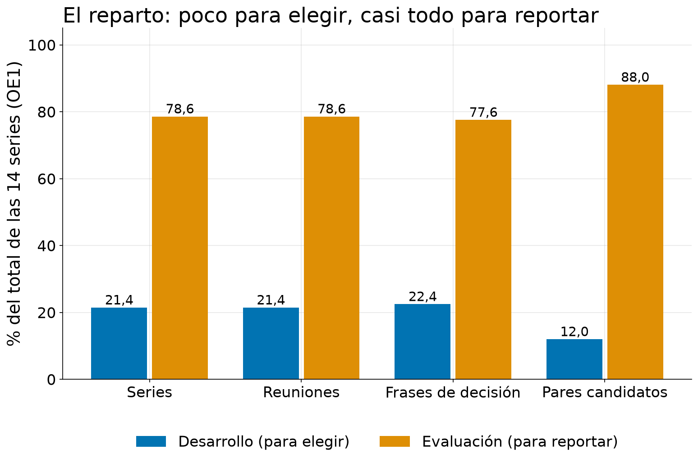
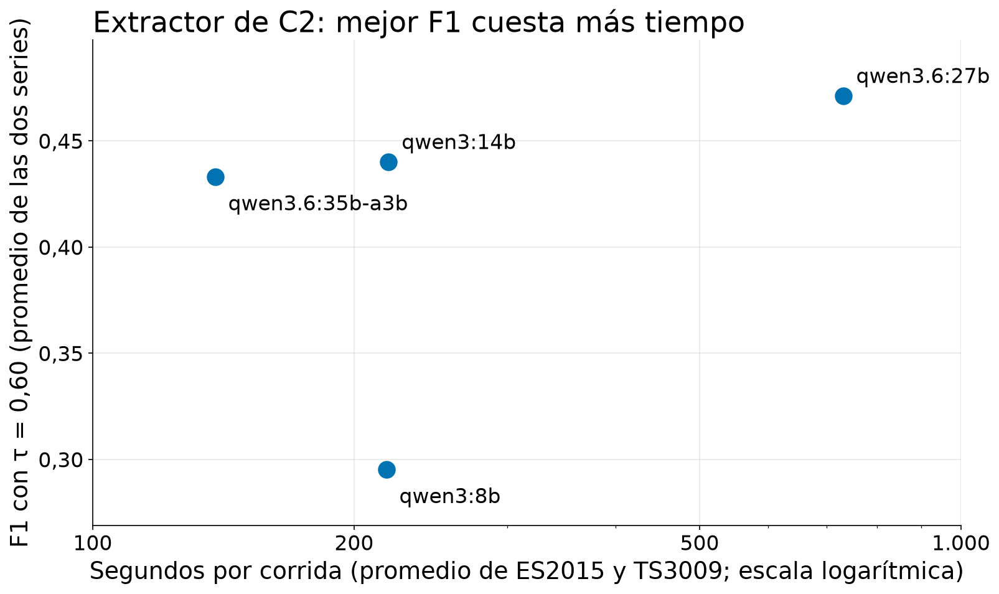
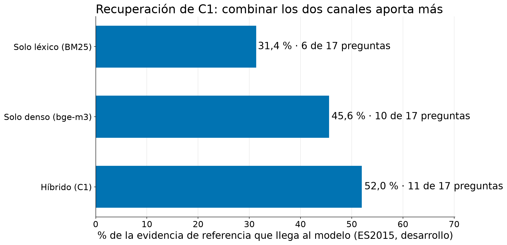
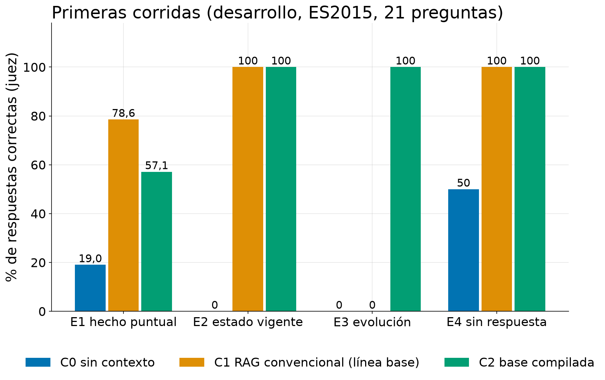
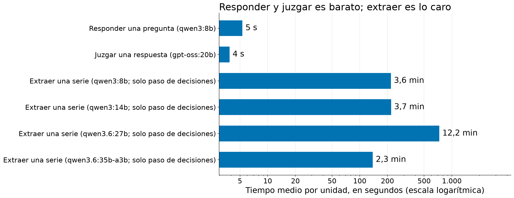
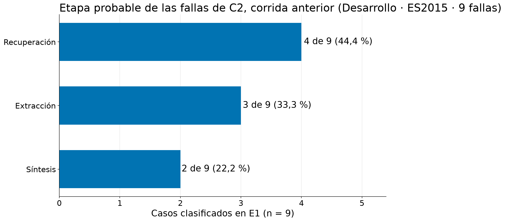

# Guion — Video de avance #2 de AFG2, semana 4: modelado de datos

| | |
|---|---|
| **Entrega** | Video de avance #2 de AFG2 (semana 4) — modelado de datos |
| **Fecha de envío** | Pendiente |
| **Versión** | 2.0 |
| **Construido desde** | `docs/avances/03-jss-objetivos.md` v5.0 (objetivos e hipótesis) · `docs/avances/09-jss-modelos-y-justificacion.md` v12.0 (todos los bloques) · [ADR 0019](../decisions/0019-adr-c0-en-la-corrida-formal-del-experimento-b.md) (C0 en la corrida formal) · `notebooks/19-jss-modelos.ipynb` (fuente principal de las cifras) · `docs/entregables/figuras/modelos-*.png` (seis figuras exportadas por el notebook 19) |
| **Duración objetivo** | 9:58 a 145 palabras por minuto (máximo de la rúbrica: 10:00) |
| **Formato** | Tres presentadores en cuatro bloques consecutivos, en este orden: Jason, Germán, Gustavo, Jason. Con diapositivas de apoyo |
| **Extensión hablada** | 1.446 palabras: 414 + 357 + 370 + 305. A 145 palabras por minuto son 9:58; a 140, 10:20 |

> **Por qué existe este documento.** El profesor evalúa solo el video, así que el trabajo
> técnico debe verse y oírse en él: cada modelo y cada técnica se nombra, y se explica con
> palabras corrientes la primera vez que aparece. Desde la versión 2.0, además, el video abre con
> el problema y los cuatro objetivos, y cada objetivo, condición o hipótesis se dice con su
> significado la primera vez que aparece en cada bloque, para que la audiencia sepa siempre dónde está. Este proyecto no entrena ningún modelo, y
> eso hay que decirlo pronto y con claridad: lo que se compara son *pipelines* construidos con
> modelos de lenguaje ya entrenados, y el juez es un instrumento de medida. Se dicen pocas
> cifras en cámara, todas de series de desarrollo, y ninguna se presenta como resultado de la
> tesis.

## Historial de versiones

| Versión | Fecha | Cambio | Motivo |
|---|---|---|---|
| 1.0 | 2026-10-26 | Versión inicial: guion del segundo video de avance de AFG2, centrado en el modelado de datos. | Pauta de la semana 4 y documento 09 v3.0. |
| 1.1 | 2026-10-27 | Se agrega al bloque 4 la atribución del error (OE4) de las fallas de C2 en E1, con una figura nueva (la 14) y unas 57 palabras habladas; las láminas 14 y 15 pasan a ser la 15 y la 16. Se actualizan extensión, tiempos del bloque 4 y fuentes (documento 09 v4.1). | El guion se construyó con el documento 09 v3.0 y no decía dónde nace el error de C2; el PR #187 incorporó el reparto por etapa (4 recuperación, 3 extracción, 2 síntesis) y la figura `modelos-etapas-fallas-c2.png`. El guion aún no se había enviado. |
| 1.2 | 2026-10-28 | Se ajusta el alcance de C0, la descripción de C3 y la interpretación de C1/C2; se conservan cifras y estructura. Extensión: 1.444 palabras (392 + 390 + 392 + 270). | Coherencia con el avance 09 v4.2. |
| 1.3 | 2026-11-01 | Se actualiza el bloque 4: la lámina 15 pasa de «Decisiones pendientes» a «Qué cambió y qué sigue abierto» y la narración explica que OpenKOS quedó fijado en la 0.7.0, que la verificación de suficiencia y las fuentes en bruto quedaron resueltas (C2 y C3 usan OpenKOS tal como se distribuye), que C1 se redefine como un RAG convencional, que las cifras de desarrollo mostradas son de la versión anterior y se repiten antes de congelar, y que la diferencia entre C1 y C2 no se puede repartir entre representación y respuesta. Solo queda abierto el extractor de C2 (#143). Se ajusta la lámina 16 y, en el bloque 1, una frase del caso del precio. El bloque 3 no cambia. Extensión: 1.448 palabras (392 + 390 + 392 + 274). | Decisión del 2026-11-01 ([ADR 0014](../decisions/0014-adr-c1-como-rag-convencional.md)) y avance 09 v6.0. Las cifras de los bloques 1 a 3 son del diseño anterior de C1 y se conservan como registro. El guion aún no se había enviado. |
| 1.4 | 2026-11-01 | Las cifras de desarrollo de los bloques 1, 3 y 4 pasan a las corridas con el diseño vigente: caso del precio (ahora C1 y C2 aciertan), línea base C0 cerca del 22 %, C1 cerca del 81 % y C2 cerca del 71 % (C2 pierde porque se abstiene más), valores por estrato en el texto alternativo de la figura 10, costo de unos 5 s por respuesta; C1 se nombra como RAG convencional. El bloque 3 se actualiza porque Gustavo lo volverá a grabar. El bloque 4 ya no dice que las cifras sean de la versión anterior; la atribución del error (OE4) se presenta como la de la corrida anterior y el próximo paso es clasificar las fallas nuevas de C2. Se corrigen las fuentes (avance 09 v7.0, filas de la lámina 15, librerías), se unifica la duración en 9:54 y la lámina 5 agrega la verificación de suficiencia. Extensión: 1.435 palabras (386 + 390 + 392 + 267); 9:54 a 145 palabras por minuto. | Corridas de desarrollo del 2026-11-01 con el diseño vigente (documento 09 v7.0, notebook 19) y decisión de volver a grabar el bloque 3. El guion aún no se había enviado. |
| 1.5 | 2026-11-01 | El bloque 4 presenta la atribución del error (OE4) de la corrida vigente de C2, ya clasificada por una persona: 3 de recuperación, 2 de extracción y 1 de síntesis, de 6 fallas, con un caso de memoria contaminada; la figura 14 pasa a mostrar la corrida vigente. La lámina 15 deja de decir que las fallas nuevas están pendientes y la lámina 16 y la frase final ya no incluyen clasificarlas. Se actualizan la fila de trazabilidad y las fuentes (avance 09 v7.1). Extensión sin cambio: 1.435 palabras (386 + 390 + 392 + 267); 9:54 a 145 palabras por minuto. Los bloques 1 a 3 no cambian. | jss clasificó las seis fallas E1 de la corrida vigente (avance 09 v7.1, notebooks 16 y 19). El guion aún no se había enviado. |
| 1.6 | 2026-11-01 | El bloque 1 cambia el caso del precio, donde C1 y C2 ya aciertan, por dos casos de la corrida vigente que muestran el valor de compilar y el costo de sus errores: la fuente de energía (C2 acierta, C1 duda) y el costo máximo de producción (C1 acierta, C2 no lo tiene en su base). La lámina 1 pasa a una tabla de dos preguntas, y el bloque 3 nombra los mismos casos al hablar de C0. Extensión: 1.442 palabras (393 + 390 + 392 + 267); 9:57 a 145 palabras por minuto. | Los casos ilustran la lámina 3 (perder una decisión) y el criterio de éxito con datos reales; el guion aún no se había enviado. |
| 1.7 | 2026-11-01 | El extractor de C2 deja de figurar como decisión pendiente (ADR 0015, issue #143). **Bloque 2 (Germán) cambia**: la lámina 5 y la figura 7 dicen que el extractor es `qwen3:8b`, el de OpenKOS, y la narración lo decide con la pasada de decisiones, que OpenKOS documenta para reuniones; Germán tendrá que grabarlo de nuevo si ya lo grabó. **Bloque 4 (Jason) cambia**: la lámina 15 marca el extractor como resuelto, la narración lo da por decidido y la lámina 16 queda en dos pasos, congelar y evaluar una vez. Los bloques 1 y 3 no cambian. Se actualizan los tiempos, la extensión y las fuentes (avance 09 v8.0). Extensión: 1.443 palabras (393 + 393 + 392 + 265); 9:57 a 145 palabras por minuto. | La decisión del extractor y de la pasada de decisiones quedó registrada en el [ADR 0015](../decisions/0015-adr-modelo-extractor-de-c2.md); el guion aún no se había enviado. |
| 1.8 | 2026-11-02 | C1 pasa a leer el mismo texto que OpenKOS (cuerpo Markdown de la transcripción) y a cortarlo con un divisor de texto genérico, y se rehízo el ajuste y la corrida de desarrollo, con el espacio de C1 para los fragmentos igual al de C2. **Bloque 1 (Jason) cambia**: el caso de la fuente de energía deja de servir (C1 ahora acierta) y se reemplaza por el del alcance del control entre la primera y la segunda reunión (q028: C1 no lo encuentra, C2 acierta); cambian la lámina 1 y una frase hablada, y se quitan unas palabras para mantener la extensión. **Bloque 3 (Gustavo) cambia**: la lámina 8 y la narración del *grid search* (ganadora 1.200 caracteres, sin solape y 5 fragmentos), la ablación de la figura 9 (52 %, 31 % y 46 %) y la frase sobre C0, que ahora cita el costo máximo y el alcance; Gustavo tendrá que grabarlo de nuevo. Los bloques 2 y 4 no cambian. Las cifras por estrato (C0 22 %, C1 81 %, C2 71 %) no cambian, aunque C1 acierta otras preguntas. Se actualizan la trazabilidad y las fuentes (avance 09 v10.0). Extensión: 1.443 palabras (393 + 393 + 392 + 265). | Decisión del autor del proyecto del 2026-11-02 sobre la lectura de C1 ([ADR 0014](../decisions/0014-adr-c1-como-rag-convencional.md) y [ADR 0007](../decisions/0007-adr-ajuste-c1-y-presupuesto-de-contexto.md), enmiendas del 2026-11-02); el guion aún no se había enviado. |
| 2.0 | 2026-11-02 | Reescritura para claridad de los cuatro bloques. **Bloque 1**: abre con el problema y los cuatro objetivos (OE1 a OE4), una oración llana cada uno, y presenta las condiciones C0 a C3 antes de los casos; se agrega la lámina 1 («El problema y los cuatro objetivos») y las láminas y figuras siguientes suben un número (17 en total); el caso del alcance se identifica como la única pregunta de evolución; el criterio de éxito se nombra como D16 y se liga a la hipótesis H1. **Bloque 2**: el extractor se liga a C2 y a OE2; se recortan frases para mantener la extensión. **Bloque 3**: C1 se describe con el texto, el divisor y el espacio igual al de C2; τ se liga a OE2 y suma la concordancia del juez con una persona (50 pares, kappa 0,716, τ se mantiene); C0 se presenta como referencia descriptiva de la corrida formal (ADR 0019); se corrige la configuración que pierde evidencia por el recorte (1200 / 200 / 10, la del avance 09, §7.1; el notebook 06 da las mismas cifras con K = 8 y K = 10). **Bloque 4**: se reescribe en torno a OE4 (qué es, por qué importa, qué se hizo, qué muestra, con los casos del costo máximo y de los botones), qué cambió esta semana (C1 sobre el mismo texto y con el mismo espacio, C0 en la corrida formal, OpenKOS y extractor fijados) y qué sigue (congelar y una corrida formal; la evaluación sigue bloqueada hasta el congelamiento). Ninguna cifra nueva: todas salen del avance 09 v12.0 y de sus notebooks. Extensión: 1.446 palabras (414 + 357 + 370 + 305); 9:58 a 145 palabras por minuto. | Retroalimentación del equipo del 2026-11-02: el bloque 4 no se entendía y hablaba de «OE4» sin que la audiencia supiera que es uno de los objetivos del proyecto. Nadie había grabado aún, así que todos los bloques podían cambiar. |

## Qué pide el curso y dónde se cubre

Objetivo del video según la rúbrica: explicar con claridad los modelos explorados, justificar su
elección en relación con el problema planteado y mostrar avances iniciales (intentos,
parámetros, librerías usadas o dificultades encontradas) de manera coherente y reflexiva.
Formato: libre, con diapositivas de apoyo; máximo de 10 minutos. No se exigen resultados
finales: importa el proceso de selección y el trabajo inicial.

| Elemento del nivel «logrado» o de la sesión sincrónica | Dónde se cubre |
|---|---|
| Problema y objetivos, para situar a la audiencia | Bloque 1 (el problema y los cuatro objetivos, OE1 a OE4, una oración cada uno; las condiciones C0 a C3) |
| Modelos explorados, explicados con claridad | Bloque 1 (qué es «el modelo» aquí: *pipelines* C1, C2 y C3, LLM, juez); bloque 2 (generador, *embeddings*, juez y extractor con sus etiquetas exactas) |
| Justificación de la elección en relación con el problema | Bloque 2 (por qué `qwen3:8b`, `bge-m3`, `gpt-oss:20b`; *screen* de cuatro extractores); bloque 3 (por qué un RAG híbrido como línea base) |
| Intentos, parámetros, librerías | Bloque 3 (*grid search* de 32 configuraciones y su corrección, ablación, τ y su concordancia con una persona, librerías); bloque 2 (candidatos probados) |
| Dificultades encontradas | Bloque 3 (error de medición del recorte de contexto); bloque 4 (muestras pequeñas, juez indulgente, dónde nace el error de C2 según OE4) |
| Coherencia y reflexión | Bloque 4 (dos aprendizajes, atribución del error, qué cambió, limitaciones) |
| Métrica de éxito y costo de los errores | Bloque 1 |
| Conjunto de prueba separado y usado una vez; reparto en porcentajes y volúmenes; fuga de datos | Bloque 2 (3 series de desarrollo y 11 de evaluación bajo llave; fuga declarada); bloque 4 (congelar y una sola corrida formal) |
| Relación con el análisis exploratorio | Bloque 2 (ventana de contexto, decisiones raras, turnos cortos) |
| Validación | Bloque 1 (3 corridas con semilla y *bootstrap*, en lugar de validación cruzada) |
| Método de búsqueda de hiperparámetros | Bloque 3 (*grid search*, ablación, τ) y bloque 2 (reglas prerregistradas del juez y del extractor) |
| Línea base simple siempre | Bloque 3 (C0 como referencia descriptiva y C1 frente a C2, solo desarrollo) |
| Limitaciones | Bloque 4 |

## Reparto de tiempos

| Bloque | Persona | Palabras | Tiempo (145 ppm) | Mensaje central |
|---|---|---|---|---|
| El problema, los cuatro objetivos, dos casos, qué es «el modelo» y qué significa funcionar bien | Jason Sepúlveda | 414 | 0:00 – 2:51 | El problema en dos oraciones; OE1 a OE4 en una oración cada uno; las condiciones C0 a C3; dos casos de la corrida vigente (el alcance, la única pregunta de evolución, donde C2 acierta y C1 no; el costo máximo, donde C1 acierta y C2 no lo tiene en su base); no se entrena nada, se comparan *pipelines*; el juez es un instrumento; criterio D16 e hipótesis H1; costo de los errores |
| Estrategia experimental y modelos por rol | Germán Vega | 357 | 2:51 – 5:19 | Partición 3 + 11 series con conjunto de prueba bajo llave; fuga declarada; restricciones del análisis exploratorio; generador, *embeddings*, juez (3 candidatos) y extractor de C2, cuya calidad mide OE2 (4 candidatos; decidido `qwen3:8b`, el de OpenKOS, con la pasada de decisiones) |
| Búsqueda de parámetros, línea base, primeros resultados y costo | Gustavo Martínez | 370 | 5:19 – 7:52 | *Grid search* de C1 (mismo texto y mismo espacio que C2) y su corrección, ablación, τ de OE2 con su concordancia humana; C0 como referencia descriptiva y C1 frente a C2 por estrato, solo desarrollo; límites de C0; costo; librerías |
| Aprendizajes, dónde falla C2 (OE4), qué cambió, limitaciones y próximos pasos | Jason Sepúlveda | 305 | 7:52 – 9:58 | Dos aprendizajes; OE4 explicado desde cero: qué pide, por qué importa, las tres etapas, la clasificación humana de las 6 fallas de C2 (3 de recuperación, 2 de extracción, 1 de síntesis), el costo máximo como falla de extracción y los botones como memoria contaminada; qué cambió esta semana; limitaciones; congelar y una sola corrida formal |

Reparto por persona: Jason 719 palabras, Germán 357, Gustavo 370. Jason abre y cierra
porque plantea el problema y reúne lo que sigue; Germán concentra la estrategia
experimental y la elección de modelos; Gustavo, los métodos de búsqueda y los resultados.
Margen sobre el tope de 10:00: 0:02 a 145 palabras por minuto; a 140 el guion se pasa (10:20), así que el ensayo debe cronometrarse y, si hace falta, recortar según la nota de grabación.

## Notas de grabación

- El texto está escrito para decirse, no para leerse. Frases cortas, una idea por oración. Las
  palabras en **negrita** se apoyan con la voz.
- En el texto hablado cada presentador dice «yo» y «nosotros»: es la excepción a la regla
  impersonal del repositorio, que sigue valiendo para las partes escritas de este documento.
- Cada bloque abre nombrando a quien habla y cierra pasando el turno.
- **La audiencia siempre debe saber dónde está.** Cada objetivo (OE1 a OE4), condición (C0 a C3)
  e hipótesis se dice con su nombre y su significado la primera vez que aparece en cada bloque
  («OE4, el cuarto objetivo: …»; «C2, la base que construye la máquina»). No se abrevia lo que no
  se explicó.
- Los nombres de modelos y técnicas se dicen en inglés tal como son (`qwen3:8b` se dice
  «quen tres, ocho be»; F1, recall, kappa, BM25, *grid search*, *bootstrap*, RAG, *embeddings*,
  LLM). Cada uno se explica en la misma oración en que aparece.
- Siempre que se muestren resultados, decir «solo desarrollo». Es una serie, 21 preguntas y
  una corrida: indica una dirección, no una magnitud.
- Las líneas que empiezan con ▶ no se dicen: marcan el momento exacto en que cambia la lámina,
  con lo que debe verse en pantalla.
- Cronometrar un ensayo completo antes de grabar. Si se pasa de 10:00, recortar primero la
  frase de librerías del bloque 3 y luego la del costo, y no los objetivos, los ejemplos ni los
  nombres de modelos.
- Las cifras de este guion salen de `docs/avances/09-jss-modelos-y-justificacion.md` v12.0 y de
  los notebooks que cita; son de series de desarrollo, de las corridas con el diseño vigente.
  Ninguna se calcula aquí. Los porcentajes dichos en voz son los de la fuente redondeados al
  entero (17 %, 21 %, 22 %, 31 %, 46 %, 52 %, 61 %, 71 %, 79 %, 81 %). Las de OE4 se dicen como
  conteos (3, 2 y 1 de 6, corrida vigente), con la frase «una serie y una persona».

---

## Bloque 1 — Jason Sepúlveda (0:00 – 2:51)

### Texto hablado

Hola. Soy **Jason Sepúlveda**. Junto a **Germán Vega** y **Gustavo Martínez** presentamos el avance de modelado de nuestro proyecto.

> **▶ Lámina 1 — se muestra al decir «El problema».**
>
> Título: «El problema y los cuatro objetivos». Arriba, una frase: «Las decisiones cambian entre reuniones. ¿Conviene buscar en las transcripciones (RAG) o compilar una base de decisiones con su historia?».
>
> | Objetivo | Qué pide |
> |---|---|
> | OE1 | Construir la referencia: personas marcan las decisiones y cómo cambian entre reuniones |
> | OE2 | Medir qué tan bien extrae la máquina esas decisiones (Experimento A) |
> | OE3 | Comparar quién responde mejor: un RAG convencional o la base compilada (Experimento B) |
> | OE4 | Cuando el sistema falla, saber en qué etapa nació el error |

El problema. Las decisiones de un equipo cambian de una reunión a otra. Hoy se pregunta con un **RAG**: un sistema que busca los trozos de transcripción más parecidos a la pregunta y responde con ellos. Puede traer la versión antigua. La alternativa es **compilar**: una máquina extrae las decisiones y las guarda en una base, con su historia.

El proyecto tiene **cuatro objetivos**. **OE1**: construir la referencia: personas marcan a mano las decisiones y cómo cambian. **OE2**: medir qué tan bien extrae la máquina esas decisiones. **OE3**: comparar quién responde mejor, el RAG o la base compilada. **OE4**: cuando el sistema falla, saber en qué etapa nació el error.

> **▶ Lámina 2 — se muestra al decir «OE3 compara condiciones».**
>
> Título: «Dos preguntas, tres sistemas». Pie: «Una corrida de desarrollo: muestra el mecanismo, no es un resultado».
>
> | Sistema | Qué hace | ¿Cómo se aclaró el alcance entre la primera y la segunda reunión? (pregunta de evolución; referencia: solo televisión) | ¿Costo máximo de producción? (referencia: 12,50 €) |
> |---|---|---|---|
> | C0 | Responde sin ningún texto de apoyo | Incorrecta | Incorrecta |
> | C1 | RAG convencional: busca fragmentos de la transcripción y responde con ellos | Habla de estilo y diseño, no del alcance: incorrecta | 12,50 €: correcta |
> | C2 | Responde desde la base de decisiones que construyó la máquina | Solo televisión, sin teletexto: correcta | Se abstiene: el dato no entró a su base |
> | C3 | La misma base, construida por personas (OE1) | Aún sin ejecutar | Aún sin ejecutar |

OE3 compara condiciones. **C0**: el modelo sin ningún texto. **C1**: un RAG convencional. **C2**: la base de decisiones que construye la máquina. **C3**: la misma base, construida por personas. En el corpus **AMI**, de reuniones públicas, un equipo diseña un control remoto en cuatro reuniones: una **serie**. Dos preguntas. ¿Cómo se aclaró el alcance entre la primera y la segunda reunión? Solo televisión. Es nuestra única pregunta de evolución. C1 trae pasajes de estilo y falla; C2 tiene la decisión consolidada y acierta. ¿Costo máximo de producción? Doce euros con cincuenta. C1 lo encuentra; C2 se abstiene: nunca entró a su base. C0 falla las dos.

¿Cuál es el «modelo»? **No entrenamos nada**: usamos **LLM**, modelos de lenguaje ya entrenados, en local con **Ollama**. El modelo es el ***pipeline*** de cada condición, del texto a la respuesta. El **juez**, otro LLM que califica las respuestas, es un instrumento de medida.

> **▶ Lámina 3 — se muestra al decir «Cada práctica del curso tiene su equivalente».**
>
> Título: «Lo que pide el curso → su equivalente en la tesis».
>
> | Lo que pide el curso | Su equivalente en esta tesis |
> |---|---|
> | El modelo | El *pipeline* completo de cada condición: C1, C2 y C3. Nada se entrena |
> | Conjunto de prueba | Series de evaluación, intactas hasta congelar |
> | Validación | 3 corridas con semilla y *bootstrap* |
> | Hiperparámetros | Parámetros ajustados solo en desarrollo |
> | Línea base | C1 (RAG convencional); C0 como referencia descriptiva |
> | Criterio de éxito (D16, hipótesis H1) | C2 − C1 en preguntas de evolución: intervalo *bootstrap* por encima de 0 |

Cada práctica del curso tiene su equivalente: la prueba son las series de evaluación; la validación, tres corridas con semilla y un **bootstrap**, que repite el cálculo sobre muestras al azar para ver cuánto varía.

«Funcionar bien» se fijó antes de ejecutar nada, con la hipótesis **H1**: la base ayuda sobre todo cuando una decisión cambió. Criterio **D16**: en las preguntas de evolución, si el intervalo bootstrap de C2 menos C1 queda sobre cero, H1 se respalda.

> **▶ Lámina 4 — se muestra al decir «No todos los errores cuestan igual».**
>
> Título: «El costo de los errores».
>
> | Error | Por qué importa |
> |---|---|
> | Responder mal una pregunta que sí tiene respuesta | El usuario cree una respuesta falsa |
> | Abstenerse ante una pregunta que sí tiene respuesta | No ayuda, pero no engaña; se informa aparte |
> | Extraer una decisión falsa | Baja la precision: se escribe una vez y se lee muchas |
> | Perder una decisión | Baja el recall: la base no responde lo que no guardó |

No todos los errores cuestan igual. Responder algo falso es peor que abstenerse. Una decisión falsa en la base se escribe una vez y se lee muchas: por eso informamos **precision** y **recall** por separado, cuánto de lo extraído es correcto y cuánto de lo que había se encontró.

Germán sigue con la estrategia experimental y los modelos.

---

## Bloque 2 — Germán Vega (2:51 – 5:19)

### Texto hablado

Gracias, Jason. Soy **Germán Vega**. Cuento cómo separamos los datos y qué modelos elegimos.

> **▶ Figura 5 — se muestra al decir «Dividimos las 14 series en desarrollo».**
>
> Texto sobrepuesto: «3 series de desarrollo · 11 de evaluación» y «Evaluación: bajo llave hasta congelar».
>
> 

Como no hay entrenamiento, no dividimos en entrenamiento y prueba. Dividimos las 14 series en **desarrollo**, 3 series, y **evaluación**, 11. Desarrollo, cerca del 21 %, sirve para elegir y ajustar. Evaluación, cerca del 79 %, sirve solo para reportar.

Esas 11 series son nuestro conjunto de prueba: no se leen ni se tocan hasta congelar todo lo ajustado, y se usan una sola vez. Las reuniones se procesan en orden, para que una decisión nunca se extraiga sabiendo lo que se dijo después. Y declaramos una fuga: dos umbrales de troceo de OpenKOS, el programa que construye la base de decisiones, se fijaron con una serie de evaluación. Medían colapsos, no aciertos.

El análisis exploratorio impuso restricciones. Una serie mide de 1,6 a 2,8 veces la **ventana de contexto** del modelo, lo que puede leer de una vez. Por eso hay que recuperar o compilar. Las decisiones son raras y los turnos muy cortos.

> **▶ Lámina 6 — se muestra al decir «Ahora los modelos, uno por rol».**
>
> Título: «Modelos por rol».
>
> | Rol | Dónde interviene | Modelo | ¿Se comparó con alternativas? |
> |---|---|---|---|
> | Generador de respuestas | C0, C1, C2 y C3 | `qwen3:8b` | No: modelo compartido |
> | Embeddings | Recuperación y alineación | `bge-m3` | No: heredado de OpenKOS |
> | Extractor de C2 (lo mide OE2) | Construye la base de decisiones | `qwen3:8b`, el de OpenKOS, con la pasada de decisiones | Sí: 4 modelos |
> | Verificación de suficiencia | Solo C2 y C3: ¿alcanza el contexto? | `gemma4:26b-a4b` | No: lo trae OpenKOS |
> | Juez | Califica cada respuesta | `gpt-oss:20b` | Sí: 3 candidatos |

Ahora los modelos, uno por rol. El **generador**, que redacta la respuesta en todas las condiciones, es `qwen3:8b`: la propuesta exige el mismo modelo y corre en local. Los **embeddings**, números que miden qué tan parecidos son dos textos, son `bge-m3`, multilingüe y fiable con textos largos.

> **▶ Lámina 7 — se muestra al decir «El juez sí lo elegimos entre tres candidatos».**
>
> Título: «Juez: tres candidatos, umbrales fijados antes de correr». Umbrales: kappa ≥ 0,70, consistencia al invertir el orden ≥ 0,90 y sin preferencia por las respuestas largas.
>
> | Candidato | Kappa | Orden | Latencia por llamada | Resultado |
> |---|---|---|---|---|
> | `mistral-small3.2:24b` | 0,951 | 0,952 | 5,5 s | Cumple todo |
> | `atla/selene-mini:q8_0` | 0,485 | 0,738 | 3,0 s | Falla kappa y orden |
> | **`gpt-oss:20b`** | 0,951 | 0,952 | 3,2 s | Cumple todo; gana por rapidez |

El **juez** sí lo elegimos entre tres candidatos. Acuerdo con personas, medido con **kappa de Cohen**, que descuenta el azar, de al menos 0,70. Consistencia al invertir el orden. Cumplieron `mistral-small3.2:24b` y `gpt-oss:20b`, ambos con kappa de 0,95. Ganó `gpt-oss:20b` por más rápido y por ser de otra familia que Qwen, para que no prefiera sus propias respuestas.

> **▶ Figura 8 — se muestra al decir «El extractor es el modelo que».**
>
> Texto sobrepuesto: «`qwen3.6:27b`: mejor F1, 1,8 a 3,6 veces el tiempo» y «Decidido: `qwen3:8b`, el de OpenKOS».
>
> 

El **extractor** es el modelo que, en C2, lee las reuniones y construye la base. **OE2**, el segundo objetivo, mide su calidad. Comparamos cuatro: `qwen3:8b`, `qwen3:14b`, `qwen3.6:27b` y `qwen3.6:35b-a3b`, con una regla de descarte escrita antes. El **F1** resume cuántas decisiones reales encuentra y cuántas inventa. `qwen3.6:27b` tiene el mejor F1, pero tarda entre 1,8 y 3,6 veces más. Decidimos **`qwen3:8b`**, el de OpenKOS, con su pasada de decisiones, pensada para reuniones.

Gustavo sigue con la búsqueda de parámetros y los primeros resultados.

---

## Bloque 3 — Gustavo Martínez (5:19 – 7:52)

### Texto hablado

Gracias, Germán. Soy **Gustavo Martínez**. Muestro cómo ajustamos los parámetros y qué obtuvimos.

> **▶ Lámina 9 — se muestra al decir «Primer método, el grid search».**
>
> Título: «Ajuste de C1: 32 configuraciones». Subtítulo: «Mismo texto que OpenKOS · divisor de texto estándar · mismo espacio de texto que C2». Columnas: tamaño de fragmento / caracteres compartidos / fragmentos entregados (K).
>
> | Configuración | Recall recuperado | Recall entregado al modelo | Papel |
> |---|---|---|---|
> | 1200 / 200 / 10 | 0,613 | 0,172 | Recupera mucho, pero el recorte descarta la evidencia |
> | **1200 / 0 / 5** | 0,520 | 0,520 | Elección final |

Primer método, el ***grid search***: probar todas las combinaciones de una grilla, 32, para los fragmentos de C1, el RAG convencional. C1 lee el mismo texto que OpenKOS, lo corta con un divisor estándar y recibe el mismo espacio de texto que C2, la base compilada. Medir lo recuperado engaña: con 1.200 caracteres, 200 compartidos y 10 fragmentos se recupera el 61 % de la evidencia, pero al modelo le llega el 17 %, porque el contexto se recorta. Medimos lo entregado y ganó 1.200 caracteres, sin solape y 5 fragmentos.

> **▶ Figura 10 — se muestra al decir «Segundo método, la ablación».**
>
> Sin texto sobrepuesto adicional.
>
> 

Segundo método, la **ablación**: quitar una pieza para ver cuánto aportaba. Medimos solo **BM25**, que busca por palabras compartidas; solo búsqueda densa con **embeddings**; y el híbrido, que los fusiona con *reciprocal rank fusion*. El híbrido entrega más evidencia: 52 %, frente a 31 % y 46 %.

Tercero, el umbral **τ** de OE2, el objetivo que mide la extracción: decide cuándo una decisión extraída es «la misma» que la de referencia. Lo calibramos con un control nulo y con el juez, y lo fijamos en 0,70. Una persona revisó 50 pares: kappa de 0,716, con un juez más estricto. τ se mantiene.

La línea base es C1, el RAG convencional. C0, el modelo sin texto de apoyo, entra en la corrida formal solo como referencia descriptiva.

> **▶ Figura 11 — se muestra al decir «Esto es solo desarrollo».**
>
> Rótulo bien visible sobre la figura: «Solo desarrollo · una serie · 21 preguntas».
>
> 

Esto es **solo desarrollo**: una serie, 21 preguntas, una corrida. Sin contexto, el modelo acierta cerca del 22 %. Con C1, cerca del 81 %. Con C2, cerca del 71 %. C2 pierde sobre todo en preguntas de un hecho puntual, porque se abstiene más. Y hay un solo caso de evolución, así que nada dice todavía sobre H1, la hipótesis central. C0 falló el alcance y el costo máximo en sus tres corridas; eso no descarta que el modelo viera AMI al entrenarse.

> **▶ Figura 12 — se muestra al decir «Costo: en C1».**
>
> Sin texto sobrepuesto adicional.
>
> 

Costo: en C1, responder tarda unos 5 segundos y juzgar 4. Lo caro es extraer: entre 2 y 12 minutos por serie, según el modelo.

> **▶ Lámina 13 — se muestra al decir «Las librerías».**
>
> Título: «Librerías y herramientas».
>
> - Ollama: ejecuta los modelos en local (generación y embeddings)
> - OpenKOS: construye la base de decisiones (C2 y C3)
> - sentence-transformers: alineación de lo extraído con la referencia
> - scikit-learn, scipy y pandas: estadística y tablas
> - BM25: implementado en el propio proyecto

Las librerías: **Ollama** para los modelos, **OpenKOS** para la base, **sentence-transformers** para alinear, y **scikit-learn**, **scipy** y **pandas** para la estadística.

Jason cierra con las dificultades y lo que sigue.

---

## Bloque 4 — Jason Sepúlveda (7:52 – 9:58)

### Texto hablado

Gracias, Gustavo. Cierro con aprendizajes, fallas y próximos pasos.

> **▶ Lámina 14 — se muestra al decir «Dos aprendizajes».**
>
> Título: «Dificultades y aprendizajes».
>
> | Dificultad | Qué aprendimos |
> |---|---|
> | El recorte de contexto invalidó una medición propia | Medir lo que de verdad llega al modelo |
> | Con 5 corridas, `qwen3:8b` no falló ninguna reunión; con 15 corridas nuevas, 6 de 60 | Desconfiar de las muestras pequeñas |
> | El juez es indulgente con respuestas genéricas | Una persona revisa el 20 % de las respuestas |

Dos aprendizajes. Primero, **medir lo que de verdad llega al modelo**: el recorte de contexto invalidó una medición nuestra. Segundo, **desconfiar de las muestras pequeñas**: con cinco corridas, el extractor no falló ninguna reunión; con quince, falló 6 de 60.

> **▶ Figura 15 — se muestra al decir «Ahora, OE4».**
>
> Título sobre la figura: «OE4: ¿en qué etapa nace el error de C2?». Tres rótulos a la izquierda: «Extracción: el dato nunca quedó bien guardado en la base» · «Recuperación: el dato estaba en la base y no se encontró» · «Síntesis: el dato llegó al modelo y la respuesta salió mal». Pie: «Solo desarrollo · ES2015 · corrida vigente · 6 fallas de hecho puntual · clasificadas por una persona · en la tesis: reglas fijas aplicadas en orden».
>
> 

Ahora, **OE4**, el cuarto objetivo: cuando C2, la base que construye la máquina, responde mal, saber en qué etapa nació el error. Importa porque cada etapa se arregla distinto. Son tres. **Extracción**: el dato nunca quedó bien guardado. **Recuperación**: estaba en la base, pero no se encontró. **Síntesis**: llegó al modelo y aun así la respuesta salió mal.

Una persona revisó, con la base a la vista, las seis preguntas de hecho puntual que C2 falló. Tres fueron de recuperación, dos de extracción y una de síntesis. El costo máximo del comienzo es de extracción: nunca entró a la base. Y un caso de recuperación es más grave: la base guardó como decisión unos botones que el equipo había descartado, y el sistema los citó. Una base que guarda lo descartado puede responder peor que no tener base.

Lo que muestra: en esta serie, la mitad nace en la recuperación. Pero es una serie y una persona: una dirección, no un resultado.

> **▶ Lámina 16 — se muestra al decir «Esta semana el diseño quedó cerrado».**
>
> Título: «Qué cambió esta semana».
>
> | Tema | Estado |
> |---|---|
> | C1, el RAG convencional | Lee el mismo texto que OpenKOS (Markdown de la transcripción), con un divisor estándar y el mismo espacio de texto que C2 |
> | C0, sin texto de apoyo | Entra en la corrida formal como referencia descriptiva: no decide ninguna hipótesis (ADR 0019) |
> | OpenKOS | Fijado en la 0.7.0; C2 y C3 lo usan tal como se distribuye |
> | Extractor de C2 | `qwen3:8b`, el de OpenKOS, con la pasada de decisiones |
> | Umbral τ de OE2 | 0,70; concordancia del juez con una persona en 50 pares: kappa 0,716 |
> | Fallas de C2 (OE4) | 3 de recuperación, 2 de extracción, 1 de síntesis (de 6; una persona) |

Esta semana el diseño quedó cerrado: C1, el RAG convencional, compite con el mismo texto que C2; C0, el modelo sin texto, entra como referencia; y OpenKOS y el extractor quedaron fijos.

Limitaciones: una serie, 21 preguntas, un dominio con habla actuada y referencia traducida. Y la diferencia entre C1 y C2 no separa la base de la redacción.

> **▶ Lámina 17 — se muestra al decir «Lo que sigue».**
>
> Título: «Próximos pasos». Dos pasos en secuencia: «1. Congelar modelos, versiones y código (las series de evaluación siguen bloqueadas hasta entonces)» → «2. Una sola corrida formal: C0, C1, C2 y C3; OE4 sobre todas las fallas de C2». Pie: «El experimento aún no se ha corrido · Limitaciones: una serie · 21 preguntas · un dominio · referencia traducida · C1 − C2 no separa la base de la redacción».

Lo que sigue. El experimento aún no se corre. Primero, congelar modelos, versiones y código; hasta entonces, la evaluación sigue bloqueada. Después, una sola corrida formal, y OE4 clasificará todas las fallas de C2. Gracias.

---

## Trazabilidad de las cifras dichas en cámara

| Cifra o afirmación | Fuente |
|---|---|
| El problema y los cuatro objetivos (OE1 construir la referencia; OE2 medir la extracción, Experimento A; OE3 comparar las condiciones, Experimento B; OE4 atribuir el error a su etapa) | Documento 03 v5.0, «Objetivos específicos»; [`../propuesta.md`](../propuesta.md) §2–§3 |
| Condiciones: C0 sin texto de apoyo, descriptiva en la corrida formal; C1 RAG convencional; C2 base construida por la máquina; C3 la misma base desde la anotación humana | [`../propuesta.md`](../propuesta.md) §5.3; documento 09 v12.0, §5; ADR 0014; ADR 0019 |
| Casos del bloque 1: alcance del control entre la primera y la segunda reunión (q028, estrato E3, la única pregunta de evolución de la serie; referencia «televisión solamente, sin DVD ni videograbadora»; C0 incorrecta en las 3 corridas, C1 incorrecta, C2 correcta) y costo máximo (q004, referencia «12,50 €»; C0 incorrecta en las 3 corridas, C1 correcta, C2 se abstiene por un error de extracción) | `reports/experiment-b/` (`diagnostico-sin-contexto-es2015`, `humo-c1-es2015-md`, `humo-c2-es2015-openkos070`, campo `stratum` = `E3_evolution` en q028), preguntas q028 y q004; documento 09 v12.0, §8.1 (E3: C1 0 de 1, C2 1 de 1) y §8.4 (q004, extracción); notebook 19, sección 7.4 |
| No se entrena ningún modelo; Ollama local; el juez es instrumento; C1, C2 y C3 | Documento 09, §1 y §5; ADR 0005 |
| Criterio de éxito D16 ligado a H1: diferencia pareada C2 − C1 en E3, intervalo bootstrap por encima de 0 | Documento 03 v5.0, «Hipótesis» y «Cómo se decide si el experimento tuvo éxito»; documento 09, §2.1 (ADR 0010, D16/D17) |
| Costo de los errores; precision y recall por separado | Documento 09, §2.2 |
| 14 series: 3 de desarrollo (21,4 %) y 11 de evaluación (78,6 %) | Documento 09, §4.1; notebook 19, §3; figura `modelos-particion-desarrollo-evaluacion.png` |
| Evaluación no leída, congelar antes de evaluar, orden cronológico, fuga declarada (#145) | Documento 09, §4.2 |
| Serie completa de 1,6 a 2,8 veces la ventana; decisiones raras; turnos cortos | Documento 09, §3; notebook 19, §2 |
| Roles y etiquetas: `qwen3:8b`, `bge-m3`, `gpt-oss:20b`, extractor `qwen3:8b` con la pasada de decisiones (#143, ADR 0015); la calidad del extractor la mide OE2 | Documento 09 v12.0, §6; ADR 0015; documento 03 v5.0, OE2 |
| Juez: tres candidatos, umbral de kappa 0,70, kappa 0,95 de `mistral-small3.2:24b` y `gpt-oss:20b`, `atla/selene-mini` descartado | Documento 09, §6.3; notebook 05 |
| Extractor: cuatro candidatos, regla prerregistrada, `qwen3.6:27b` con mejor F1 y 1,8 a 3,6 veces el tiempo; decisión: `qwen3:8b`, el de OpenKOS, con la pasada de decisiones | Documento 09 v12.0, §6.2; ADR 0015; notebook 15; figura `modelos-screen-extraccion-f1-costo.png` |
| C1 lee el mismo cuerpo Markdown que OpenKOS, con un divisor de texto genérico (`RecursiveCharacterTextSplitter`) y un espacio para los fragmentos igual al de C2 | Documento 09 v12.0, §5 y §7.1; ADR 0007 (enmienda del 2026-11-02); ADR 0014 |
| *Grid search* de 32 configuraciones; 1200/200/10 (0,613 recuperado, 0,172 entregado) y 1200/0/5 (0,520) | Documento 09 v12.0, §7.1; ADR 0007; notebook 06 (la configuración 1200/200/8 da las mismas dos cifras) |
| Ablación: 0,314 BM25, 0,456 denso, 0,520 híbrido | Documento 09 v12.0, §7.2; figura `modelos-ablacion-recuperacion.png` |
| τ principal 0,70 con control nulo y juez; concordancia del juez con una persona en 50 pares, kappa 0,716, juez más estricto, τ se mantiene | Documento 09 v12.0, §7.3 y §11.1 (decisión 5); ADR 0012; notebook 17 |
| Línea base: 22,2 % (C0), 81,0 % (C1), 71,4 % (C2); pérdida de C2 en E1 (8 de 14 frente a 11 de 14) por abstenciones; un solo caso de E3 | Documento 09 v12.0, §8.1 y §8.2; notebook 19, secciones 7.2 y 7.3; figura `modelos-baseline-por-estrato.png` |
| C0 entra en la corrida formal como referencia descriptiva y no decide ninguna hipótesis | ADR 0019; documento 09 v12.0, §5; [`../propuesta.md`](../propuesta.md) §5.3 |
| C0: alcance y costo máximo fallan en 3 corridas; no se descarta exposición previa a AMI | Notebook 19, sección 7.4 (tabla por pregunta, q028 y q004); documento 09, §8.3 |
| Costo: unos 5 s por respuesta de C1, 4 s por juicio, entre 2 y 12 minutos por serie al extraer | Documento 09 v12.0, §9; figura `modelos-costo-latencia-por-rol.png` |
| Librerías: Ollama, OpenKOS, sentence-transformers, scikit-learn, scipy, pandas; BM25 propio | `pyproject.toml` (dependencias y extras `instrument`, `llm` y `embeddings`); `src/afg/conditions/c1_retrieval.py` (BM25 propio); documento 09, §5 |
| `qwen3:8b`: 0 de 20 reuniones fallidas con 5 corridas y 6 de 60 con 15 corridas nuevas | Documento 09, §6.2 y dificultad 7 |
| Juez indulgente con respuestas genéricas; verificación humana del 20 % | Documento 09, §8.3 y §10 |
| OE4: qué pide (etapa de origen de cada falla de C2: extracción, recuperación o síntesis) y por qué importa | Documento 03 v5.0, OE4; documento 09 v12.0, §8.4 |
| Atribución del error de C2 en E1 (OE4), corrida vigente: 3 de recuperación, 2 de extracción y 1 de síntesis, de 6 fallas; q004 (costo máximo) es de extracción; un caso de recuperación (q017, botones de desplazamiento descartados en lugar de botones de presión) es de memoria contaminada; una serie, una persona, solo desarrollo | Documento 09 v12.0, §8.4; notebook 19, §7.5; notebook 16, sección 10; hoja `reports/experiment-b/humo-c2-es2015-openkos070/oe4-etapa-e1.csv`; figura `modelos-etapas-fallas-c2.png` |
| Qué cambió: C1 sobre el mismo texto y con el mismo espacio; C0 en la corrida formal; OpenKOS fijado en la 0.7.0 (#94) y usado tal como se distribuye; extractor fijado; la diferencia entre C1 y C2 no se reparte entre representación y respuesta | Documento 09 v12.0, §5, §6.5, §7.1 y §11.1; ADR 0006 (enmienda del 2026-11-01); ADR 0007; ADR 0014; ADR 0015; ADR 0019 |
| El experimento no se ha corrido; las series de evaluación siguen bloqueadas hasta el registro del congelamiento; luego una sola corrida formal | Documento 09 v12.0, §11 y §11.2; ADR 0019, decisión 1; ADR 0005 |

## Láminas y figuras

En orden de aparición. Los PNG están en `docs/entregables/figuras/`; las láminas de texto o tabla se construyen con el contenido que figura bajo su marca ▶.

| N.º | Bloque | Presentador | Archivo o tipo |
|---|---|---|---|
| 1 | 1 | Jason | lámina de texto/tabla |
| 2 | 1 | Jason | lámina de texto/tabla |
| 3 | 1 | Jason | lámina de texto/tabla |
| 4 | 1 | Jason | lámina de texto/tabla |
| 5 | 2 | Germán | `figuras/modelos-particion-desarrollo-evaluacion.png` |
| 6 | 2 | Germán | lámina de texto/tabla |
| 7 | 2 | Germán | lámina de texto/tabla |
| 8 | 2 | Germán | `figuras/modelos-screen-extraccion-f1-costo.png` |
| 9 | 3 | Gustavo | lámina de texto/tabla |
| 10 | 3 | Gustavo | `figuras/modelos-ablacion-recuperacion.png` |
| 11 | 3 | Gustavo | `figuras/modelos-baseline-por-estrato.png` |
| 12 | 3 | Gustavo | `figuras/modelos-costo-latencia-por-rol.png` |
| 13 | 3 | Gustavo | lámina de texto/tabla |
| 14 | 4 | Jason | lámina de texto/tabla |
| 15 | 4 | Jason | `figuras/modelos-etapas-fallas-c2.png`, con título y rótulos sobrepuestos |
| 16 | 4 | Jason | lámina de texto/tabla |
| 17 | 4 | Jason | lámina de texto/tabla |
