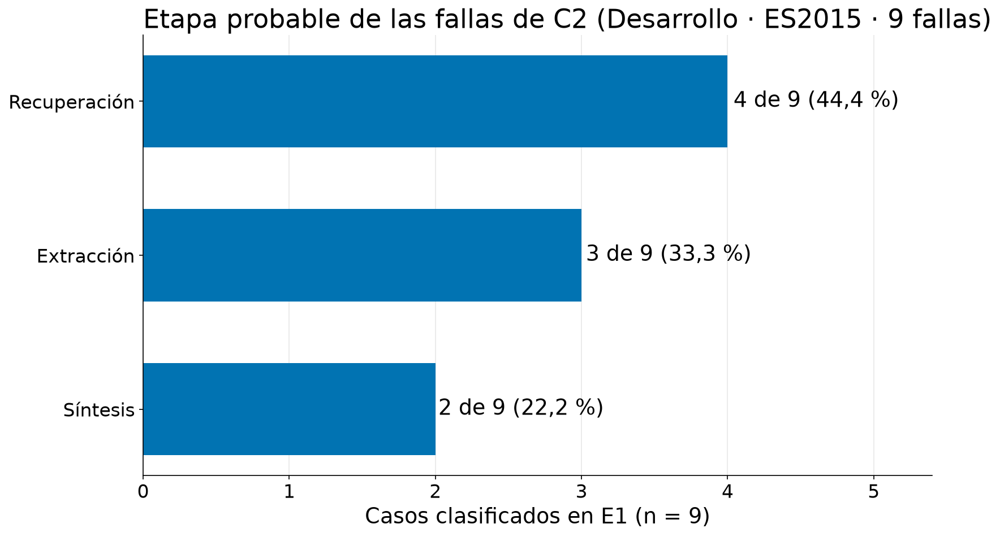

# Guion — Video de avance #2 de AFG2, semana 4: modelado de datos

| | |
|---|---|
| **Entrega** | Video de avance #2 de AFG2 (semana 4) — modelado de datos |
| **Fecha de envío** | Pendiente |
| **Versión** | 1.2 |
| **Construido desde** | `docs/avances/09-jss-modelos-y-justificacion.md` v4.2 · `notebooks/19-jss-modelos.ipynb` (fuente principal de las cifras) · `docs/entregables/figuras/modelos-*.png` (seis figuras exportadas por el notebook 19) |
| **Duración objetivo** | 9:58 a 145 palabras por minuto (máximo de la rúbrica: 10:00) |
| **Formato** | Tres presentadores en cuatro bloques consecutivos, en este orden: Jason, Germán, Gustavo, Jason. Con diapositivas de apoyo |
| **Extensión hablada** | 1.444 palabras: 392 + 390 + 392 + 270. A 145 palabras por minuto son 9:58; a 140, 10:19 |

> **Por qué existe este documento.** El profesor evalúa solo el video, así que el trabajo
> técnico debe verse y oírse en él: cada modelo y cada técnica se nombra, y se explica con
> palabras corrientes la primera vez que aparece. Este proyecto no entrena ningún modelo, y
> eso hay que decirlo pronto y con claridad: lo que se compara son *pipelines* construidos con
> modelos de lenguaje ya entrenados, y el juez es un instrumento de medida. Se dicen pocas
> cifras en cámara, todas de series de desarrollo, y ninguna se presenta como resultado de la
> tesis.

## Historial de versiones

| Versión | Fecha | Cambio | Motivo |
|---|---|---|---|
| 1.0 | 2026-10-26 | Versión inicial: guion del segundo video de avance de AFG2, centrado en el modelado de datos. | Pauta de la semana 4 y documento 09 v3.0. |
| 1.1 | 2026-10-27 | Se agrega al bloque 4 la atribución del error (OE4) de las fallas de C2 en E1, con una figura nueva (la 14) y unas 57 palabras habladas; las láminas 14 y 15 pasan a ser la 15 y la 16. Se actualizan extensión, tiempos del bloque 4 y fuentes (documento 09 v4.1). | El guion se construyó con el documento 09 v3.0 y no decía dónde nace el error de C2; el PR #187 incorporó el reparto por etapa (4 recuperación, 3 extracción, 2 síntesis) y la figura `modelos-etapas-fallas-c2.png`. El guion aún no se había enviado. |
| 1.2 | 2026-10-28 | Se ajusta el alcance de C0, la descripción de C3 y la interpretación de C1/C2; se conservan cifras y estructura. Extensión: 1.444 palabras (392 + 390 + 392 + 270). | Coherencia con el avance 09 v4.2. |

## Qué pide el curso y dónde se cubre

Objetivo del video según la rúbrica: explicar con claridad los modelos explorados, justificar su
elección en relación con el problema planteado y mostrar avances iniciales (intentos,
parámetros, librerías usadas o dificultades encontradas) de manera coherente y reflexiva.
Formato: libre, con diapositivas de apoyo; máximo de 10 minutos. No se exigen resultados
finales: importa el proceso de selección y el trabajo inicial.

| Elemento del nivel «logrado» o de la sesión sincrónica | Dónde se cubre |
|---|---|
| Modelos explorados, explicados con claridad | Bloque 1 (qué es «el modelo» aquí: *pipelines* C1, C2 y C3, LLM, juez); bloque 2 (generador, *embeddings*, juez y extractor con sus etiquetas exactas) |
| Justificación de la elección en relación con el problema | Bloque 2 (por qué `qwen3:8b`, `bge-m3`, `gpt-oss:20b`; screen de cuatro extractores); bloque 3 (por qué un RAG híbrido como línea base) |
| Intentos, parámetros, librerías | Bloque 3 (*grid search* de 32 configuraciones y su corrección, ablación, τ, librerías); bloque 2 (candidatos probados) |
| Dificultades encontradas | Bloque 3 (error de medición del recorte de contexto); bloque 4 (muestras pequeñas, juez indulgente, defecto del control nulo, dónde nace el error de C2) |
| Coherencia y reflexión | Bloque 4 (dos aprendizajes, decisiones abiertas, limitaciones) |
| Métrica de éxito y costo de los errores | Bloque 1 |
| Conjunto de prueba separado y usado una vez; reparto en porcentajes y volúmenes; fuga de datos | Bloque 2 (3 series de desarrollo y 11 de evaluación bajo llave; fuga declarada); bloque 4 (congelar y evaluar una vez) |
| Relación con el análisis exploratorio | Bloque 2 (ventana de contexto, decisiones raras, turnos cortos) |
| Validación | Bloque 1 (3 corridas con semilla y *bootstrap*, en lugar de validación cruzada) |
| Método de búsqueda de hiperparámetros | Bloque 3 (*grid search*, ablación, τ) y bloque 2 (reglas prerregistradas del juez y del extractor) |
| Línea base simple siempre | Bloque 3 (C0 y C1 frente a C2, solo desarrollo) |
| Limitaciones | Bloque 4 |

## Reparto de tiempos

| Bloque | Persona | Palabras | Tiempo (145 ppm) | Mensaje central |
|---|---|---|---|---|
| El problema en un caso, qué es «el modelo» y qué significa funcionar bien | Jason Sepúlveda | 392 | 0:00 – 2:42 | El precio de venta en C0, C1 y C2; no se entrena nada, se comparan *pipelines*; el juez es un instrumento; criterio de éxito y costo de los errores |
| Estrategia experimental y modelos por rol | Germán Vega | 390 | 2:42 – 5:24 | Partición 3 + 11 series con conjunto de prueba bajo llave; fuga declarada; restricciones del análisis exploratorio; generador, *embeddings*, juez (3 candidatos) y extractor (4 candidatos, decisión pendiente) |
| Búsqueda de parámetros, línea base, primeros resultados y costo | Gustavo Martínez | 392 | 5:24 – 8:06 | *Grid search* y su corrección, ablación, τ; línea base C0 y C1 frente a C2 por estrato, solo desarrollo; límites de C0; costo; librerías |
| Dificultades, pendientes, limitaciones y próximos pasos | Jason Sepúlveda | 270 | 8:06 – 9:58 | Aprendizajes, atribución del error de C2 (OE4, solo desarrollo), decisiones abiertas, limitaciones y el paso siguiente: congelar y evaluar una vez |

Reparto por persona: Jason 662 palabras, Germán 390, Gustavo 392. Jason abre y cierra
porque plantea el problema y reúne las decisiones pendientes; Germán concentra la estrategia
experimental y la elección de modelos; Gustavo, los métodos de búsqueda y los resultados.
Margen sobre el tope de 10:00: 0:02 a 145 palabras por minuto; a 140 el guion se pasa (10:19), así que el ensayo debe cronometrarse y, si hace falta, recortar según la nota de grabación.

## Notas de grabación

- El texto está escrito para decirse, no para leerse. Frases cortas, una idea por oración. Las
  palabras en **negrita** se apoyan con la voz.
- En el texto hablado cada presentador dice «yo»: es la excepción a la regla impersonal del
  repositorio, que sigue valiendo para las partes escritas de este documento.
- Cada bloque abre nombrando a quien habla y cierra pasando el turno.
- Los nombres de modelos y técnicas se dicen en inglés tal como son (`qwen3:8b` se dice
  «quen tres, ocho be»; F1, recall, kappa, BM25, *grid search*, *bootstrap*, RAG, *embeddings*,
  LLM). Cada uno se explica en la misma oración en que aparece.
- Siempre que se muestren resultados, decir «solo desarrollo». Es una serie, 21 preguntas y
  una corrida: indica una dirección, no una magnitud.
- Las líneas que empiezan con ▶ no se dicen: marcan el momento exacto en que cambia la lámina,
  con lo que debe verse en pantalla.
- Cronometrar un ensayo completo antes de grabar. Si se pasa de 10:00, recortar primero la
  frase de librerías del bloque 3 y la mención de τ, y no los ejemplos ni los nombres de modelos.
- Las cifras de este guion salen de `docs/avances/09-jss-modelos-y-justificacion.md` v4.2 y del
  notebook 19. Ninguna se calcula aquí. Los porcentajes dichos en voz son los de la fuente
  redondeados al entero (21 %, 79 %, 22 %, 76 %, 48 %, 57 %, 37 %, 42 %). Las de OE4 se dicen como conteos (4, 3 y 2 de 9), con la frase «una serie y una persona».

---

## Bloque 1 — Jason Sepúlveda (0:00 – 2:42)

### Texto hablado

Hola. Soy **Jason Sepúlveda**. Junto a **Germán Vega** y **Gustavo Martínez** presentamos el avance de modelado de datos de nuestro proyecto.

Empiezo con un caso real. En una serie de cuatro reuniones, un equipo diseña un control remoto. A tres sistemas les hicimos la misma pregunta: ¿qué precio de venta se fijó? La respuesta correcta es veinticinco euros.

> **▶ Lámina 1 — se muestra al decir «C0 responde sin ningún texto de apoyo».**
>
> Título: «¿Qué precio de venta se fijó? Referencia: veinticinco euros». Pie: «Una pregunta, una corrida: muestra el mecanismo, no es un resultado».
>
> | Sistema | Qué hace | Respuesta (resumida) | ¿Correcta? |
> |---|---|---|---|
> | C0 | Responde sin ningún texto de apoyo | No tiene información sobre ese control remoto ni su precio | No |
> | C1 | Busca fragmentos de la transcripción y responde con ellos | Veinticinco euros | Sí |
> | C2 | Responde desde una base de decisiones construida antes | Encontró conceptos relacionados, pero ninguno responde | No |

**C0** responde sin ningún texto de apoyo, solo con lo que el modelo ya sabe: dice que no tiene información. Se equivoca. **C1** busca fragmentos de la transcripción y responde con ellos: veinticinco euros. Acierta. **C2** responde desde una base de decisiones que otro proceso construyó antes: dice que ninguno de los conceptos encontrados responde. Se equivoca. El precio sí está en la reunión. C1 lo recuperó y C2 no; queremos comprobar si la diferencia persiste al controlar el resto del proceso.

Ahora, ¿cuál es nuestro «modelo»? El curso entiende por modelo un algoritmo que se entrena con datos. Nosotros **no entrenamos nada**. Usamos **LLM**, modelos de lenguaje ya entrenados, que corren en nuestros computadores con **Ollama**. Lo que comparamos son ***pipelines***: cada condición completa, desde el texto hasta la respuesta. C1 busca fragmentos; C2 usa la base construida por la máquina; C3, una base de referencia construida con anotaciones humanas. El **juez**, otro LLM que califica las respuestas, es un instrumento de medida, no un modelo bajo prueba.

> **▶ Lámina 2 — se muestra al decir «Cada práctica del curso tiene su equivalente».**
>
> Título: «Lo que pide el curso → su equivalente en la tesis».
>
> | Lo que pide el curso | Su equivalente en esta tesis |
> |---|---|
> | El modelo | El *pipeline* completo de cada condición: C1, C2 y C3. Nada se entrena |
> | Conjunto de prueba | Series de evaluación, intactas hasta congelar |
> | Validación | 3 corridas con semilla y *bootstrap* |
> | Hiperparámetros | Parámetros ajustados solo en desarrollo |
> | Línea base | C1 (RAG) y el diagnóstico C0 |

Cada práctica del curso tiene su equivalente. El conjunto de prueba son las series de evaluación. La validación son tres corridas con semilla y un **bootstrap**, que repite el cálculo sobre muestras al azar para saber cuánto podría variar el resultado. La línea base es C1 y el diagnóstico C0.

«Funcionar bien» se define con una sola comparación, escrita antes de ejecutar nada: la corrección de las respuestas de C2 frente a C1 en las preguntas de evolución, cuando una decisión cambió entre reuniones. Si el intervalo bootstrap de esa diferencia queda por encima de cero, la hipótesis se respalda.

> **▶ Lámina 3 — se muestra al decir «No todos los errores cuestan igual».**
>
> Título: «El costo de los errores».
>
> | Error | Por qué importa |
> |---|---|
> | Responder mal una pregunta que sí tiene respuesta | El usuario cree una respuesta falsa |
> | Abstenerse ante una pregunta que sí tiene respuesta | No ayuda, pero no engaña; se informa aparte |
> | Extraer una decisión falsa | Baja la precision: se escribe una vez y se lee muchas |
> | Perder una decisión | Baja el recall: la base no responde lo que no guardó |

No todos los errores cuestan igual. Responder algo falso es peor que abstenerse, porque el usuario se lo cree. Y una decisión falsa en la base se escribe una vez y se lee muchas, por eso informamos **precision** y **recall** por separado: cuánto de lo extraído es correcto y cuánto de lo que había se encontró.

Germán sigue con la estrategia experimental y los modelos.

---

## Bloque 2 — Germán Vega (2:42 – 5:24)

### Texto hablado

Gracias, Jason. Soy **Germán Vega**. Cuento cómo separamos los datos y qué modelos elegimos.

> **▶ Figura 4 — se muestra al decir «Dividimos las 14 series en desarrollo».**
>
> Texto sobrepuesto: «3 series de desarrollo · 11 de evaluación» y «Evaluación: bajo llave hasta congelar».
>
> 

Como no hay entrenamiento, no dividimos en entrenamiento y prueba. Dividimos las 14 series en **desarrollo**, 3 series, y **evaluación**, 11. Desarrollo, cerca del 21 %, sirve para elegir y ajustar. Evaluación, cerca del 79 %, sirve solo para reportar.

Esas 11 series son nuestro conjunto de prueba: su contenido no se leyó y no se toca hasta congelar todo lo ajustado. Se usan una sola vez. Además, las reuniones se procesan en orden cronológico, para que una decisión nunca se extraiga sabiendo lo que se dijo después. Y declaramos una fuga: dos umbrales de troceo de OpenKOS, el programa que construye la base de decisiones, se fijaron con una serie de evaluación, antes de la partición. Medían si el modelo colapsaba, no si acertaba, pero lo declaramos.

El análisis exploratorio también nos impuso restricciones. Una serie completa mide de 1,6 a 2,8 veces la **ventana de contexto** del modelo, que es lo que puede leer de una vez. Por eso hay que recuperar o compilar. Las decisiones son raras y los turnos muy cortos, así que un fragmento agrupa varios turnos.

> **▶ Lámina 5 — se muestra al decir «Ahora los modelos, uno por rol».**
>
> Título: «Modelos por rol».
>
> | Rol | Dónde interviene | Modelo | ¿Se comparó con alternativas? |
> |---|---|---|---|
> | Generador de respuestas | C0, C1, C2 y C3 | `qwen3:8b` | No: modelo compartido |
> | Embeddings | Recuperación y alineación | `bge-m3` | No: heredado de OpenKOS |
> | Extractor de C2 | Construye la base de decisiones | `qwen3:8b` hoy; decisión pendiente | Sí: 4 modelos |
> | Juez | Califica cada respuesta | `gpt-oss:20b` | Sí: 3 candidatos |

Ahora los modelos, uno por rol. El **generador**, que redacta la respuesta en todas las condiciones, es `qwen3:8b`: la propuesta exige el mismo modelo y corre en local. Los **embeddings**, números que miden qué tan parecidos son dos textos, son `bge-m3`, multilingüe y fiable con documentos largos.

> **▶ Lámina 6 — se muestra al decir «El juez sí lo elegimos entre tres candidatos».**
>
> Título: «Juez: tres candidatos, umbrales fijados antes de correr». Umbrales: kappa ≥ 0,70 y consistencia al invertir el orden ≥ 0,90.
>
> | Candidato | Kappa | Orden | Latencia por llamada | Resultado |
> |---|---|---|---|---|
> | `mistral-small3.2:24b` | 0,951 | 0,952 | 5,5 s | Cumple todo |
> | `atla/selene-mini:q8_0` | 0,485 | 0,738 | 3,0 s | Falla kappa y orden |
> | **`gpt-oss:20b`** | 0,951 | 0,952 | 3,2 s | Cumple todo; gana por rapidez |

El **juez** sí lo elegimos entre tres candidatos, con umbrales fijados antes de correr. Acuerdo con personas, medido con **kappa de Cohen**, que descuenta el azar, de al menos 0,70. Consistencia al invertir el orden de presentación. Y que no premie las respuestas largas. Cumplieron `mistral-small3.2:24b` y `gpt-oss:20b`, ambos con kappa de 0,95. Ganó `gpt-oss:20b` por más rápido, y por ser de otra familia que Qwen, para que no prefiera sus propias respuestas. `atla/selene-mini` quedó fuera.

> **▶ Figura 7 — se muestra al decir «El extractor lo comparamos entre cuatro».**
>
> Texto sobrepuesto: «`qwen3.6:27b`: mejor F1, 1,8 a 3,6 veces el tiempo» y «Decisión pendiente».
>
> 

El **extractor** lo comparamos entre cuatro: `qwen3:8b`, `qwen3:14b`, `qwen3.6:27b` y `qwen3.6:35b-a3b`, con una regla de descarte escrita antes y exigiendo ganar en las dos series de desarrollo. El **F1** resume cuántas decisiones reales encuentra y cuántas inventa. `qwen3.6:27b` tiene el mejor F1, pero tarda entre 1,8 y 3,6 veces más. Son solo dos series de desarrollo: la decisión sigue pendiente.

Gustavo sigue con la búsqueda de parámetros y los primeros resultados.

---

## Bloque 3 — Gustavo Martínez (5:24 – 8:06)

### Texto hablado

Gracias, Germán. Soy **Gustavo Martínez**. Muestro cómo buscamos los parámetros y qué obtuvimos, siempre en desarrollo.

> **▶ Lámina 8 — se muestra al decir «Para el tamaño de fragmento de C1 hicimos un grid search».**
>
> Título: «Ajuste de C1: 32 configuraciones y una corrección». Columnas: tamaño de fragmento / turnos compartidos / fragmentos entregados (K).
>
> | Configuración | Recall recuperado | Recall entregado al modelo | Papel |
> |---|---|---|---|
> | 1600 / 0 / 8 | 0,642 | 0,446 | Primera elección (error de medición) |
> | **1200 / 1 / 5** | 0,569 | 0,569 | Elección final |

Usamos un método distinto según el parámetro. Para el tamaño de fragmento de C1 hicimos un ***grid search***: probar todas las combinaciones de una grilla, 32 en total, midiendo qué parte de la evidencia llega al modelo. Ganó 1.600 caracteres, sin turnos compartidos y 8 fragmentos. Pero encontramos un error propio: OpenKOS recorta el contexto y al modelo solo le llegaba una parte. Repetimos midiendo el texto entregado y ganó otra: 1.200 caracteres, un turno compartido y 5 fragmentos. Lo corregimos y lo dejamos documentado.

> **▶ Figura 9 — se muestra al decir «Segundo método, la ablación».**
>
> Sin texto sobrepuesto adicional.
>
> 

Segundo método, la **ablación**: quitar una pieza para ver cuánto aportaba. En C1 medimos solo **BM25**, que busca por palabras compartidas; solo búsqueda densa con **embeddings**; y el híbrido, que los fusiona con *reciprocal rank fusion*. El híbrido entrega más evidencia: 57 %, frente a 37 % y 42 %.

Tercero, el umbral **τ**, que decide cuándo una decisión extraída es «la misma» que la de referencia. Lo calibramos con un control nulo y con el juez, y lo fijamos en 0,70. Cuarto, la regla de descarte del extractor y los umbrales del juez que ya conté.

Ahora la línea base. El curso pide siempre una simple. Tenemos dos: C0, el modelo sin texto de apoyo, y C1, un **RAG**: recupera los pasajes más relacionados con la pregunta y se los entrega al modelo.

> **▶ Figura 10 — se muestra al decir «Esto es solo desarrollo».**
>
> Rótulo bien visible sobre la figura: «Solo desarrollo · una serie · 21 preguntas».
>
> 

Esto es **solo desarrollo**: una serie, 21 preguntas, una corrida. Sin contexto, el modelo acierta cerca del 22 %. Con C1, cerca del 76 %. Con C2, cerca del 48 %. C2 pierde sobre todo en preguntas de un hecho puntual, porque contesta algo equivocado más que callar. Y hay un solo caso de evolución, así que no podemos decir nada de lo que la tesis quiere probar. C0 falló el precio y el costo máximo en las tres corridas. Eso no descarta que el modelo haya visto AMI durante su entrenamiento.

> **▶ Figura 11 — se muestra al decir «Costo: responder tarda».**
>
> Sin texto sobrepuesto adicional.
>
> 

Costo: responder tarda unos 9 segundos y juzgar 4. Lo caro es extraer: entre 2 y 12 minutos por serie, según el modelo.

> **▶ Lámina 12 — se muestra al decir «Las librerías».**
>
> Título: «Librerías y herramientas».
>
> - Ollama: ejecuta los modelos en local (generación y embeddings)
> - OpenKOS: construye la base de decisiones (C2 y C3)
> - sentence-transformers: alineación de lo extraído con la referencia
> - scikit-learn, scipy y pandas: estadística y tablas
> - BM25: implementado en el propio proyecto

Las librerías: **Ollama** para ejecutar los modelos, **OpenKOS** para la base de decisiones, **sentence-transformers** para alinear lo extraído con la referencia, **scikit-learn**, **scipy** y **pandas** para la estadística. El BM25 lo escribimos nosotros.

Jason cierra con las dificultades y lo que sigue.

---

## Bloque 4 — Jason Sepúlveda (8:06 – 9:58)

### Texto hablado

Gracias, Gustavo. Cierro con lo que aprendimos y lo que falta.

> **▶ Lámina 13 — se muestra al decir «Dejo dos aprendizajes».**
>
> Título: «Dificultades y aprendizajes».
>
> | Dificultad | Qué aprendimos |
> |---|---|
> | El recorte de contexto invalidó una medición propia | Medir lo que de verdad llega al modelo |
> | Con 5 corridas, `qwen3:8b` no falló ninguna reunión; con 15 corridas nuevas, 6 de 60 | Desconfiar de las muestras pequeñas |
> | El juez es indulgente con respuestas genéricas | Una persona revisa el 20 % de las respuestas |
> | El control nulo de τ tenía un defecto | Desvío declarado: τ = 0,70 |

Dejo dos aprendizajes. Primero, **medir lo que de verdad llega al modelo**: el recorte de contexto invalidó una medición nuestra. Segundo, **desconfiar de las muestras pequeñas**: con cinco corridas, `qwen3:8b` no falló ninguna reunión en una serie; con quince corridas nuevas, falló 6 de 60. También vimos que el juez es indulgente con una respuesta genérica, así que una persona revisará el 20 % de las respuestas del experimento. Y el control nulo de τ tenía un defecto, por eso declaramos el desvío.

> **▶ Figura 14 — se muestra al decir «Y un resultado sobre dónde falla C2».**
>
> Texto sobrepuesto: «Solo desarrollo · ES2015 · 9 fallas · una persona».
>
> 

Y un resultado sobre dónde falla C2, la atribución del error, OE4. De las nueve fallas de C2 en desarrollo, en cuatro el dato estaba en la base pero no llegó al modelo: es **recuperación**. Tres nacieron en la extracción y dos al redactar la respuesta. Es una serie y una persona: una dirección, no un resultado.

> **▶ Lámina 15 — se muestra al decir «Quedan decisiones abiertas».**
>
> Título: «Decisiones pendientes».
>
> | Decisión | Qué está en juego |
> |---|---|
> | Modelo extractor de C2 (issue 143) | `qwen3.6:27b` gana en F1 pero tarda más; ¿debe ser el mismo modelo que responde? |
> | Versión exacta de OpenKOS (issue 94) | Hoy hay un piso, no una versión |
> | Verificación de suficiencia de C2 y C3 | Si usa otro modelo que C1, las condiciones dejan de ser iguales |
> | Fuentes en bruto en C2 (issue 146) | Si cuentan como parte de C2 |

Quedan decisiones abiertas. Qué extractor usar, y si debe ser el mismo modelo que responde. Fijar la versión exacta de OpenKOS. La verificación de suficiencia, que decide si el contexto alcanza para responder: si C2 usa otro modelo que C1, ya no comparamos solo cómo se organiza la información. Y si las transcripciones en bruto que recupera C2 cuentan como parte de C2.

Las limitaciones están declaradas: una serie, 21 preguntas, un solo dominio con habla actuada, referencia traducida del español, y no exploramos la temperatura ni otros generadores. Además, esperamos la respuesta del tutor sobre nuestro encuadre.

> **▶ Lámina 16 — se muestra al decir «Lo que sigue».**
>
> Título: «Próximos pasos». Tres pasos en secuencia: «1. Decidir lo pendiente» → «2. Congelar modelos, versiones y código» → «3. Evaluar una sola vez». Pie: «Limitaciones: una serie · 21 preguntas · un dominio · referencia traducida».

Lo que sigue: decidir lo pendiente, congelar modelos, versiones y código, y solo entonces correr la evaluación, una única vez. Gracias.

---

## Trazabilidad de las cifras dichas en cámara

| Cifra o afirmación | Fuente |
|---|---|
| Caso del precio: respuesta de referencia «veinticinco euros»; C0 sin información (incorrecta), C1 acierta, C2 no encuentra (incorrecta) | `docs/avances/09-jss-modelos-y-justificacion.md` v4.2, «Un caso para entrar en materia»; notebook 19, mismo apartado |
| No se entrena ningún modelo; Ollama local; el juez es instrumento; C1, C2 y C3 | Documento 09, §1 y §5; ADR 0005 |
| Criterio de éxito: diferencia pareada C2 − C1 en E3, intervalo bootstrap por encima de 0 | Documento 09, §2.1 (ADR 0010, D16/D17) |
| Costo de los errores; precision y recall por separado | Documento 09, §2.2 |
| 14 series: 3 de desarrollo (21,4 %) y 11 de evaluación (78,6 %) | Documento 09, §4.1; notebook 19, §3; figura `modelos-particion-desarrollo-evaluacion.png` |
| Evaluación no leída, congelar antes de evaluar, orden cronológico, fuga declarada (#145) | Documento 09, §4.2 |
| Serie completa de 1,6 a 2,8 veces la ventana; decisiones raras; turnos cortos | Documento 09, §3; notebook 19, §2 |
| Roles y etiquetas: `qwen3:8b`, `bge-m3`, `gpt-oss:20b`, extractor pendiente (#143) | Documento 09, §6 |
| Juez: tres candidatos, umbral de kappa 0,70, kappa 0,95 de `mistral-small3.2:24b` y `gpt-oss:20b`, `atla/selene-mini` descartado | Documento 09, §6.3; notebook 05 |
| Extractor: cuatro candidatos, regla prerregistrada, `qwen3.6:27b` con mejor F1 y 1,8 a 3,6 veces el tiempo | Documento 09, §6.2; notebook 15; figura `modelos-screen-extraccion-f1-costo.png` |
| *Grid search* de 32 configuraciones; 1600/0/8 (0,642 recuperado, 0,446 entregado) y 1200/1/5 (0,569) | Documento 09, §7.1; ADR 0007; notebook 06 |
| Ablación: 0,373 BM25, 0,417 denso, 0,569 híbrido | Documento 09, §7.2; figura `modelos-ablacion-recuperacion.png` |
| τ principal 0,70 con control nulo y juez | Documento 09, §7.3; ADR 0012; notebook 17 |
| Línea base: 22,2 % (C0), 76,2 % (C1), 47,6 % (C2); pérdida de C2 en E1 por respuestas equivocadas; un solo caso de E3 | Documento 09, §8.1 y §8.2; figura `modelos-baseline-por-estrato.png` |
| C0: precio y costo máximo fallan en 3 corridas; no se descarta exposición previa a AMI | Documento 09, §8.3 |
| Costo: unos 9 s por respuesta, 4 s por juicio, entre 2 y 12 minutos por serie al extraer | Documento 09, §9; figura `modelos-costo-latencia-por-rol.png` |
| Librerías: Ollama, OpenKOS, sentence-transformers, scikit-learn, scipy, pandas; BM25 propio | Documento 09, §5; `pyproject.toml`; `src/afg/conditions/c1_retrieval.py` |
| `qwen3:8b`: 0 de 20 reuniones fallidas con 5 corridas y 6 de 60 con 15 corridas nuevas | Documento 09, §6.2 y dificultad 7 |
| Juez indulgente con respuestas genéricas; verificación humana del 20 % | Documento 09, §8.3 y §10 |
| Atribución del error de C2 en E1 (OE4): 4 de recuperación, 3 de extracción y 2 de síntesis, de 9 fallas; una serie, una persona, solo desarrollo | Documento 09, §8.4; notebook 19, §7.5; figura `modelos-etapas-fallas-c2.png` |
| Decisiones abiertas: extractor (#143), versión de OpenKOS (#94), verificación de suficiencia, fuentes en bruto (#146) | Documento 09, §6.5 y §11.1 |
| Respuesta del tutor pendiente | Documento 09, §1 |

## Láminas y figuras

En orden de aparición. Los PNG están en `docs/entregables/figuras/`; las láminas de texto o tabla se construyen con el contenido que figura bajo su marca ▶.

| N.º | Bloque | Presentador | Archivo o tipo |
|---|---|---|---|
| 1 | 1 | Jason | lámina de texto/tabla |
| 2 | 1 | Jason | lámina de texto/tabla |
| 3 | 1 | Jason | lámina de texto/tabla |
| 4 | 2 | Germán | `figuras/modelos-particion-desarrollo-evaluacion.png` |
| 5 | 2 | Germán | lámina de texto/tabla |
| 6 | 2 | Germán | lámina de texto/tabla |
| 7 | 2 | Germán | `figuras/modelos-screen-extraccion-f1-costo.png` |
| 8 | 3 | Gustavo | lámina de texto/tabla |
| 9 | 3 | Gustavo | `figuras/modelos-ablacion-recuperacion.png` |
| 10 | 3 | Gustavo | `figuras/modelos-baseline-por-estrato.png` |
| 11 | 3 | Gustavo | `figuras/modelos-costo-latencia-por-rol.png` |
| 12 | 3 | Gustavo | lámina de texto/tabla |
| 13 | 4 | Jason | lámina de texto/tabla |
| 14 | 4 | Jason | `figuras/modelos-etapas-fallas-c2.png` |
| 15 | 4 | Jason | lámina de texto/tabla |
| 16 | 4 | Jason | lámina de texto/tabla |
